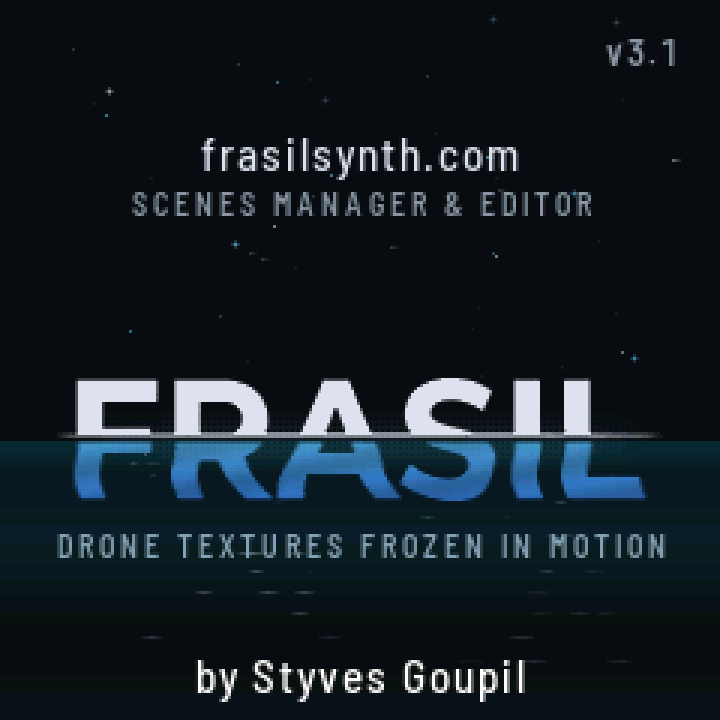
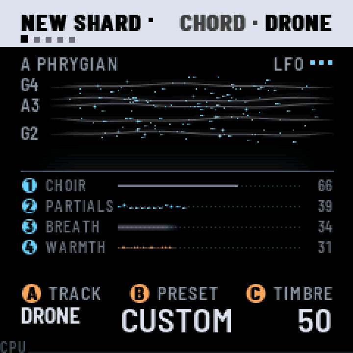
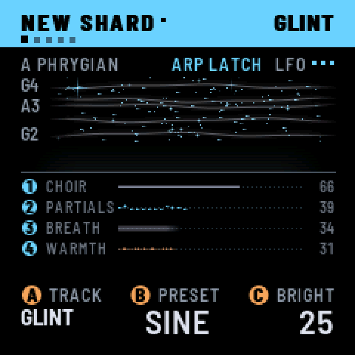

# FRASIL

*[English](README.md) · Français*

**Des textures de drone figées en mouvement.** Un firmware sur mesure qui transforme le M-VAVE FM-1 en instrument
pour drones et textures ambient.

<p align="center">
  
  
  
</p>

*Le frasil : des cristaux de glace qui se forment dans une eau vive et libre (sur le fleuve Saint-Laurent, entre
autres). Ils restent en suspension dans le courant : granuleux, à la dérive, jamais immobiles.*

Les drones sont les notes que tu allumes, et elles ne changent jamais. Un tap latche un drone : une note, ou un accord
construit dans la gamme que tu as choisie. Appuyer plus fort le fait gonfler. Le timbre dérive et reflue de lui-même,
tout doucement; les notes des drones, elles, ne changent jamais. Le tout se déverse dans une grande réverb luxuriante,
avec shimmer et freeze. Par-dessus les drones, tu peux jouer GLINT, de petites cloches FM glacées, à la main, avec un
arpégiateur ou un séquenceur de 32 pas. Sous eux, BASS tient une note grave, ou joue son propre arpège ou une ligne
d'au plus 32 pas. Le drone a aussi sa propre séquence : ses accords, un pas à la fois. Tous suivent l'horloge MIDI.
Le hasard n'entre que là où tu le laisses entrer (CHANCE fait sauter des pas, RANDOM et DRIFT choisissent l'ordre d'un
arpège, SPARKLE fait tomber des glints sur les notes de tes drones).

FRASIL est pensé comme une voix dans un setup plus grand. Il reçoit les notes MIDI, la pression, les CC et l'horloge
par USB et TRS.

> **FRASIL 3.0.** Installe-le à tes risques : l'installateur peut toujours remettre le firmware de M-VAVE. FRASIL
> n'est pas affilié à M-VAVE.

## Installer

- **Depuis le navigateur :** Chrome ou Edge, avec le FM-1 branché en USB. Utilise [FRASIL sur The FM-1 Firmware Hub](https://thefirmwarehub.com/#fw-frasil).
- **Depuis un terminal :** télécharge `frasil-X.Y.fwsc` depuis les [versions](https://github.com/styvesgoupil/frasil/releases),
  puis lance `python3 base/tools/fm1_install.py frasil-X.Y.fwsc` depuis un clone de ce dépôt.
- **Retour au firmware officiel :** installe le V15 de M-VAVE depuis le hub. Si le FM-1 ne démarre plus, tiens OCT−
  enfoncé pendant que tu l'allumes : il attend alors une mise à jour par USB.

Identifiant du paquet : `FM-1_47XXYYZZ`, avec sa version : la 1.0 est `FM-1_47010000`, la 2.0 `FM-1_47020000`. La
version est dans `VERSION`.

### Où sont gardées tes scènes

FRASIL garde ce que tu sauvegardes dans la flash du FM-1, hors du firmware lui-même, dans la zone qu'utilise la
famille de firmwares de Felucca. Il n'a pas de zone à lui :

| Quoi | Où | Comment |
| --- | --- | --- |
| Les 16 scènes | `0xDA000` | deux secteurs de 4 Kio, écrits à tour de rôle, chaque enregistrement avec un CRC |
| Les séquences de basse et le TEMPO des scènes | `0xD8000` | pareil |
| Les séquences du drone des scènes | `0xD6000` | pareil |
| Les noms des scènes après leur seizième caractère | `0xD2000` | pareil |
| Tes presets (drone, GLINT, basse) | la flash aussi | pareil |
| Les réglages : le son au démarrage, les canaux MIDI, le tempo, LOAD, le métronome et COUNT-IN, KEYS, les CC appris | `0xFC000` | pareil, dans la paire de secteurs où Felucca garde ses réglages globaux |
| La calibration du panneau | `0xDC000` | dans le format de Felucca, pour qu'elle reste valide de l'un à l'autre |

Quand tu changes de firmware :

- **FRASIL ne lit que ses propres enregistrements.** Il ne lit pas les projets ni les samples d'un autre firmware.
  Tout le reste, à ces adresses, est ignoré : FRASIL repart alors avec ses scènes d'usine et ses réglages par défaut.
- **Sauvegarder peut écraser les données d'un autre firmware** : les réglages globaux de Felucca, et une partie de la
  zone où Felucca garde ses projets et ses samples. Fais une copie de sauvegarde du firmware d'où tu viens avant de
  sauvegarder dans FRASIL.
- **Un autre firmware peut écraser les scènes de FRASIL.** Mettre à jour ou installer FRASIL n'écrit que la zone du
  firmware (le chargeur de mise à jour de felucca-bsp) : tes scènes restent. Ce que fait l'installation d'un autre
  firmware dépend de son propre chargeur. Le V15 de M-VAVE écrit son image au complet : pars du principe que tes
  scènes n'y survivront pas.
- **Fais une copie de sauvegarde de tes scènes avant de changer de firmware.** FRASIL 1.1 et les suivants
  sauvegardent les 16 scènes, tes presets et les réglages dans un fichier, par USB, et les remettent :
  - **dans le navigateur** : [la River](https://river.frasilsynth.com/) (Chrome ou Edge). Sauvegarde, télécharge tout ou
    les scènes que tu sélectionnes, puis remets une sauvegarde au complet ou, avec FRASIL 3.0 sur le FM-1, des scènes
    dans les emplacements que tu choisis, plusieurs à la fois ;
  - **dans un terminal** : `python3 base/tools/fm1_backup.py backup scenes.frasil --magic FRBK`, puis
    `python3 base/tools/fm1_backup.py restore scenes.frasil` (`info` montre ce que contient un fichier).

  Une restauration ne touche jamais à la calibration du panneau. Tiens PLAY pour tout relâcher d'abord : le FM-1 ne
  restaure pas pendant que quelque chose joue (STOP FIRST). Il reçoit tout le fichier et le vérifie avant que rien ne
  change, puis il demande à l'écran : RESTORE FROM USB? SEL oui, FX non. Tes presets sur le FM-1 restent, sauf si la sauvegarde en
  contient : elle les remplace alors. Une sauvegarde d'avant la 3.0 n'en a pas.

## Le son

Chaque voix de drone (jusqu'à 8) a trois couches. Elles jouent toutes les mêmes notes; tu les mélanges et tu façonnes
chacune d'elles :

| Couche | Ce que c'est |
| --- | --- |
| **CHOIR** | trois dents de scie (ou impulsions) désaccordées passées dans un filtre qui suit la note : passe-bas, passe-bande ou passe-haut, résonant |
| **PARTIALS** | 8 harmoniques additives, chacune dérivant de son côté en niveau et en accord; du brillant au sombre, impaires, étirées vers la cloche, battantes, avec un formant qui peut isoler une seule harmonique |
| **BREATH** | du bruit ou des grains épars passés dans trois résonateurs accordés sur la note, de l'air (Q bas) au verre (Q élevé) |

Chaque couche a une deuxième page dans EDIT pour sa source et ce qui la façonne ensuite (CHOIR II, PARTIALS II,
BREATH II ; le SOFT de CHOIR III arrondit l'onde du chœur), et DRONE TONE façonne tout le drone (PRESET, TIMBRE, SPACE,
BODY). PRESETS fait défiler 36 presets de drone (MIST, CATHEDRAL, GLACIER, ABYSS, AURORA, EMBER, TIDE, DUST, WIND,
ORGAN, HOLLOW, VOWEL, SHIMMER, CHANTER, ENSEMBLE, BELLS, NOCTURNE, HAZE, PULSE, RIME, DEEP, SPECTRAL, RUST, STILL,
VELVET, CHROME, SWARM, FOGHORN, SOLAR, CAVE, GLASS HARP, MONK, STATIC, LULLABY, STORM, PRISM), puis les tiens : touche
un réglage et le drone devient CUSTOM, qu'un autre preset ne fait pas perdre. BODY (DRONE TONE) amincit le drone, peu
importe le preset; MOTION, sa dérive, est sur DRONE MOTION, la deuxième page d'EDIT. Trois **LFO** (sur LFO) font bouger
chacun jusqu'à quatre réglages, en vitesse libre ou sur l'horloge MIDI ou TEMPO.

Ensuite, WARMTH (saturation douce) alimente **CLOUD**, la réverb : un réseau de délais à rétroaction modulé à 8 lignes,
avec de la diffusion dans sa boucle, un pré-délai, un **shimmer** transposé dans la boucle, et **FREEZE**. La queue va
de 0,4 à 60 secondes.

**GLINT** se pose par-dessus : 4 voix de FM propre à deux opérateurs. Il a 23 presets (ICE, BELL, BLIP, GLASS, CHIME,
DROP, FROST, CELESTA, SINE, KALIMBA, MARIMBA, MUSIC BOX, VIBES, HARP, PIPE, BOWED, et les leads WARM LEAD, BRASS,
SQUARE, SUB LEAD, STRINGS, REED : SUSTAIN les tient tant que la touche est enfoncée ; et PIANO, un piano droit lofi),
puis les tiens. GLINT choisi, EDIT donne son son (GLINT I, II, DELAY), ENV son enveloppe (GLINT ADSR, dessinée avec
chaque glint qui la parcourt), ARP son arpégiateur (UP, DOWN, UPDOWN, RANDOM, DRIFT, avec latch et CHANCE) et SEQ son
séquenceur de 32 pas (écrit pas à pas ou en direct, REC y entre tout droit, avec accents, liaisons et une LENGTH pour
chaque note, transposé dans la gamme par les touches, un par scène). ARP et SEQ s'ouvrent chacun sur leur ON/OFF;
l'un mis à ON éteint l'autre. OCTAVE est le sien : il déplace tous ses glints, ceux de l'arpège et de la séquence
aussi, ceux qui sonnent sur-le-champ. Il a un délai synchronisé au tempo, ping-pong. La pression rend un glint plus
fort et plus long, et avec VIBRATO, un tremblement du doigt infléchit un peu sa hauteur (une pression stable reste
juste); AUTO VIB donne à chaque glint un vibrato à lui.

**BASS** se glisse en dessous : une seule note grave à la fois, parmi huit MODELs (SINE, TRIANGLE, SQUARE, SAW, REESE,
SUB, ORGAN, FM), DRIVE dans un écrêtage doux, un passe-bas résonant (FILTER, RESONANCE), avec un glissando d'une note à
l'autre; WEIGHT, PUNCH et BITE (BASS TONE) lui gardent sa place dans le mix. Elle est tenue comme un drone et reste
hors de la réverb, sauf son SPACE. Ou elle joue son propre arpège, ou sa séquence : jusqu'à 32 pas sur un seul RATE
(de 1/16 à 16 BARS), chaque pas une NOTE, un CUT ou un HOLD, avec une LENGTH, un ACCENT et un GATE; écrite pas à pas ou
en direct, transposée dans la gamme par les touches, une par scène.

**DRONE SEQ** : la séquence du drone, jusqu'à 32 pas, chacun les notes qu'il y joue (jusqu'à huit : un accord et des
notes par-dessus), un silence ou une liaison, sur son propre RATE (1 BAR au départ). Enregistrée en direct ou pas à
pas avec REC, une par scène. PLAY lance et arrête les trois séquences ensemble.

**GENERATIVE FX** (la première page de FX) agit sur tout à la fois : SWELL fait gonfler toutes les voix et les y
tient, SPARKLE fait briller des glints tout seuls sur les notes des drones, BLUR fond le drone dans le nuage, SINK
plonge tout sous un passe-bas.

## Jouer

| Contrôle | Ce qu'il fait |
| --- | --- |
| **Touches** | tap : allume un drone (il monte lentement et reste). Tape-le de nouveau : il s'estompe. Tape une autre touche : elle prend sa place, ou s'y ajoute avec le STACK de KEYS à ON. Tiens et appuie : il gonfle et s'ouvre |
| **SELECT** (A) | TRACK : DRONE, GLINT ou BASS. Les touches la jouent, l'en-tête prend sa couleur, et EDIT, ENV, ARP, SEQ et REC agissent sur elle; sur leurs pages, la page suit. OCT− tenu en le tournant : la piste change, la page reste. Un bouton de page tenu et SELECT tourné : les pages de ce bouton |
| **PRESETS** (B) | le preset de la piste, sur toutes les pages, dans une grille des noms : celui du drone (CUSTOM, les 36, les tiens), celui de GLINT, le MODEL de la basse. Tu l'entends quand tu t'arrêtes dessus; SEL le garde, FX revient au son d'avant. OCT− tenu en le tournant : le choix se fait sans l'entendre, pris au relâchement |
| **ALGORITHM** (C) | la brillance de la piste, sur toutes les pages : le TIMBRE du drone, le BRIGHT de GLINT, le FILTER de la basse. GLO tenu en le tournant : le CUTOFF de MASTER FILTER |
| **K1–K4** | les quatre réglages de la page à l'écran |
| **EDIT** | le son de la piste : DRONE TONE, DRONE MOTION et les couches du drone (×9 : chaque couche et sa deuxième page, CHOIR III), GLINT I, II, DELAY, ou BASS I, II, TONE. Tenu : fa♯, sol♯ et la♯ de l'octave la plus grave s'allument et mènent aux groupes de pages de la piste. OCT- tenu, puis EDIT : COMPARE, la scène telle que sauvée |
| **ENV** | l'enveloppe de la piste : DRONE SHAPE, GLINT ADSR, BASS ADSR. Tenu : SWELL, toutes les voix du drone gonflent ensemble |
| **ARP** | l'arpégiateur de la piste (GLINT, BASS), qui s'ouvre sur son ON/OFF; à ON, ses pages, et la séquence à OFF. Tenu : LATCH de l'arpège. Sur le DRONE : NOT AVAILABLE FOR DRONE |
| **SEQ** | la séquence de la piste, celle du drone comprise, qui s'ouvre sur son ON/OFF; à ON, ses trois pages, et l'arpège à OFF. Tenu : le STACK de la piste |
| **REC** | enregistre dans la séquence de la piste, de n'importe quelle page : LIVE (une mesure de décompte depuis le silence, tout de suite par-dessus une séquence qui joue), encore une fois STEP, encore une fois OFF. Quitter les pages SEQ et ARP termine la prise. REC clignote sur le temps tant qu'il enregistre. Tenu : éteint le métronome, ou le rallume. OCT− tenu et REC, sur une page SEQ : CLEAR |
| **SEL** | HARMONY : fondamentale, gamme, accord, voicing. Tiens SEL et tape une touche : une note seule par-dessus ce qui est allumé, quel que soit STACK; sur la basse, elle prend la place de sa note |
| **LFO, FX, GLO** | les trois LFO et leurs cibles (×6), GENERATIVE FX, CLOUD (×3), MASTER FILTER, LOFI TAPE et PUMP (×2), GLOBAL, MIDI, MASTERING, MASTER EQ (×2), ROUTING, SCREEN et RECORD (METRONOME, COUNT-IN, TUNE A4). FX tenu : FREEZE. LFO tenu en tournant K1–K4 : ce réglage sur un LFO. GLO tenu en bougeant un CC : MIDI learn |
| **HOME** | la page de jeu; encore une fois : KEYS (comment les touches jouent la piste : HARMONY, NOTES, LATCH, STACK); MIXER; CLOUD SEND (le SPACE de chaque piste); l'écran du logo, vivant. Tenu : l'aide à l'écran (5 pages, tourne SELECT) |
| **SAVE** | LOAD ou SAVE. LOAD : SCENES (K1 ou SELECT l'emplacement, ou NEW SHARD au-dessus de l'emplacement 01 pour repartir à neuf; MORPH, LOAD; PLAY charge). SAVE : WHAT (une scène, ou un preset de drone, de GLINT ou de basse), INTO (un emplacement, ou un nouveau preset ou l'un des tiens), puis NAME IT; SEL avance, FX recule, SAVE deux fois va droit à la sauvegarde. SAVE tenu + une touche blanche : charger cette scène. SAVE tenu + REC : sauvegarder la scène en cours |
| **PLAY** | quand rien ne joue, la scène (ses trois pistes, comme tenu); sinon le transport : les trois séquences s'arrêtent ensemble ou repartent ensemble du début, les arpèges attendent ou reprennent; sur SCENES, charger. Tapé deux fois vite pendant que ça joue, ou tenu : RELEASE ALL; tenu quand rien ne joue : RESTORE, la scène de nouveau, ses séquences du début. Lancé ou tenu, il relance le temps à ce moment, comme un Start MIDI (les temps d'une horloge MIDI restent les siens) |
| **FREEZE** (FX tenu, ou K4 de CLOUD) | le nuage retient ce qu'il contient, plus rien n'y entre (FX vif entre-temps) |
| **OCT− / OCT+** | octave, de −3 à +2 (les deux : retour à −1), affichée en grand un instant. Ils clignotent sur le temps. Quand une grille de noms est ouverte, ses écrans |

Un appui montre, un appui tenu agit : chaque bouton agit quand tu le relâches (OCT tout de suite); tenu, il fait autre
chose.

À l'écran, chaque réglage porte le badge de son contrôle : un disque bleu de 1 à 4 pour K1–K4, un disque orange A, B ou
C pour les trois encodeurs de gauche. Sur la page de jeu, chaque couche du drone a son élément dans la rivière : le
courant, c'est CHOIR, les cristaux, c'est PARTIALS, la brume, c'est BREATH; la basse, c'est une lente houle orangée,
couleur de lampe, sur toute la rivière, l'eau plus sombre en dessous. Les quatre strates sous la ligne d'eau montrent
le mélange exact, WARMTH avec lui. L'en-tête est celui de la piste choisie : toute la bande à sa couleur, DRONE en
blanc, GLINT en bleu glace, BASS en orange, le nom de la page et celui de la piste écrits dessus; sur la page de jeu,
il nomme la scène, avec un point dès que le son a changé. Des points sous le titre de chaque page disent où elle est
parmi les pages de son bouton.

**Harmonie.** 12 gammes (chromatique, les sept modes, mineure harmonique et mineure mélodique, les deux pentatoniques).
Accords construits dans la gamme (SINGLE, FIFTH, TRIAD, SEVENTH, SUS2, SUS4, ADD9, QUARTAL) ou de type fixe (MAJ, MIN,
MAJ7, MIN7, DOM7, AUG, DIM). Voicings : CLOSE, OPEN, WIDE. Une touche hors gamme joue la note de la gamme juste en
dessous; les touches de la gamme s'allument. KEYS (la deuxième page de HOME) règle, pour chaque piste, HARMONY (à ON,
ou les touches chromatiques), NOTES (une note seule ou un accord), LATCH (un tap tient la note, ou elle sonne tant que
la touche est enfoncée) et STACK (un nouvel accord s'ajoute à ce qui est latché, ou prend sa place). Au départ, le drone et GLINT jouent des accords, la basse des notes seules, tout latché, STACK à
OFF. KEYS sont au FM-1, pas à une scène; NEW SHARD les remet au départ.

**Arpégiateur.** Avec ARP à ON, il joue les touches tenues de la piste une à une, à RATE, sur RANGE octaves. Il suit
l'horloge MIDI, ou TEMPO quand aucune horloge n'entre. Un nouvel accord prend effet au prochain pas de RATE, ce qui
garde le motif sur la grille. Un Start MIDI remet la grille à zéro. Avec LATCH activé (par défaut), le motif continue
après que tu as levé les mains. La touche dont la note sonne s'allume aussi longtemps que dure la note.

**Basse.** BASS choisie, un tap tient une note : la note de la touche dans la gamme, une octave plus bas (OCTAVE, sur
BASS II, celle de la basse : aucune, une ou deux, sur chaque note qu'elle joue, celle qui sonne déplacée
sur-le-champ). Tape une autre touche et la basse glisse vers elle; tape sa propre touche et elle lâche. Appuyer dedans
la rend plus forte et ouvre son filtre. Avec le LATCH de KEYS à OFF, elle sonne tant que sa touche est tenue.
BASS ADSR est son enveloppe, dans l'ordre ADSR (ATTACK, DECAY, SUSTAIN, RELEASE : DECAY s'entend dès que SUSTAIN est
sous 100 %), dessinée sur la page avec la note qui la parcourt; PULSE (BASS II) lâche la note tenue un instant et la
rejoue à chaque division de la grille, du 1/8 de temps à 4 temps, et garde le temps : une note changée à la main est
frappée à la division suivante. Avec sa SEQUENCE en marche, les touches transposent sa séquence, ou y écrivent (REC :
LIVE ou STEP); une séquence vide leur laisse la basse.

**Mixer, pump, mastering.** Le troisième écran de HOME est un MIXER : un fader et un vu-mètre en direct pour DRONE,
BASS, GLINT et CLOUD, le retour de la réverb; OCT- tenu en tournant K1-K4 : le pan de chaque piste. PUMP (FX) fait plonger chaque piste sur le temps, comme le ferait un
sidechain, de 4 mesures au 1/8, synchronisé à l'horloge MIDI ou à TEMPO; sa remontée, son attaque et son décalage
sont sur PUMP II. MASTERING (GLO) est un compresseur léger sur
la sortie, avec sa réduction de gain à l'écran. MASTER FILTER (FX) est un passe-bas ou un passe-haut résonant sur les
pistes choisies, LOFI TAPE (FX) les met sur une bande saturée qui pleure et hoquette (les bobines d'une cassette à
l'écran), et MASTER EQ (GLO) façonne la sortie avant le compresseur : trois bandes, sept presets, sa courbe dessinée.
Chaque scène les garde. ROUTING (GLO) place le filtre et la bande avant ou après le nuage, et SPK/JACK coupe la sortie propre du FM-1 (haut-parleur et jack) pendant que l'audio USB continue; SCREEN a ANIMATIONS LOW pour garder l'écran vif avec une scène lourde, et HEADER : la bande du haut dans la couleur de la piste (INVERT) ou sombre, le texte dans cette couleur (DARK).

**Scènes et presets.** 16 emplacements, dont 7 scènes d'usine qui jouent dès qu'on les charge, chacune à son TEMPO
(NORTH RIVER, LUMIERE NOCTURNE, RESILIENCE, LONG NIGHT, OPEN WATER, WHITEOUT, THAW). Un FM-1 neuf démarre sur NEW
SHARD, un son frais d'où partir. Une scène contient le son, son TEMPO, les drones latchés, les notes des arpèges, la
basse et les trois séquences. SAVE, puis SAVE : sauvegarde une scène dans un emplacement, ou le son d'une piste comme
preset à toi (puis le nomme : une scène jusqu'à 32 caractères, un preset seize); SAVE tenu + une touche blanche charge l'une des 16, comme PLAY
sur SCENES (SAVE, puis LOAD) ou un Program Change MIDI. MORPH fait glisser le son vers la scène (jusqu'à deux minutes)
ou le change d'un coup (CUT); LOAD sur SND+NOTES relâche tout et joue les notes de la scène à son TEMPO, ses séquences
du début, sur SND ONLY ne change que le son. Tiens OCT-, puis EDIT, pour entendre la scène telle que sauvée (COMPARE);
SAVE s'allume tant que le son a changé. Les scènes sauvegardées par un FRASIL antérieur se chargent telles quelles, les
réglages plus récents à leur valeur par défaut.

Le manuel complet est [app/docs/MANUAL.md](app/docs/MANUAL.md). Un aide-mémoire d'une page (en français) est
[docs/cheatsheet.html](docs/cheatsheet.html).

### MIDI (USB et TRS)

Chaque piste a son propre canal, peu importe ce que jouent les touches : les drones sur 1, GLINT sur 2, BASS sur 3 par
défaut (la deuxième page de GLO, MIDI : OFF, 1–16 ou OMNI pour chacune). Les notes des drones passent par l'harmonie,
selon les KEYS du DRONE (HARMONY, NOTES), donc la note unique d'un séquenceur joue un accord; le sustain (CC 64) les retient. Les notes de GLINT et de BASS
jouent telles quelles, sans gamme, avec l'OCTAVE de leur piste (elles vont dans son arpégiateur ou sa séquence quand l'un d'eux est actif); la
basse est mono, la dernière note l'emporte. Les notes sonnent seulement tant qu'elles sont tenues. L'aftertouch
polyphonique fait gonfler une note; la pression de canal fait gonfler toute la piste. Les CC du son arrivent sur le canal
des drones; 123 relâche les notes de la piste dont c'est le canal, 120 (All Sound Off) tout. Un Program Change de 0 à 15 sur le canal
des drones charge les scènes 1 à 16.

| CC | | CC | |
| --- | --- | --- | --- |
| 1 | MOTION | 74 | TIMBRE |
| 91 | SPACE | 11 | SWELL |
| 70 · 71 · 72 | CHOIR · PARTIALS · BREATH | 73 · 75 | ATTACK · RELEASE |
| 76 · 77 | SIZE · DECAY | 78 · 79 | SHIMMER · WARMTH |
| 12 · 13 | BODY · le PRESET du drone | 14 · 15 · 16 | SPARKLE · BLUR · SINK |
| 17 · 18 · 19 | les faders DRONE · GLINT · BASS | 80 | FREEZE (≥ 64) |
| 120 | tout relâcher, les séquences arrêtées | 123 | relâcher les notes de la piste de ce canal |

MIDI learn : tourne un réglage, tiens GLO et bouge un bouton du contrôleur (un CC sur le canal des drones) : ce CC le
tourne désormais. Jusqu'à 8, gardés avec les réglages; un CC appris passe avant ceux du tableau, sauf 64, 120 et 123.

L'horloge (`F8`) pilote les arpégiateurs, les trois séquences et le délai de GLINT, et Start (`FA`) remet la grille à zéro.

## Compiler à partir des sources

```sh
git clone --recursive https://github.com/styvesgoupil/frasil
cd frasil
python3 -m venv .venv && .venv/bin/pip install Pillow fonttools mido python-rtmidi numpy scipy matplotlib
brew install libraqm                     # les polices de l'écran (macOS)

./build.sh --host                        # le simulateur hôte : app/build/host/frasil_host
app/build/host/frasil_host app/tests/basic.txt app/build/host      # les vérifications
app/build/host/frasil_host app/tests/demo.txt renders              # une performance, en fichiers WAV
./build.sh --web                         # l'émulateur navigateur : app/build/emu/ (Emscripten)
./build.sh                               # le firmware : app/build/frasil-VERSION.fwsc (la version dans VERSION)
```

La compilation du firmware demande la chaîne d'outils Linux de JieLi et le SDK AC79, exécutés dans Docker (OrbStack sur
macOS). Consulte [le README de fm1-base](https://github.com/charlesvestal/fm1-base#readme) pour la mise en place.
`tools/screens.sh` génère les captures d'écran. `tools/bench/` mesure le DSP : rendus de test et nombre d'instructions
comparés au budget du FM-1.

| Chemin | Contenu |
| --- | --- |
| `engine/` | le moteur de FRASIL, sans le FM-1 (il se compile aussi seul : `frasil_engine.h`) : `core.c` (les touches, les séquenceurs, les LFO, les scènes, le MIDI), `params.c`, `harmony.c` |
| `engine/dsp/` | le son : `frasil.c` (voix), `glint.c` (GLINT et son délai), `bass.c` (BASS), `nuage.c` (CLOUD, la réverb) |
| `app/` | le firmware, l'enveloppe du FM-1 autour du moteur : `app.c` (le panneau, la mémoire, les emplacements), `pages.c`, `ui.c` (l'écran) |
| `app/docs/`, `app/site/` | le manuel et la page d'accueil du site (`base/tools/make_site.py`) |
| `base/` | [fm1-base](https://github.com/charlesvestal/fm1-base), la plateforme (sous-module git) |
| `tools/` | captures d'écran, banc d'essai du DSP, script de publication |

Publication des versions : voir [RELEASING.md](RELEASING.md).

## Licence et crédits

FRASIL est un logiciel libre sous la [Mozilla Public License 2.0](LICENSE) : voir [LICENSING.md](LICENSING.md).

- Par Styves Goupil.
- Construit sur [fm1-base](https://github.com/charlesvestal/fm1-base) de Charles Vestal et
  [felucca-bsp](https://github.com/hugelton/felucca-bsp), issu de [Felucca](https://github.com/hugelton/Felucca) de
  Leo Kuroshita (Hügelton Instruments).
- Polices : Barlow (The Barlow Project Authors) et Terminus (Dimitar Toshkov Zhekov), SIL OFL 1.1, via fm1-base.

M-VAVE et FM-1 sont des marques de commerce de leurs propriétaires.
