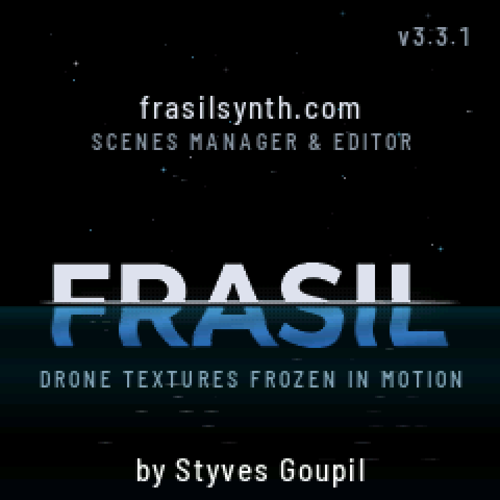
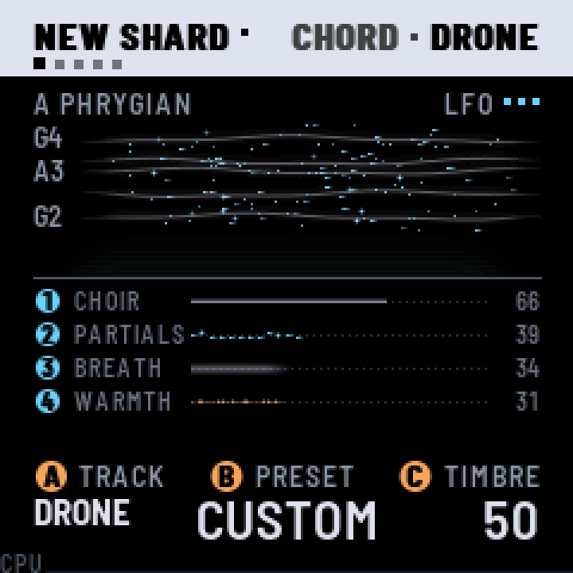
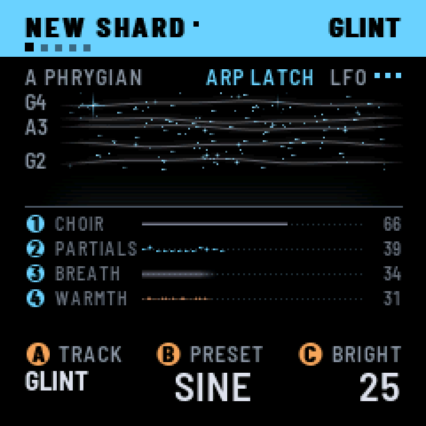

# FRASIL

*English · [Français](README.fr.md)*

**Drone textures frozen in motion.** A custom firmware that turns the M-VAVE FM-1 into an instrument for
ambient drones and textures.

<p align="center">
  
  
  
</p>

*Frasil: ice crystals that form in fast, open water (on the St. Lawrence River, among others). They stay
suspended in the current: grainy, drifting, never still.*

The drones are the notes you light, and they never change. A tap latches a drone: a note, or a chord built in the
key you chose. Pressing harder makes it swell. The timbre drifts and ebbs on its own, slowly; the drones' notes never
change. Everything flows into a large, lush reverb with shimmer and freeze. Above the drones you can play GLINT, small
icy FM bells, by hand, through an arpeggiator or a 32-step sequencer. Under them, BASS holds one deep note, or plays
its own arpeggio or a line of up to 32 steps. The drone has a sequence of its own too: its chords, a step at a time.
All of them follow MIDI clock. Chance comes in only where you let it (CHANCE skips steps, RANDOM and DRIFT pick an
arpeggio's order, SPARKLE lets glints fall on the notes your drones hold).

FRASIL is designed as one voice in a larger setup. It takes MIDI notes, pressure, CCs and clock over USB and TRS.

> **FRASIL 3.0.** Install at your own risk: the installer can always put M-VAVE's firmware back. FRASIL is not
> affiliated with M-VAVE.

## Install

- **From the browser:** Chrome or Edge, with the FM-1 connected by USB. Use [FRASIL on The FM-1 Firmware Hub](https://thefirmwarehub.com/#fw-frasil).
- **From a terminal:** download `frasil-X.Y.fwsc` from the [releases](https://github.com/styvesgoupil/frasil/releases),
  then run `python3 base/tools/fm1_install.py frasil-X.Y.fwsc` from a checkout of this repository.
- **Back to the official firmware:** install M-VAVE's V15 from the hub. If the FM-1 no longer starts, hold OCT−
  while you switch it on: it waits for an update over USB.

Package identity: `FM-1_47XXYYZZ`, its version in it: 1.0 is `FM-1_47010000`, 2.0 `FM-1_47020000`. The version is in
`VERSION`.

### Where your scenes are kept

FRASIL keeps what you save in the FM-1's flash, outside the firmware itself, in the area the Felucca family of
firmwares uses. It has no area of its own:

| What | Where | How |
| --- | --- | --- |
| The 16 scenes | `0xDA000` | two 4 KiB sectors, written in turn, each record with a CRC |
| The scenes' bass sequences and TEMPOs | `0xD8000` | the same |
| The scenes' drone sequences | `0xD6000` | the same |
| The scenes' names past their sixteenth character | `0xD2000` | the same |
| Your presets (drone, GLINT, bass) | the flash too | the same |
| The settings: the sound at power-on, MIDI channels, tempo, LOAD, the metronome and COUNT-IN, KEYS, the learned CCs | `0xFC000` | the same, in the sector pair where Felucca keeps its globals |
| The panel's calibration | `0xDC000` | in Felucca's own format, so it stays valid from one to the other |

When you switch firmwares:

- **FRASIL reads only its own records.** It does not read another firmware's projects or samples. Anything else at
  those addresses is ignored: FRASIL then starts with its factory scenes and default settings.
- **Saving can overwrite another firmware's data**: Felucca's globals, and a part of the area where Felucca keeps
  its projects and samples. Back up the firmware you come from before you save in FRASIL.
- **Another firmware may overwrite FRASIL's scenes.** Updating or installing FRASIL writes only the firmware's own
  area (felucca-bsp's update loader): your scenes stay. What another firmware's install does depends on its own
  loader. M-VAVE's V15 writes its whole image: assume your scenes won't survive it.
- **Back up your scenes before you switch firmwares.** FRASIL 1.1 and later back up the 16 scenes, your presets and the
  settings to a file over USB, and put them back:
  - **in the browser**: [the River](https://river.frasilsynth.com/) (Chrome or Edge). Back up, download everything or the
    scenes you select, then put a backup back whole, or, with FRASIL 3.0 on the FM-1, scenes into the slots you choose,
    several at once;
  - **from a terminal**: `python3 base/tools/fm1_backup.py backup scenes.frasil --magic FRBK`, then
    `python3 base/tools/fm1_backup.py restore scenes.frasil` (`info` shows what a file holds).

  A restore never touches the panel's calibration. Hold PLAY to release everything first: the FM-1 won't restore
  while something plays (STOP FIRST). It receives the whole file and checks it before anything changes, then asks on
  its screen: RESTORE FROM USB? SEL yes, FX no. Your presets on the FM-1 stay unless the backup holds presets: then it
  replaces them. A backup from before 3.0 holds none.

## The sound

Each drone voice (up to 8) has three layers. They all play the same notes; you mix them and shape each one:

| Layer | What it is |
| --- | --- |
| **CHOIR** | three detuned saws or pulses through a filter that follows the note: low, band or high, resonant |
| **PARTIALS** | 8 additive harmonics, each drifting on its own in level and tuning; from bright to dark, odd, stretched into bells, beating, with a formant down to one overtone alone |
| **BREATH** | noise or sparse grains through three resonators tuned to the note, from air (low Q) to glass (high Q) |

Each layer has a second page on EDIT for its source and what shapes it after (CHOIR II, PARTIALS II, BREATH II; CHOIR
III's SOFT rounds the choir's wave off), and DRONE TONE shapes the whole drone (PRESET, TIMBRE, SPACE, BODY). PRESETS
turns through 36 drone presets (MIST, CATHEDRAL, GLACIER, ABYSS, AURORA, EMBER, TIDE, DUST, WIND, ORGAN, HOLLOW, VOWEL,
SHIMMER, CHANTER, ENSEMBLE, BELLS, NOCTURNE, HAZE, PULSE, RIME, DEEP, SPECTRAL, RUST, STILL, VELVET, CHROME, SWARM,
FOGHORN, SOLAR, CAVE, GLASS HARP, MONK, STATIC, LULLABY, STORM, PRISM), then your own: touch a setting and the drone
becomes CUSTOM, which another preset doesn't lose. BODY (DRONE TONE) thins the drone out, whatever the preset; MOTION,
its drift, is on DRONE MOTION, EDIT's second page. Three **LFOs** (on LFO) move up to four settings each, free or on
the MIDI clock or TEMPO.

Then WARMTH (soft saturation) feeds **CLOUD**, the reverb: an 8-line modulated feedback delay network with
diffusion inside its loop, pre-delay, a pitch-shifted **shimmer** inside the loop, and **FREEZE**. The tail runs from
0.4 to 60 seconds.

**GLINT** sits on top: 4 voices of clean two-operator FM. It has 23 presets (ICE, BELL, BLIP, GLASS, CHIME, DROP,
FROST, CELESTA, SINE, KALIMBA, MARIMBA, MUSIC BOX, VIBES, HARP, PIPE, BOWED, and the leads WARM LEAD, BRASS, SQUARE,
SUB LEAD, STRINGS, REED: SUSTAIN holds them while the key is down; and PIANO, a lofi upright), then your own. With
GLINT selected, EDIT gives its sound (GLINT I, II, DELAY), ENV its envelope (GLINT ADSR, drawn with each glint riding
it), ARP its arpeggiator (UP, DOWN, UPDOWN, RANDOM, DRIFT, with latch and chance) and SEQ its 32-step sequencer
(written step by step or live, REC straight into it, with accents, ties and a LENGTH for each note, transposed along the
scale by the keys, one per scene). ARP and SEQ each open on their ON/OFF; one on turns the other off. OCTAVE is
GLINT's own: it moves every glint, the arpeggio's and the sequence's too, those sounding at once. It has a
tempo-synced delay, ping-pong. Pressure makes a glint louder and longer, and with VIBRATO a wiggle of the finger bends
its pitch slightly (a steady press stays in tune); AUTO VIB gives every glint a vibrato of its own.

**BASS** sits underneath: one deep note at a time, from eight MODELs (SINE, TRIANGLE, SQUARE, SAW, REESE, SUB, ORGAN,
FM), DRIVE into a soft clip, a resonant low-pass (FILTER, RESONANCE), gliding from note to note; BASS TONE's WEIGHT,
PUNCH and BITE hold its place in the mix. It is held like a drone and stays out of the reverb, but for its SPACE. Or
it plays its own arpeggio, or its sequence: up to 32 steps on one RATE (1/16 to 16 BARS), each step a NOTE, a CUT or
a HOLD, with a LENGTH, an ACCENT and a GATE; written step by step or live, transposed along the scale by the keys, one
per scene.

**DRONE SEQ**: the drone's own sequence, up to 32 steps, each the notes it plays there (up to eight: a chord and
notes over it), a rest or a tie, on its own RATE (1 BAR at first). Recorded live or step by step with REC, one per
scene. PLAY starts and stops the three sequences together.

**GENERATIVE FX** (FX's first page) acts on the whole: SWELL swells every voice and holds it there, SPARKLE plays
glints by themselves on the drones' notes, BLUR dissolves the drone into the cloud, SINK takes everything under a
low-pass.

## Playing

| Control | What it does |
| --- | --- |
| **Keys** | tap: light a drone (it rises slowly and stays). Tap it again: it fades. Tap another: it takes its place, or joins it with KEYS' STACK ON. Hold and press: it swells and opens |
| **SELECT** (A) | TRACK: DRONE, GLINT or BASS. The keys play it, the header takes its colour, and EDIT, ENV, ARP, SEQ and REC act on it; on their pages, the page follows. Hold OCT− and turn it: the track changes, the page stays. Hold a page button and turn SELECT: that button's pages |
| **PRESETS** (B) | the track's preset, on every page, in a grid of the names: the drone's (CUSTOM, the 36, yours), GLINT's, the bass's MODEL. Heard as you stop on one; SEL keeps it, FX goes back. Hold OCT− and turn it: picked unheard, taken when you let go |
| **ALGORITHM** (C) | the track's brightness, on every page: the drone's TIMBRE, GLINT's BRIGHT, the bass's FILTER. Hold GLO and turn it: MASTER FILTER's CUTOFF |
| **K1–K4** | the four settings of the page on screen |
| **EDIT** | the track's sound: DRONE TONE, DRONE MOTION and the drone's layers (×9: each layer and its second page, CHOIR III), GLINT I, II, DELAY, or BASS I, II, TONE. Held: F♯, G♯ and A♯ of the lowest octave light, and jump to the track's groups of pages. Hold OCT−, then EDIT: COMPARE, the scene as saved |
| **ENV** | the track's envelope: DRONE SHAPE, GLINT ADSR, BASS ADSR. Held: SWELL, every drone voice swells together |
| **ARP** | the track's arpeggiator (GLINT, BASS), opening on its ON/OFF; ON, its pages, and the sequence OFF. Held: arpeggio LATCH. On the DRONE: NOT AVAILABLE FOR DRONE |
| **SEQ** | the track's sequence, the drone's included, opening on its ON/OFF; ON, its three pages, and the arpeggio OFF. Held: the track's STACK |
| **REC** | records into the track's sequence, from any page: LIVE (counted in for a bar from silence, at once over a sequence playing), again STEP, again OFF. Leaving the SEQ and ARP pages ends a take. REC flashes on the beat while it records. Held: the metronome off, or back on. Hold OCT− and press REC on a SEQ page: CLEAR |
| **SEL** | HARMONY: root, scale, chord, voicing. Hold SEL and tap a key: a single note over what is lit, whatever STACK says; on the bass, it takes the note's place |
| **LFO, FX, GLO** | the three LFOs and their targets (×6), GENERATIVE FX, CLOUD (×3), MASTER FILTER, LOFI TAPE and PUMP (×2), GLOBAL, MIDI, MASTERING, MASTER EQ (×2), ROUTING, SCREEN and RECORD (METRONOME, COUNT-IN, TUNE A4). Hold FX: FREEZE. Hold LFO and turn K1–K4: that setting onto an LFO. Hold GLO and move a CC: MIDI learn |
| **HOME** | the play page; again: KEYS (how the keys play the track: HARMONY, NOTES, LATCH, STACK); MIXER; CLOUD SEND (each track's SPACE); the living logo screen. Hold: on-screen help (5 pages, turn SELECT) |
| **SAVE** | LOAD or SAVE. LOAD: SCENES (K1 or SELECT the slot, or NEW SHARD above slot 01 to start fresh; MORPH, LOAD; PLAY loads). SAVE: WHAT (a scene, or a drone, GLINT or bass preset), INTO (a slot, or a new preset or one of yours), then NAME IT; SEL goes on, FX goes back, SAVE twice goes straight to saving. Hold SAVE and press a white key: load that scene. Hold SAVE and press REC: store the current scene |
| **PLAY** | with nothing playing, the scene (its three tracks, as held); else the transport: the three sequences stop together or start together from the top, the arpeggios wait or go on; on SCENES, load. Tapped twice quick while anything plays, or held: RELEASE ALL; with nothing playing, RESTORE: the scene again, its sequences from the top. Starting or held, it restarts the beat there, as a MIDI Start (a MIDI clock's beats are left as they are) |
| **FREEZE** (hold FX, or CLOUD's K4) | the cloud holds what is in it, nothing more goes in (FX bright meanwhile) |
| **OCT− / OCT+** | octave, −3 to +2 (both: back to −1), shown large a moment. They blink on the beat. While a grid of names is open, its screens |

A press shows, a hold acts: the buttons do their job when you let them go (OCT at once), and held, their other thing.

On screen, each setting wears the badge of its control: a blue disc 1–4 for K1–K4, an orange disc A, B or C for the
three left encoders. On the play page, each layer of the drone shows in the river: the current is CHOIR, the crystals
PARTIALS, the mist BREATH; the bass is a slow swell of lamp light across the river, the water darker under it. The
four strata below the waterline show the exact mix, WARMTH with it. The header is the selected track's: the whole
band in its colour, DRONE white, GLINT ice blue, BASS orange, the page's name and the track's written on it; on the
play page it names the scene, with a dot once the sound has changed. Dots under each page's title say where it is
among its button's pages.

**Harmony.** 12 scales (chromatic, the seven modes, harmonic and melodic minor, both pentatonics). Chords built in
the scale (SINGLE, FIFTH, TRIAD, SEVENTH, SUS2, SUS4, ADD9, QUARTAL) or fixed (MAJ, MIN, MAJ7, MIN7, DOM7, AUG,
DIM). Voicings: CLOSE, OPEN, WIDE. A key outside the scale plays the scale note just below; the scale's keys glow.
KEYS (HOME's second page) sets, for each track, HARMONY (on, or the keys chromatic), NOTES (a single note or a chord),
LATCH (a tap holds the note, or it sounds while the key is down) and STACK (a new chord joins what is latched, or
takes its place). At first the drone plays chords, GLINT and the bass single notes, all latched, STACK off. KEYS are the
FM-1's, not a scene's; NEW SHARD puts them back.

**Arpeggiator.** With ARP ON, it plays the track's held keys one at a time, at RATE, over RANGE octaves. It follows
MIDI clock, or TEMPO when no clock comes in. A new chord waits for ARP SNAP's next point (GLOBAL, K4: the next beat at
first), so the pattern stays on the grid. MIDI Start resets the grid. With LATCH on (the default), the pattern keeps
going after you lift your hands. The key whose note is sounding lights up for as long as the note lasts.

**Bass.** With BASS selected, a tap holds a note: the key's note in the scale, an octave down (BASS II's OCTAVE, the
bass's own: none, one or two, on every note it plays, the one sounding moved at once). Tap another key and the bass
glides to it; tap its own key and it lets go. Pressing into it makes it louder and opens its filter. With KEYS'
LATCH OFF, it sounds while its key is down. BASS ADSR is its envelope, in ADSR's order (ATTACK, DECAY, SUSTAIN,
RELEASE: DECAY is heard once SUSTAIN is under 100 %), drawn on the page with the note riding it; PULSE (BASS II) lets
the held note go a moment and plays it again on each division of the grid, from 1/8 of a beat to 4 beats, and keeps
the beat: a note changed by hand is struck on the next division. With its SEQUENCE on, the keys transpose its
sequence, or write into it (REC: LIVE or STEP); an empty sequence leaves them the bass.

**Mixer, pump, mastering.** HOME's third screen is a MIXER: a fader and a live meter for DRONE, BASS, GLINT and
CLOUD, the reverb's return; hold OCT- and turn K1-K4 for each track's pan. PUMP (FX) ducks each track on the beat, as a sidechain would, from 4 bars to 1/8, synced
to MIDI clock or TEMPO, its release, attack and offset on PUMP II. MASTERING (GLO) is a light compressor on the output, with its gain reduction on screen.
MASTER FILTER (FX) is a low-pass or a high-pass with resonance on the tracks you choose, LOFI TAPE (FX) puts them on a
saturated, wobbling tape (a cassette's reels on screen), and MASTER EQ (GLO) shapes the output before the compressor:
three bands and seven presets, its curve drawn. Each scene keeps them. ROUTING (GLO) puts the filter and the tape before or after the cloud, and SPK/JACK quiets the FM-1's own output (speaker and jack) while the USB audio goes on; SCREEN has ANIMATIONS LOW to keep the screen quick with a heavy scene, and SCREENSAVER: after IDLE TIME untouched (1 to 60 minutes, 10 at first), the screen goes black and the logo drifts; HEADER draws the band at the top in the track's colour (INVERT) or dark with the words in that colour (DARK).

**Scenes and presets.** 16 slots, 7 of them factory scenes that play once loaded, each at its own TEMPO (NORTH
RIVER, LUMIERE NOCTURNE, RESILIENCE, LONG NIGHT, OPEN WATER, WHITEOUT, THAW). A new FM-1 starts on NEW SHARD, a fresh
sound to begin from. A scene holds the sound, its TEMPO, the latched drones, the arpeggios' notes, the bass and the
three sequences. SAVE, then SAVE: store a scene into a slot, or a track's sound as a preset of your own (then name it:
a scene up to 32 characters, a preset sixteen); SAVE held and a white key loads one of the 16, as does PLAY on SCENES (SAVE, then LOAD) or a
MIDI Program Change. MORPH glides into a scene, up to two minutes, or cuts; LOAD on SND+NOTES lets everything go and
plays the scene's notes at its TEMPO, its sequences from the top, on SND ONLY changes the sound alone. Hold OCT-, then
EDIT, to hear the scene as saved (COMPARE); SAVE lights while the sound has changed. Scenes saved by an earlier FRASIL
load as they were, the newer settings at their defaults.

The full manual is [app/docs/MANUAL.md](app/docs/MANUAL.md). A one-page field card (in French) is
[docs/cheatsheet.html](docs/cheatsheet.html).

### MIDI (USB and TRS)

Each track has its own channel, whatever the keys play: the drones 1, GLINT 2, BASS 3 by default (GLO's second
page, MIDI: OFF, 1–16 or OMNI each). Notes for the drones go through the harmony, as the DRONE's KEYS say (HARMONY, NOTES), so a sequencer's single note
plays a chord; sustain (CC 64) holds them. GLINT's and BASS's notes play as they come, with no scale, their track's OCTAVE
on them (they go into the track's arpeggiator or sequence while one is on); the bass is mono, its last note on top. Notes sound only while held.
Polyphonic aftertouch swells a note; channel pressure swells the whole track. The sound's CCs come in on the drones'
channel; 123 releases the notes of the track whose channel it comes on, 120 (All Sound Off), on any channel, everything. Program Change 0–15 on the drones'
channel loads scenes 1–16.

| CC | | CC | |
| --- | --- | --- | --- |
| 1 | MOTION | 74 | TIMBRE |
| 91 | SPACE | 11 | SWELL |
| 70 · 71 · 72 | CHOIR · PARTIALS · BREATH | 73 · 75 | ATTACK · RELEASE |
| 76 · 77 | SIZE · DECAY | 78 · 79 | SHIMMER · WARMTH |
| 12 · 13 | BODY · the drone's PRESET | 14 · 15 · 16 | SPARKLE · BLUR · SINK |
| 17 · 18 · 19 | the DRONE · GLINT · BASS faders | 80 | FREEZE (≥ 64) |
| 120 | all sound off: everything let go, the sequences stopped | 123 | release the notes of the track on that channel |

MIDI learn: turn a setting, hold GLO, move a knob on the controller (a CC on the drones' channel): that CC turns it
from then on. Up to 8, kept with the settings; a learned CC comes before the table's, but for 64, 120 and 123.

Clock (`F8`) drives the arpeggiators, the three sequences and GLINT's delay, and Start (`FA`) resets the grid.

## Build from source

```sh
git clone --recursive https://github.com/styvesgoupil/frasil
cd frasil
python3 -m venv .venv && .venv/bin/pip install Pillow fonttools mido python-rtmidi numpy scipy matplotlib
brew install libraqm                     # the screen's fonts (macOS)

./build.sh --host                        # the host simulator: app/build/host/frasil_host
app/build/host/frasil_host app/tests/basic.txt app/build/host      # the checks
app/build/host/frasil_host app/tests/demo.txt renders              # a performance, as WAV files
./build.sh --web                         # the browser emulator: app/build/emu/ (Emscripten)
./build.sh                               # the firmware: app/build/frasil-VERSION.fwsc (the version in VERSION)
```

The firmware build needs JieLi's Linux toolchain and the AC79 SDK, run in Docker (OrbStack on macOS). See
[fm1-base's README](https://github.com/charlesvestal/fm1-base#readme) for setup. `tools/screens.sh` renders the
screenshots. `tools/bench/` measures the DSP: test renders and instruction counts against the FM-1's budget.

| Path | What |
| --- | --- |
| `engine/` | FRASIL's engine, without the FM-1 (it builds alone too: `frasil_engine.h`): `core.c` (the keys, the sequencers, the LFOs, the scenes, MIDI), `params.c`, `harmony.c` |
| `engine/dsp/` | the sound: `frasil.c` (voices), `glint.c` (GLINT and its delay), `bass.c` (BASS), `nuage.c` (CLOUD, the reverb) |
| `app/` | the firmware, the FM-1's shell around the engine: `app.c` (the panel, the store, the slots), `pages.c`, `ui.c` (the screen) |
| `app/docs/`, `app/site/` | the manual and the site's front page (`base/tools/make_site.py`) |
| `base/` | [fm1-base](https://github.com/charlesvestal/fm1-base), the platform (git submodule) |
| `tools/` | screenshots, the DSP bench, the release script |

Releases: see [RELEASING.md](RELEASING.md).

## Licence and credits

FRASIL is free software under the [Mozilla Public License 2.0](LICENSE): see [LICENSING.md](LICENSING.md).

- By Styves Goupil.
- Built on [fm1-base](https://github.com/charlesvestal/fm1-base) by Charles Vestal and
  [felucca-bsp](https://github.com/hugelton/felucca-bsp), from [Felucca](https://github.com/hugelton/Felucca) by
  Leo Kuroshita (Hügelton Instruments).
- Fonts: Barlow (The Barlow Project Authors) and Terminus (Dimitar Toshkov Zhekov), SIL OFL 1.1, through fm1-base.

M-VAVE and FM-1 are trademarks of their owners.
