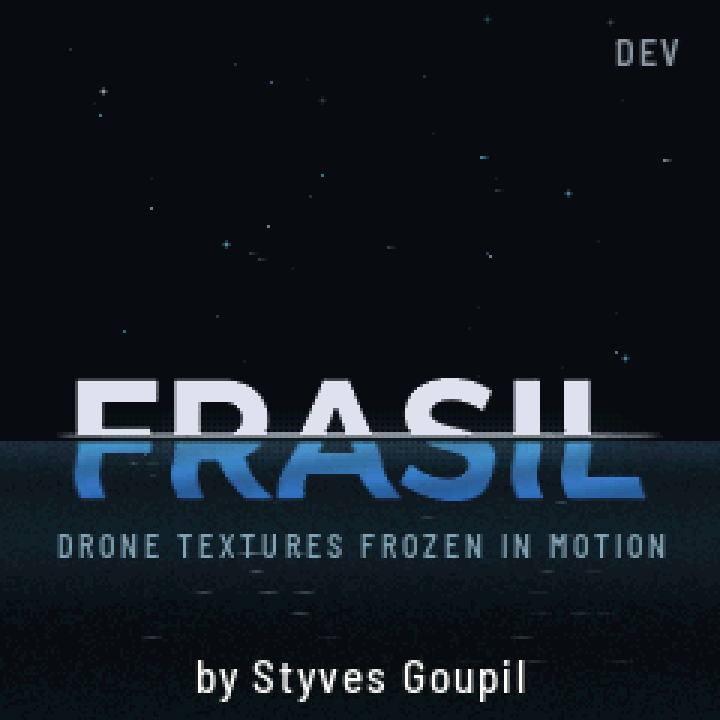
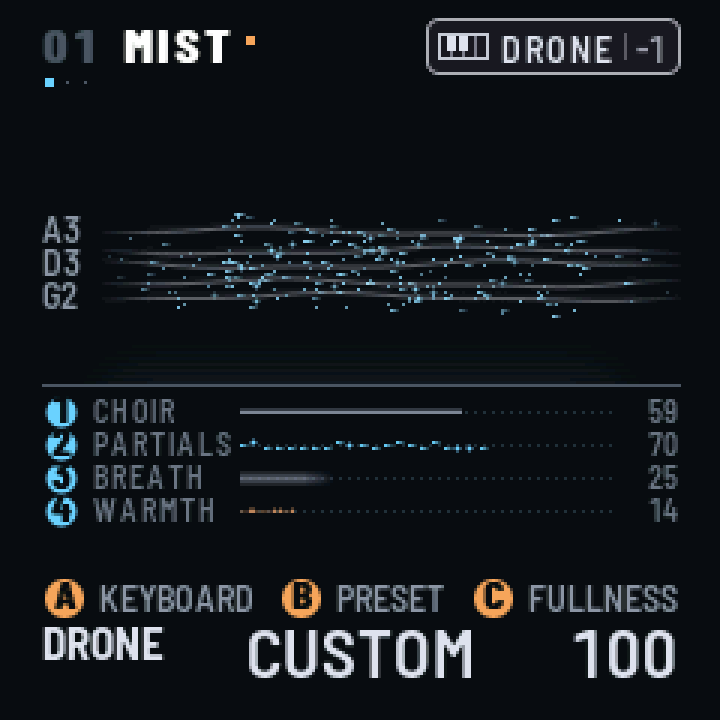
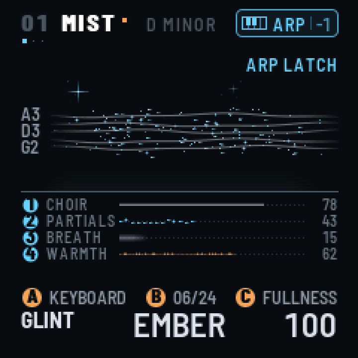

# FRASIL

*English · [Français](README.fr.md)*

**Drone textures frozen in motion.** A custom firmware that turns the M-VAVE FM-1 into an instrument for
ambient drones and textures.

<p align="center">
  
  
  
</p>

*Frasil: ice crystals that form in fast, open water (on the St. Lawrence River, among others). They stay
suspended in the current: grainy, drifting, never still.*

The drones are the notes you light, and they never change. GLINT's arpeggiator plays the keys you hold and its
sequencer the steps you write; chance comes in only where you let it (CHANCE skips steps, RANDOM and DRIFT pick the
arpeggio's order, SPARKLE lets glints fall on the notes your drones hold). A tap latches
a drone: a note, or a chord built in the key you chose. Pressing harder makes it swell. The timbre drifts and ebbs on
its own, slowly; the drones' notes never change. Everything flows into a large, lush reverb with shimmer and freeze. Above
the drones you can play GLINT, small icy FM bells, by hand, through an arpeggiator or a 32-step sequencer that
follow MIDI clock. Under
them, BASS holds one deep note.

FRASIL is designed as one voice in a larger setup. It takes MIDI notes, pressure, CCs and clock over USB and TRS.

> **Status: beta.** The way scenes are saved may still change between releases. Install at your own risk.
> FRASIL is not affiliated with M-VAVE.

## Install

- **From the browser:** Chrome or Edge, with the FM-1 connected by USB. Use [The FM-1 Firmware Hub](https://thefirmwarehub.com/)
  once FRASIL is listed there.
- **From a terminal:** download `frasil-X.Y.fwsc` from the [releases](https://github.com/styvesgoupil/frasil/releases),
  then run `python3 base/tools/fm1_install.py frasil-X.Y.fwsc` from a checkout of this repository.
- **Back to the official firmware:** install M-VAVE's V15 from the hub. If the FM-1 no longer starts, hold OCT−
  while you switch it on: it waits for an update over USB.

Package identity: `FM-1_47XXYYZZ`. The first release will be 1.0 (`FM-1_47010000`); the builds before it are
0.9.x. The version is in `VERSION`.

## The sound

Each drone voice (up to 8) has three layers. They all play the same notes; you mix them and shape each one:

| Layer | What it is |
| --- | --- |
| **CHOIR** | three detuned saws or pulses through a filter that follows the note: low, band or high, resonant |
| **PARTIALS** | 8 additive harmonics, each drifting on its own in level and tuning; from bright to dark, odd, stretched into bells, beating, with a formant down to one overtone alone |
| **BREATH** | noise or sparse grains through three resonators tuned to the note, from air (low Q) to glass (high Q) |

Each layer has a second page on EDIT for its source and what shapes it after (CHOIR II, PARTIALS II, BREATH II),
and DRONE PARAMS shapes the whole drone (TIMBRE, SPACE, MOTION, FULLNESS). PRESETS turns through 24 drone presets
(MIST, CATHEDRAL, GLACIER, ABYSS, AURORA, EMBER, TIDE, DUST, WIND, ORGAN, HOLLOW, VOWEL, SHIMMER, CHANTER, ENSEMBLE,
BELLS, NOCTURNE, HAZE, PULSE, RIME, DEEP, SPECTRAL, RUST, STILL): touch a setting and the drone becomes CUSTOM, which
another preset doesn't lose. ALGORITHM thins the drone out (FULLNESS), whatever the preset.
Three **LFOs** (on LFO, after DRONE MOTION) move up to four settings each, free or on the MIDI clock or TEMPO.

Then WARMTH (soft saturation) feeds **CLOUD**, the reverb: an 8-line modulated feedback delay network with
diffusion inside its loop, pre-delay, a pitch-shifted **shimmer** inside the loop, and **FREEZE**. The tail runs from
0.4 to 60 seconds.

**GLINT** sits on top: 4 voices of clean two-operator FM, never latched. It has 22 presets (ICE, BELL, BLIP, GLASS,
CHIME, DROP, FROST, CELESTA, SINE, KALIMBA, MARIMBA, MUSIC BOX, VIBES, HARP, PIPE, BOWED, and the leads WARM LEAD,
BRASS, SQUARE, SUB LEAD, STRINGS, REED: SUSTAIN holds them while the key is down). Its TYPE chooses how the keys
play it: each key its glint, its own arpeggiator (UP, DOWN, UPDOWN, RANDOM, DRIFT, with latch and chance), or a
32-step sequencer (written step by step or live, REC straight into it, with accents and ties, transposed along the
scale by the keys, one per scene). OCTAVE moves the arpeggio and the sequence as they play. It has a tempo-synced
delay, mono or ping-pong. Pressure makes a glint louder and longer, and with VIBRATO a wiggle of the finger bends its
pitch slightly (a steady press stays in tune).

**BASS** sits underneath: one deep note at a time, from eight MODELs (SINE, TRIANGLE, SQUARE, SAW, REESE, SUB, ORGAN,
FM), DRIVE into a soft clip, a resonant low-pass (FILTER, RESONANCE), gliding from note to note. It is held like a
drone and stays out of the reverb.

**GENERATIVE FX** (FX's first page) acts on the whole: SWELL swells every voice and holds it there, SPARKLE plays
glints by themselves on the drones' notes, BLUR dissolves the drone into the cloud, SINK takes everything under a
low-pass.

## Playing

| Control | What it does |
| --- | --- |
| **Keys** | tap: light a drone (it rises slowly and stays). Tap it again: it fades. Hold and press: it swells and opens |
| **SELECT / PRESETS / ALGORITHM** (A B C) | KEYBOARD, what the keys play (DRONE, GLINT, BASS) / the drone's PRESET (24, and your CUSTOM) / FULLNESS, on every page |
| **K1–K4** | the four settings of the page on screen |
| **REC** | into GLINT's sequencer, recording LIVE (the keys on GLINT, the sequence playing); again: RECORD OFF, the keys back to what they played before REC. REC flashes on the beat while it records, with a metronome; hold REC to turn the metronome off or on |
| **ARP** | GLINT's pages (tap again for the next: GLINT PARAMS, II, III, DELAY, then GLINT ARP or the sequencer's as TYPE has it). Hold: arpeggio LATCH |
| **SEQ** | BASS's pages (tap again for the next). Hold: SWELL, every voice swells together |
| **SEL** | HARMONY: root, scale, chord, voicing. Hold SEL and tap a key: a single note over a chord |
| **EDIT, ENV, LFO, FX, GLO** | DRONE PARAMS and the LAYERS (×7: each layer and its second page), DRONE SHAPE, DRONE MOTION and the three LFOs (×7), GENERATIVE FX, CLOUD (×3) and PUMP (×2), GLOBAL, MIDI and MASTERING. Hold EDIT: COMPARE, the scene as saved. Hold FX: FREEZE. Hold LFO and turn K1–K4: that setting onto an LFO. Hold GLO and move a CC: MIDI learn |
| **HOME** | the play page; again: the MIXER; again: the living logo screen. Hold: on-screen help (5 pages, turn SELECT) |
| **SAVE** | SCENES (K1 the slot, MORPH, KEEP, UNDO); again: back. Hold SAVE and press REC: STORE. Hold SAVE and press a white key: load that scene |
| **PLAY** | GLINT's transport: the sequence stops or starts from the top, the arpeggio waits or goes on; on SCENES, load. Hold: RELEASE ALL; hold again: RESTORE |
| **FREEZE** (hold FX, or CLOUD's K4) | the cloud holds what is in it, nothing more goes in (FX bright meanwhile) |
| **OCT− / OCT+** | octave, −3 to +2 (both: back to −1). They blink on the beat |

A press shows, a hold acts: the buttons do their job when you let them go (OCT at once), and held, their other thing.

On screen, each setting wears the badge of its control: a blue disc 1–4 for K1–K4, an orange disc A, B or C for the
three left encoders. On the play page, each layer shows in the river: the current is CHOIR, the crystals PARTIALS,
the mist BREATH; the bass is a slow swell across the river, the water darker under it. The four strata below the
waterline show the exact mix, WARMTH with it. The header names the scene, with an amber dot once the sound has
changed, and dots under each page's title say where it is among its button's pages. At the top right, a badge shows
what the keys play (SELECT) and the octave: a small keyboard and DRONE in white, BASS in orange, or in blue what
GLINT's keys do (GLINT, ARP, SEQ; REC in orange). Its frame is solid while the notes latch, dotted while they sound
only as long as their key is held.

**Harmony.** 12 scales (chromatic, the seven modes, harmonic and melodic minor, both pentatonics). Chords built in
the scale (SINGLE, FIFTH, TRIAD, SEVENTH, SUS2, SUS4, ADD9, QUARTAL) or fixed (MAJ, MIN, MAJ7, MIN7, DOM7, AUG,
DIM). Voicings: CLOSE, OPEN, WIDE. A key outside the scale plays the scale note just below; the scale's keys glow.

**Arpeggiator.** With TYPE on ARP, it plays GLINT's held keys one at a time, at RATE, over RANGE octaves. It follows
MIDI clock, or TEMPO when no clock comes in. A new chord takes effect on the next RATE step, so the pattern stays on
the grid. MIDI Start resets the grid. With LATCH on (the default), the pattern keeps going after you lift your hands.
The key whose note is sounding lights up for as long as the note lasts.

**Bass.** With the keys on BASS, a tap holds a note: the key's note in the scale, an octave down (BASS II's OCTAVE:
one or two). Tap another key and the bass glides to it; tap its own key and it lets go. Pressing into it makes it
louder and opens its filter. With GLOBAL's KEYS on HOLD, it sounds while its key is down.

**Mixer, pump, mastering.** HOME's second screen is a MIXER: a fader and a live meter for DRONE, BASS, GLINT and
CLOUD, the reverb's return. PUMP (FX) ducks each track on the beat, as a sidechain would, from 4 bars to 1/8, synced
to MIDI clock or TEMPO, its release, attack and offset on PUMP II. MASTERING (GLO) is a light compressor on the output, with its gain reduction on screen.

**Scenes.** 16 slots, 8 of them factory scenes (MIST, GLASS, ABYSS, CHORALE, WIND, BELLS, TIDE, AURORA). A scene
holds the sound, the latched drones, GLINT's arpeggio and sequence, and the bass. SAVE held and REC stores; SAVE held
and a white key loads one of the 16, as does PLAY on SCENES or a MIDI Program Change. MORPH glides into a scene, up
to two minutes, or cuts; KEEP on SCENE lets everything go and plays the scene's notes, on PLAYING changes the sound
alone. Hold EDIT to hear the scene as saved (COMPARE); SAVE lights while the sound has changed. Scenes saved by an
earlier FRASIL load as they were, the newer settings at their defaults.

The full manual is [app/docs/MANUAL.md](app/docs/MANUAL.md). A one-page field card (in French) is
[docs/cheatsheet.html](docs/cheatsheet.html).

### MIDI (USB and TRS)

Each track has its own channel, whatever the keys play: the drones 1, GLINT 2, BASS 3 by default (GLO's second
page, MIDI: OFF, 1–16 or OMNI each). Notes for the drones go through the harmony, so a sequencer's single note plays
a chord; sustain (CC 64) holds them. GLINT's and BASS's notes play as they come, with no scale or octave added (GLINT's
go into its arpeggiator or its sequencer while one is on); the bass is mono, its last note on top. Notes sound only while held.
Polyphonic aftertouch swells a note; channel pressure swells the whole track. The sound's CCs come in on the drones'
channel; 120 and 123 release the notes of the track whose channel they come on. Program Change 0–15 on the drones'
channel loads scenes 1–16.

| CC | | CC | |
| --- | --- | --- | --- |
| 1 | MOTION | 74 | TIMBRE |
| 91 | SPACE | 11 | SWELL |
| 70 · 71 · 72 | CHOIR · PARTIALS · BREATH | 73 · 75 | ATTACK · RELEASE |
| 76 · 77 | SIZE · DECAY | 78 · 79 | SHIMMER · WARMTH |
| 12 · 13 | FULLNESS · the drone's PRESET | 14 · 15 · 16 | SPARKLE · BLUR · SINK |
| 17 · 18 · 19 | the DRONE · GLINT · BASS faders | 80 | FREEZE (≥ 64) |
| 120 · 123 | release the notes of the track on that channel | | |

MIDI learn: turn a setting, hold GLO, move a knob on the controller (a CC on the drones' channel): that CC turns it
from then on. Up to 8, kept with the settings; a learned CC comes before the table's, but for 64, 120 and 123.

Clock (`F8`) drives the arpeggiator, the sequencer and GLINT's delay, and Start (`FA`) resets the grid.

## Build from source

```sh
git clone --recursive https://github.com/styvesgoupil/frasil
cd frasil
python3 -m venv .venv && .venv/bin/pip install Pillow fonttools mido python-rtmidi numpy scipy matplotlib
brew install libraqm                     # the screen's fonts (macOS)

./build.sh --host                        # the host simulator: app/build/host/frasil_host
app/build/host/frasil_host app/tests/basic.txt app/build/host      # the checks
app/build/host/frasil_host app/tests/demo.txt renders              # a performance, as WAV files
./build.sh --web                         # the browser emulator: app/build/emu/ (Emscripten)
./build.sh                               # the firmware: app/build/frasil-VERSION.fwsc (the version in VERSION)
```

The firmware build needs JieLi's Linux toolchain and the AC79 SDK, run in Docker (OrbStack on macOS). See
[fm1-base's README](https://github.com/charlesvestal/fm1-base#readme) for setup. `tools/screens.sh` renders the
screenshots. `tools/bench/` measures the DSP: test renders and instruction counts against the FM-1's budget.

| Path | What |
| --- | --- |
| `app/` | the firmware: `app.c` (controls, MIDI, scenes), `ui.c` (the screen), `params.c`, `harmony.c` |
| `app/dsp/` | the sound: `frasil.c` (voices), `glint.c` (GLINT and its delay), `bass.c` (BASS), `nuage.c` (CLOUD, the reverb) |
| `app/docs/`, `app/site/` | the manual and the site's front page (`base/tools/make_site.py`) |
| `base/` | [fm1-base](https://github.com/charlesvestal/fm1-base), the platform (git submodule) |
| `tools/` | screenshots, the DSP bench, the release script |

Releases: see [RELEASING.md](RELEASING.md).

## Licence and credits

FRASIL is free software under the [Mozilla Public License 2.0](LICENSE): see [LICENSING.md](LICENSING.md).

- By Styves Goupil.
- Built on [fm1-base](https://github.com/charlesvestal/fm1-base) by Charles Vestal and
  [felucca-bsp](https://github.com/hugelton/felucca-bsp), from [Felucca](https://github.com/hugelton/Felucca) by
  Leo Kuroshita (Hügelton Instruments).
- Fonts: Barlow (The Barlow Project Authors) and Terminus (Dimitar Toshkov Zhekov), SIL OFL 1.1, through fm1-base.

M-VAVE and FM-1 are trademarks of their owners.
