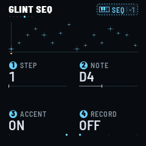

# FRASIL

FRASIL turns the M-VAVE FM-1 into an instrument for ambient drones and textures. The drones are the notes
you light, and they never change. GLINT's arpeggiator plays the keys you hold and its sequencer the steps you write;
chance comes in only where you let it (CHANCE skips steps, RANDOM and DRIFT pick the arpeggio's order, SPARKLE lets
glints fall on the notes your drones hold). A tap latches a drone, and pressing makes it
swell. The timbre drifts and ebbs slowly on its own; the drones' notes never change. Everything flows into a large reverb
with shimmer and freeze. Above the drones, GLINT plays small icy FM bells, by hand, through an arpeggiator or a
32-step sequencer. Under
them, BASS holds one deep note.

---

## Contents

1. Install
2. How FRASIL works
3. The screen
4. Playing drones
5. Harmony
6. GLINT
7. BASS
8. The pages
9. Scenes
10. MIDI
11. The lights
12. Troubleshooting

---

## 1. Install

**Try it first:** the emulator runs the same code in the browser, with sound. No FM-1 needed.

**Install from the browser:** in Chrome or Edge, connect the FM-1 by USB, open the installer and press Install.
The browser asks once to allow MIDI: allow it. Don't unplug the cable while it writes.

**Install from a terminal:** `python3 base/tools/fm1_install.py frasil-VERSION.fwsc`, from a checkout of FRASIL's
repository.

**Back to the official firmware:** install M-VAVE's V15 from the installer or from The FM-1 Firmware Hub. If the
FM-1 no longer starts, hold OCT− while you switch it on: it waits for an update over USB.

FRASIL keeps its scenes and settings in the FM-1's flash, in its own format. Another firmware may not read them,
and may overwrite them.

---

## 2. How FRASIL works

The keys play one set of notes. Every note you light is a **voice** (up to 8), and every voice has three layers:

- **CHOIR:** three detuned saws (or pulses) through a low-pass filter that follows the note. Warm, wide, vocal.
- **PARTIALS:** 8 additive harmonics, each drifting on its own in level and tuning. Bright or dark, odd, stretched
  into bells, with a formant.
- **BREATH:** noise (a hiss or sparse grains) through three resonators tuned to the note, from air to glass.

Each layer has two pages on EDIT: the first its level and main character, the second (CHOIR II, PARTIALS II,
BREATH II) its source and what shapes it after. Before them, **DRONE PARAMS** shapes the whole drone: TIMBRE (all
three layers brighter or darker), SPACE (how much of it goes to the reverb), MOTION (how far it drifts) and FULLNESS.
At 100 % FULLNESS leaves the drone as its settings make it. Turned down, it thins it out without changing them: the
choir closer and quieter, fewer partials, little breath, narrower, less warmth, its low body taken off.
**ALGORITHM** (C) turns it too, on any page, and the presets leave it where it is. An LFO can move it.

**The drone's presets.** Turn **PRESETS** (B), on any page: 24 drones, each setting the three layers (their levels,
both their pages) and the drone's own (DRONE PARAMS but FULLNESS, DRONE SHAPE's ATTACK and RELEASE, DRONE MOTION).
The cloud, PRESSURE and VELOCITY stay as they are. MIST, CATHEDRAL, GLACIER, ABYSS, AURORA, EMBER, TIDE, DUST, WIND,
ORGAN, HOLLOW, VOWEL, SHIMMER, CHANTER, ENSEMBLE, BELLS, NOCTURNE, HAZE, PULSE, RIME, DEEP, SPECTRAL, RUST, STILL.
Before them, **CUSTOM**: your own. Turn any of those settings and the drone becomes CUSTOM, from where it was.
Another preset doesn't lose it: turn back to CUSTOM and it is there. A scene keeps its CUSTOM, and the preset chosen
over it.

You don't choose a layer per note: all three play every note, and you mix and shape them. Then WARMTH (a soft
saturation) feeds **CLOUD**, the reverb: an 8-line modulated network with diffusion in its loop, a pre-delay, a
pitch-shifted **shimmer** inside the loop, and **FREEZE**. Its tail runs from 0.4 to 60 seconds.

Your drones' notes never change. What moves on its own is the sound: **MOTION** is a slow random drift of each
partial, detune and resonance; **TIDE** is a slow swell of the timbre over minutes. Chance comes into GLINT's notes only
where you let it: **CHANCE** skips steps, RANDOM and DRIFT pick the arpeggio's order, **SPARKLE** plays glints of its
own on the notes the drones hold.

**GLINT** is a separate layer on top: 4 voices of clean FM, played from the keys when you switch them over
(**SELECT**, KEYBOARD: DRONE, GLINT, BASS). GLINT notes are never latched: each one rings and fades like a bell. The
drones keep sounding while you play GLINT.

**BASS** is a third thing the keys can play (SELECT on BASS): one deep note at a time, held like a drone, under
everything. It stays out of the reverb, but for a little SPACE.

**GENERATIVE FX** (FX's first page) acts on everything at once: SWELL swells every voice, SPARKLE scatters glints over
the drones' notes, BLUR dissolves the drone into the cloud, SINK takes the whole mix under a low-pass (section 8).

---

## 3. The screen

FRASIL's screen is a river at night. Pitch is height above the waterline. Each voice is a current carrying ice.

- **The current** is CHOIR: its line grows brighter as CHOIR gets louder.
- **The crystals** are PARTIALS: more of them as PARTIALS gets louder.
- **The mist** around the current is BREATH.
- **Pressure** warms a voice's crystals to lamp light. **GLINT** notes shine in the sky above. **FREEZE** sets the
  crystals into a lattice and stills the water.
- **The bass** is a slow swell across the whole river at its note's height, the water darker under it; its note is
  written on the right.
- **SINK** darkens the river from the top as it is turned, deep water closing over it. **BLUR** thickens the haze
  off the water, the reverb's, as SPACE toward 90 % would.

Under the waterline, four strata show the drone's mix: CHOIR, PARTIALS and BREATH, each drawn as its own thing in
the river, and WARMTH, as embers in lamp light. K1–K4 set them. The one you turn lights up.

At the top right of the river, only what is on, out of sight elsewhere: **SEQ** (ice while the sequence runs, slate
while it is stopped) or **REC** (lamp, while it records); **ARP**, or **ARP LATCH**, while the arpeggio has notes
(slate while it waits); **LFO** and three dots, one for each, ice while it runs; **SWELL** (lamp) while it swells.

At the bottom, the three left encoders, the same on every page: **KEYBOARD** (SELECT: what the keys play), the
drone's **PRESET** (PRESETS: its number among the 24 over it, CUSTOM's PRESET) and **FULLNESS** (ALGORITHM).

**The badges.** Every setting on screen wears the badge of the control that turns it. A blue disc numbered 1–4 is
K1–K4, the four encoders at the top right. An orange disc A, B or C is SELECT, PRESETS or ALGORITHM, the three
encoders on the left. Turning one of these shows its value large for a moment, on any page.

**The header.** On the play page: the scene's number, in slate, and its name, an amber dot while the sound differs
from the scene's, then the key (D MINOR), once you set a scale or a chord and if there is room. Elsewhere, the page's
name; SCENES adds CHANGED, in lamp, while the sound differs. FRASIL's name stays on the logo screen. Under the title, a
dot for each page of its button (those TYPE hides not counted), the one on screen ice; HOME's three are SOUND, MIXER
and the logo.

At the right, the keys' badge: a small keyboard, what the keys do and the octave, in the mode's colour: DRONE white,
BASS orange, and for GLINT, in ice blue, what its keys do: GLINT (TYPE OFF: each key its glint), ARP (they feed the
arpeggio), SEQ (they transpose the sequence), or REC, in orange, while they write into it. Its frame is solid while
the notes latch, dotted while they sound only as long as their key is held: for DRONE and BASS, GLOBAL's KEYS (LATCH
or HOLD); for GLINT, the arpeggio (TYPE on ARP and latched, or not). Beside it: FREEZE while the cloud is held, an
amber dot while the processor lightens the sound, and on GLOBAL the processor's load. When it is full, the least
important items step aside.

For a moment the header gives way to a message (STORED 03 ABYSS, FILTER > LFO 2); to PLAY held (RELEASE ALL or
RESTORE, a line of progress under it); on the play page and SCENES, to a scene's MORPH (an arrow, the scene's name, a
line for how far it has come; elsewhere, only the line, under the page's name); and, while EDIT is held, to COMPARE ·
AS SAVED.

**The mixer.** Press HOME on the play page: a fader for each track, DRONE, BASS, GLINT, and CLOUD, the reverb's
return, each in its colour, with the track's meter beside it, live. K1–K4 move them. 100 is the level as it is (a mark
on the track), up to 127. The faders are the tracks' levels in the mix, after their own sound: DRONE and GLINT take what
they send into the cloud down with them. HOME again opens the logo screen.

**The logo screen.** HOME's third screen: the logo, alive, the version at the top right, the sky over two thirds of
the screen. Over the waterline, granules of frasil drift like stars: they follow what plays (faster with MOTION),
pressure warms them, GLINT notes sparkle among them. Under it, the water: night blue, slow swells of light passing
through it, the sky's light on it in short strokes that come and go, and the letters in it, deep blue, swaying. FREEZE
stills it all. PLAY and the octave buttons leave it open, so you can play from it. HOME again goes back to the
play page.

**Help.** Hold HOME: the help screen opens and stays, on the page with the button of the page you were on. Turn
SELECT for its five pages: the buttons in the panel's order (three pages), the encoders, the keys. Each line gives a
control's job, then the control, and under it, in amber, what it does again, held, or with something else. Tap HOME
to close it and go back where you were.

---

## 4. Playing drones

| Gesture | What happens |
| --- | --- |
| **Tap a key** | lights the note, or a chord (see Harmony). It rises over ATTACK and stays |
| **Tap a lit key** | it fades over RELEASE |
| **Hold a key and press** | the voice swells and opens (PRESSURE sets how much). Let go: it stays lit |
| **Hold SEQ** | SWELL: after 0.4 s, every voice swells together (1.5 s up, 1.5 s down) |
| **SWELL** (FX, GENERATIVE FX's K1) | held where you leave it: every voice swells as far as it is turned (with SEQ's and CC 11's, the most of them) |
| **Turn SELECT** | KEYBOARD, what the keys play: DRONE, GLINT, BASS (it stops at each end) |
| **Turn PRESETS** | the drone's preset (CUSTOM, then the 24) |
| **Turn ALGORITHM** | FULLNESS: at 100 % the drone as set; down, thinner (section 2) |
| **Hold SEL, tap a key** | a single note, even when CHORD makes chords: a note over a chord |
| **OCT− / OCT+** | octave −3 to +2. Both together: back to −1, where the keys run F2 to G4 |
| **Hold PLAY** | after 0.6 s, RELEASE ALL: the drones, the bass, the glints, the arpeggio and the sequence. From 0.2 s the header says RELEASE ALL, a line counting down under it: let go then, before 0.6 s, and nothing happens |
| **Hold PLAY again** | with nothing playing: RESTORE, what the last RELEASE ALL let go comes back (the latched drones, the bass, the arpeggio's notes, the sequence running) |
| **Tap PLAY** | GLINT's transport (section 6): the sequence stops, or starts from its first step; the arpeggio waits, or goes on from the top. With TYPE OFF, it only says HOLD PLAY · RELEASE ALL |
| **REC** | into GLINT's sequencer, recording what you play (section 6); again: RECORD OFF, the keys back to what they played before REC |
| **Hold FX** (or CLOUD's K4) | FREEZE: the cloud holds what is in it, without end and without darkening. Nothing more goes in: what you play next sounds dry over it. Off: it thaws, and fades over DECAY. The page stays; FX stays bright while it is on |

With GLOBAL › KEYS on HOLD, notes sound only while their key is held.

**The buttons.** A press shows, a hold acts. Every button does its job when you let it go, but OCT− and OCT+, which
act at once. Held 0.4 s (PLAY 0.6 s), it does its other thing instead. A button used with something else (SEL with a
key, SAVE with a key or REC, LFO with an encoder, GLO with a CC) does nothing more when you let it go.

| Button | Tap | Hold | Held, with |
| --- | --- | --- | --- |
| **FX** | GENERATIVE FX; again: CLOUD, CLOUD II, CLOUD III, PUMP, PUMP II | FREEZE on or off | |
| **SEL** | HARMONY | | a key: a single note |
| **ENV** | DRONE SHAPE | | |
| **LFO** | DRONE MOTION; again: the three LFOs and their targets | | K1–K4 turned: that setting onto an LFO (section 8) |
| **EDIT** | DRONE PARAMS; again: the layers' pages | COMPARE: the scene as saved, while held (section 9) | |
| **GLO** | GLOBAL; again: MIDI, MASTERING | | a CC from a controller: MIDI learn (section 10) |
| **HOME** | the play page; again: MIXER, the logo | help, on the page with this page's button | |
| **SAVE** | SCENES; again: back to the page you came from | | a white key: that scene · REC: STORE (section 9) |
| **ARP** | GLINT's pages | the arpeggio's LATCH | |
| **SEQ** | BASS's pages | SWELL, while held | |
| **PLAY** | start, stop GLINT's sequence or arpeggio; on SCENES: load | RELEASE ALL; again: RESTORE | |
| **REC** | record LIVE; again: RECORD OFF | the metronome on or off | |

---

## 5. Harmony

SEL opens HARMONY. You set a key once, then every key you tap plays something that belongs to it.

| K1 | K2 | K3 | K4 |
| --- | --- | --- | --- |
| ROOT: C to B | SCALE | CHORD | VOICING |

**Scales:** CHROMATIC, MAJOR, MINOR, DORIAN, PHRYGIAN, LYDIAN, MIXOLYDIAN, LOCRIAN, HARMONIC, MELODIC,
PENTA MAJ, PENTA MIN. A key outside the scale plays the scale's note just below it. The scale's keys glow faintly.

**Chords in the scale:** SINGLE, FIFTH, TRIAD, SEVENTH, SUS2, SUS4, ADD9, QUARTAL. Each key builds the chord from
the scale's own notes. In D MINOR with SEVENTH, D plays Dm7, E plays Em7♭5 and F plays Fmaj7.

**Fixed chords:** MAJ, MIN, MAJ7, MIN7, DOM7, AUG, DIM: the same shape on every key.

**Voicing**, for D MINOR with TRIAD:

- **CLOSE:** D3 F3 A3, tight, within an octave.
- **OPEN:** D3 A3 F4, the second note an octave up. More air.
- **WIDE:** D2 F3 A3, the root an octave down. A bass under the chord.

---

## 6. GLINT

Turn **SELECT** to GLINT: the keys play GLINT (the badge turns blue, and says what they do: GLINT, ARP, SEQ, or REC
in orange). On to BASS, or back to DRONE, the same way. A
key plays an icy FM bell in the scale, OCTAVE octaves up (two by default, from +0 to +3). Pressing it makes it louder
(up to +8 dB) and makes it ring longer.

**VIBRATO** (GLINT III, K3): once your finger has pressed in, wiggling it bends the glint's pitch, both ways around
its note, like a string player's finger. A steady press stays in tune. Up to 25 cents at 100; about 10 at its
default; OFF at 0.

**Its pages:** tap **ARP**, then ARP again for the next page: GLINT PARAMS, GLINT II, GLINT III and GLINT DELAY,
always the fourth. Then TYPE decides: GLINT ARP while it is on ARP, the sequencer's three pages while it is on SEQ,
neither on OFF (four pages). If the page on screen goes (TYPE turned, a scene loaded), you land on GLINT PARAMS.

| Page | K1 | K2 | K3 | K4 |
| --- | --- | --- | --- | --- |
| GLINT PARAMS | PRESET | TYPE (OFF, ARP, SEQ) | LEVEL | BRIGHT (FM index) |
| GLINT II | ATTACK (2 ms to 1.5 s) | DECAY (80 ms to 6 s) | OCTAVE (+0 to +3) | RATIO (×0.5 to ×13.6) |
| GLINT III | PING (strike or ring) | SCATTER (place and detune) | VIBRATO (OFF, the wiggle's depth) | SUSTAIN (the level held) |
| GLINT DELAY | TIME (1/32 to 1/2, triplet and dotted; then the same, PP) | FEEDBACK | MIX | SPACE (GLINT's reverb send) |
| GLINT ARP (TYPE on ARP) | MODE (UP, DOWN, UPDOWN, RANDOM, DRIFT) | RATE (1/1 to 1/32, triplets) | RANGE (1 to 3 octaves) | CHANCE |
| GLINT SEQ, II, III (TYPE on SEQ) | the sequencer's (below) | | | |

**TYPE** is how the keys play GLINT: OFF, each key its own glint; ARP, through the arpeggiator; SEQ, through the
sequencer.

**Presets:** ICE, BELL, BLIP, GLASS, CHIME, DROP, FROST, CELESTA, SINE (the default), KALIMBA, MARIMBA, MUSIC BOX,
VIBES, HARP, PIPE, BOWED, and six leads: WARM LEAD, BRASS, SQUARE, SUB LEAD, STRINGS, REED. A preset sets GLINT's
sound (all but VIBRATO and the delay's TIME, FEEDBACK and MIX). Turn RATIO, BRIGHT and the rest from there.

**SUSTAIN** (GLINT III, K4) turns a bell into a lead. At 0 a glint fades out over DECAY, even while you hold its key.
Turned up, it settles at that level for as long as the key is down, then rings out when you let go. DECAY is then
how long it takes to settle, and PING the brightness at the start, as a filter's sweep would be. The leads use it,
with RATIO at ×1 (all the harmonics, as a saw has), ×2 (the odd ones, hollow, as a square) or ×0.5 (an octave
under).

**OCTAVE** (GLINT II, K3) moves a running arpeggio or sequence too, at once: they keep their notes without it, and
play them with it.

**The arpeggiator** (TYPE on ARP) plays the held GLINT keys one at a time, at RATE, over RANGE octaves. CHANCE
decides whether each step plays. It follows MIDI clock when one comes in, and TEMPO (GLOBAL, K1) otherwise. It stays
on the grid: a new chord, an added or a lifted note takes effect on the next RATE step, and the pattern starts again
from its first note. MIDI Start resets the grid.

**Latch:** hold **ARP**. With LATCH on (the default), the arpeggio keeps playing after you lift your hands, even back
on the drones. A new hand replaces the chord. Hold ARP again to turn it off. Tap **PLAY** and the arpeggio waits, its
notes kept (ARPEGGIO · WAITING); tap it again and it goes on from the top. Hold PLAY to let it go with everything else.

**The sequencer:** set TYPE to **SEQ**, or tap REC (below). In place of the arpeggio, a 32-step sequence plays GLINT,
on the same grid: RATE, MIDI clock or TEMPO, CHANCE for each step (the arpeggiator's RATE and CHANCE, on GLINT SEQ II
too). It plays on without end while TYPE is on SEQ. **PLAY** stops it, and starts it again from its first step. MIDI
Start starts it from the top too.

| Page | K1 | K2 | K3 | K4 |
| --- | --- | --- | --- | --- |
| GLINT SEQ | STEP (1 to 32) | NOTE (REST, a note, TIE) | ACCENT (OFF, ON) | RECORD (OFF, STEP, LIVE) |
| GLINT SEQ II | LENGTH (1 to 32 steps) | RATE (the arpeggiator's) | GATE (a note's length) | CHANCE (the arpeggiator's) |
| GLINT SEQ III | TRANSPOSE (−14 to +14 steps of the scale) | CLEAR (turn twice) | NEW TAKE (turn twice) | UNDO (turn twice) |

**REC** takes you straight in: TYPE on SEQ, the keys on GLINT, RECORD on LIVE, GLINT SEQ on screen, the sequence
started if it was stopped. Play, and what you play goes in. REC again: RECORD OFF, the keys back to what they played
before REC's take (RECORD OFF · DRONE), and the page stays. While RECORD is on, STEP or LIVE, REC flashes on the beat
(twice as quick as OCT) and a metronome ticks each beat, the bar's first higher, on the grid (MIDI clock, else
TEMPO). Hold REC to turn the metronome off, or on again; it is kept with the settings. REC keeps the sequence as it
was before the take, for UNDO.

- **RECORD on STEP:** a GLINT key writes its note on STEP, then STEP moves on to the next, round LENGTH. A hard
  strike writes an accent. K2 and K3 change the step on STEP: its NOTE (as it sounds, OCTAVE on it; REST all the way
  down, TIE all the way up, the last note held on through it) and its ACCENT.
- **RECORD on LIVE:** play while it runs. Each note sounds and goes into the step nearest the playhead.
- **RECORD OFF:** the keys transpose the sequence. A key moves it from its first note to that key's, along the
  scale, so it stays in the key. TRANSPOSE shows how far, and turns it back.
- **GATE** is how long each note sounds, from a twentieth of its step to all of it. A TIE holds a note on, legato;
  with SUSTAIN up, GLINT's leads then sing through.
- **CLEAR:** turn it once (AGAIN), then once more: every step a rest.
- **NEW TAKE:** turned twice the same way: every step a rest, RECORD on LIVE, the sequence started if it was stopped
  (NEW TAKE · RECORDING). Play it in again from nothing.
- **UNDO:** turned twice: the sequence as it was before the last take (REC, NEW TAKE) or CLEAR. Again: back to the
  one after.

The screen draws the sequence as a constellation: a star a step, as high as its note, larger with an accent; a line
for a tie, a dot for a rest. The step playing is white, with a line of light through it; the step on STEP has an
amber mark under it. The keys light the note playing. Each scene keeps its own sequence.

**The delay** is GLINT's alone. TIME runs from 1/32 to 1/2, with triplets and dotted values, first mono, then the
same twelve again ping-pong (PP); 1/8D PP by default. Its time follows MIDI clock, or TEMPO. Its echoes go into the
cloud with GLINT: SPACE, on the same page, is how much.

---

## 7. BASS

Turn **SELECT** all the way, to BASS: the keys play BASS (the badge turns orange). One note at a time, deep and
steady: one of eight MODELs, DRIVE into a soft clip, through a resonant low-pass. None of it goes into the reverb.

**Models:** SINE (pure), TRIANGLE (soft, a little hollow), SQUARE (hollow, woody), SAW (bright, buzzing), REESE (two
saws ten cents apart, beating slowly), SUB (the sine and its octave below), ORGAN (three drawbars: the note, its
octave and its twelfth), FM (a sine modulating itself: round, growling). Turning MODEL while the bass sounds crosses
over in a few milliseconds, without a click.

| Gesture | What happens |
| --- | --- |
| **Tap a key** | the bass holds that note: the key's note in the scale, OCTAVE octaves down. It rises over ATTACK |
| **Tap another key** | the bass glides to its note (GLIDE), without starting again |
| **Tap the bass's key** | it lets go, over RELEASE |
| **Hold its key and press** | louder, and its filter opens. Let go: it stays |

With GLOBAL › KEYS on HOLD, the bass sounds while its key is down. Holding PLAY lets it go with everything else. It
stays when you switch the keys back to drones or GLINT: turn SELECT to BASS again to come back to it.

**Its pages:** tap **SEQ**, then SEQ again for the next. Hold SEQ for SWELL, as ever.

| Page | K1 | K2 | K3 | K4 |
| --- | --- | --- | --- | --- |
| BASS | MODEL (SINE, TRIANGLE, SQUARE, SAW, REESE, SUB, ORGAN, FM) | DRIVE (clean to soft-clipped) | FILTER (40 Hz to 5 kHz) | RESONANCE (Q 0.5 to 6) |
| BASS II | LEVEL | OCTAVE (−2, −1, 0 under the keys) | GLIDE (OFF to 2 s) | |
| BASS III | ATTACK (5 ms to 5 s) | RELEASE (30 ms to 15 s) | | |

A pure sine this low barely reaches the FM-1's small speaker: DRIVE, or a richer MODEL, gives it the harmonics that
let you hear it there. In headphones or a mixer, SINE with DRIVE at 0 is a clean sub.

---

## 8. The pages

Press a page's button again for its next page (EDIT ×7, LFO ×7: DRONE MOTION and the three LFOs, ARP ×4 to ×7 as
GLINT's TYPE has them, SEQ ×3, FX ×6, GLO ×3: GLOBAL, MIDI, MASTERING;
HOME: SOUND, MIXER, the logo). A button opens its page when you let it go, because holding it may do something else
(section 4, the buttons). The dots under the page's name say where you are among them.

| Button | Page | K1 | K2 | K3 | K4 |
| --- | --- | --- | --- | --- | --- |
| HOME | SOUND | CHOIR | PARTIALS | BREATH | WARMTH (soft saturation) |
| HOME | MIXER | DRONE | BASS | GLINT | CLOUD (each 0 to 127, 100 as it is) |
| EDIT | DRONE PARAMS | TIMBRE (all three layers' brightness) | SPACE (the reverb's share) | MOTION (the drift's depth) | FULLNESS (100 %: as set; down: thinner) |
| EDIT | CHOIR | CHOIR (level) | DETUNE (0 to 40 cents) | FILTER (follows the note) | WARMTH |
| EDIT | CHOIR II | SHAPE (SAW, SQUARE in the middle, then narrower pulses) | INTERVAL (the centre saw: UNISON, −12, +7, +12) | RESONANCE (the filter's peak, Q 0.5 to 20) | TYPE (LOW, BAND, HIGH) |
| EDIT | PARTIALS | PARTIALS (level) | TILT (bright to dark) | ODD (odd harmonics) | STRETCH (toward a bell) |
| EDIT | PARTIALS II | EVOLVE (their levels wander, deeper and quicker) | BEAT (each one pulses at its own pace) | FORMANT (its place, H1 to H8) | PEAK (up to that harmonic alone) |
| EDIT | BREATH | BREATH (level) | RESONANCE (air to glass) | COLOR (harmonic, odd, bell) | SPREAD (the voices' width) |
| EDIT | BREATH II | GRAIN (a hiss to sparse grains) | PITCH (the resonators: −12, UNISON, +12, +19, +24) | TONE (the noise darker or brighter) | AIR (the noise itself, beside them) |
| ENV | DRONE SHAPE | ATTACK (5 ms to 30 s) | RELEASE (50 ms to 60 s) | PRESSURE (its effect) | VELOCITY |
| LFO | DRONE MOTION | MOTION (the drift's depth) | RATE (20 s to 0.5 s) | TIDE (a swell of the timbre) | PERIOD (5 min to 10 s) |
| LFO | LFO 1, LFO 2, LFO 3 | SHAPE (SINE, TRIANGLE, SAW, RAMP, SQUARE, RANDOM, DRIFT) | RATE (200 s to 10 Hz, then 16 BARS to 1/16) | DEPTH (0: off) | POLARITY (BIPOLAR, UP, DOWN) |
| LFO | LFO 1, 2, 3 TARGETS | TARGET 1 | TARGET 2 | TARGET 3 | TARGET 4 (each OFF or a setting) |
| SEL | HARMONY | ROOT | SCALE | CHORD | VOICING |
| FX | GENERATIVE FX | SWELL (every voice swelled, held) | SPARKLE (glints by themselves) | BLUR (the drone into the cloud) | SINK (a low-pass on everything) |
| FX | CLOUD | SIZE | DECAY (0.4 s to 60 s) | TONE (how long the highs last) | FREEZE (OFF, ON) |
| FX | CLOUD II | DIFFUSION | MODULATION | PRE-DELAY (0 to 200 ms) | WIDTH (the tail's stereo width) |
| FX | CLOUD III | SHIMMER | INTERVAL (+12, +7, +5, +19, −12) | BRIGHT (the shimmer's brightness, 700 Hz to 8 kHz) | |
| FX | PUMP | RATE (OFF, 4 BARS, 2 BARS, 1 BAR, 1/2, 1/4, 1/8) | DRONE (its depth) | BASS | GLINT |
| FX | PUMP II | RELEASE (10 to 100 % of the period) | ATTACK (1 to 300 ms) | OFFSET (0 to 100 % of the period) | |
| GLO | GLOBAL | TEMPO (30 to 240 BPM) | LOW CUT (20 to 500 Hz) | TUNE (±50 cents) | KEYS (LATCH, HOLD: two detents) |
| GLO | MIDI | DRONE CH | GLINT CH | BASS CH (each OFF, 1 to 16, OMNI) | |
| GLO | MASTERING | THRESHOLD (−40 to 0 dB) | RATIO (OFF, 1.5:1 to 20:1) | RELEASE (30 ms to 1.5 s) | GAIN (0 to +18 dB) |
| SAVE | SCENES | the slot, 1 to 16 | MORPH (CUT, 1 S to 2:00) | KEEP (SCENE, PLAYING) | UNDO (turn twice) |

GLINT's pages are under ARP (section 6: its sound, its delay, the arpeggiator or the sequencer), BASS's three under
SEQ (section 7).

**GLOBAL** (GLO): TEMPO, the grid's when no MIDI clock comes in (the arpeggiator, the sequencer, GLINT's delay, PUMP,
the LFOs on the grid); LOW CUT; TUNE; KEYS. KEYS lets every note go, so it changes only on a second detent the same
way within 2 seconds: the first says KEYS · TURN AGAIN.

**GENERATIVE FX** is FX's first page, to perform with, on the whole sound:

- **SWELL** swells every drone voice as far as it is turned, and holds it there (with SEQ's and CC 11's, the most of
  them). It is not kept: FRASIL starts with it at 0.
- **SPARKLE** plays glints by themselves, now and then, on the notes the drones hold: GLINT's OCTAVE up, one in three
  an octave more, soft and short, in GLINT's sound. From a few a minute to about six a second. No drone, no sparkle.
- **BLUR** dissolves the drone into the cloud: wetter (SPACE toward 90 %), a longer DECAY, more DIFFUSION and
  MODULATION, the glints further in too. The settings themselves stay where they are.
- **SINK** takes everything under: a low-pass on the whole mix, from 12 kHz down to about 120 Hz (some 2.4 kHz at
  25, 800 Hz at 50), with a small resonance as it goes down.

A scene keeps SPARKLE, BLUR and SINK. An LFO can move them.

**PUMP** (FX, fifth page) ducks the tracks on the beat, as a sidechain from a kick would, without a kick: at RATE,
on the arpeggiator's grid (MIDI clock, else TEMPO), each track dips and comes back up. DRONE, BASS and GLINT set how
deep each one goes; the cloud pumps with the drones. The river breathes with it. PUMP II shapes it: RELEASE, how much
of the period it takes to come back (short: a tight pump; all of it: a slow breath); ATTACK, how fast it goes down
(1 ms: a kick's; 300 ms: a soft wave); OFFSET, where in the period it goes down (50 %: on the off-beat).

**MASTERING** (GLO, third page) is a compressor on the whole output, before the soft limit: THRESHOLD, RATIO (OFF by
default), RELEASE (its attack is 10 ms) and GAIN, the make-up. The page shows the gain reduction, live.

**The layers' second pages.**

- **CHOIR II.** SHAPE takes each saw toward a square, reached in the middle: hollow, woody, the even harmonics
  gone. Past it, the pulse narrows: brighter, nasal. Its width sways on its own, as an old synthesizer's pulse width
  modulation does, more so toward the narrow end. It stays as loud all the way. INTERVAL moves the centre saw an
  octave down, a fifth up or an octave up, under or over its two detuned neighbours. RESONANCE gives the filter a
  peak, a soft vowel by the middle, a whistle at the top. TYPE is the filter: LOW (the low-pass, as on the first
  page), BAND (a band-pass: nasal, vocal) or HIGH (a high-pass: thin, airy). FILTER sets where it sits either way.
- **PARTIALS II.** EVOLVE makes the partials' levels wander much further, and up to four times quicker, than
  MOTION alone does: partials come and go, and the spectrum changes colour by itself. At 0 they wander as MOTION has
  them. BEAT makes each partial pulse at its own pace, slow and shallow at first, quick and deep at the top (about
  7 Hz): a shimmering, beating texture, as loud as before. FORMANT and PEAK lift the partials around one harmonic, as
  a vowel does. The higher PEAK, the narrower, and the more the rest go down: at the top only that harmonic sounds,
  as in overtone singing. Sweep FORMANT with PEAK up. At 0, PEAK leaves the spectrum as TILT and ODD make it.
- **BREATH II.** GRAIN turns the hiss into grains, sparser as you turn it up: the resonators then ring like ice
  ticking, or rain on glass, more so with RESONANCE high. PITCH moves the resonators an octave down or up, a twelfth
  or two octaves up: an airy halo over the drone. TONE makes the noise darker (turned left) or brighter (right)
  before it reaches them. AIR adds the noise itself, beside the resonators: breath, or with GRAIN, crackle.

They all start where the sound was before them. SHAPE, RESONANCE, TYPE, BEAT and AIR take more of the processor.
With many voices and several of them up, FRASIL thins out the partials, then the voices, to keep the sound going.

**LFO 1, LFO 2 and LFO 3** move the sound on their own. Tap LFO again after DRONE MOTION: LFO 1, its targets, LFO 2,
its targets, LFO 3, its targets.

- **SHAPE:** SINE, TRIANGLE, SAW (up), RAMP (down), SQUARE, RANDOM (a new value each turn, held) or DRIFT (a new
  value each turn, glided to).
- **RATE:** one knob, free first: from a 200-second turn to 10 Hz. Past the fastest it is on the grid: 16 BARS to
  1/16, with triplets, following MIDI clock when one comes in, else TEMPO (GLOBAL, K1). MIDI Start puts those back to
  the top of their turn.
- **DEPTH:** 0 is off. Up, it reaches the whole range of each target.
- **POLARITY:** BIPOLAR moves a setting both ways around where you set it, UP only above, DOWN only below.
- **TARGET 1–4:** each OFF or a setting: TIMBRE, SPACE, MOTION, WARMTH, CHOIR, PARTIALS, BREATH, DETUNE, FILTER,
  SHAPE, CH RESO (CHOIR's), TILT, ODD, STRETCH, EVOLVE, BEAT, FORMANT, PEAK, BR RESO and BR TONE (BREATH's), COLOR,
  GRAIN, AIR, SPREAD, GL LEVEL, GL BRIGHT, GL PING, GL SPACE (GLINT's), BS FILTER, BS RESO, BS DRIVE (BASS's: they
  glide, so a FILTER swept by an LFO is a smooth wobble), DRONE LVL, GLINT LVL and BASS LVL (the MIXER's), FULLNESS,
  GL CHANCE (the arpeggiator's and the sequencer's CHANCE), SEQ LEN (the sequence's LENGTH), SPARKLE, BLUR, SINK.
  Each is written in its track's colour, as the keys' badge has them: GLINT's ice blue (the GL ones, GLINT LVL, SEQ
  LEN, SPARKLE), BASS's orange (the BS ones, BASS LVL), the drone's and the whole mix's white.

An LFO runs freely and without end while it is on, with DEPTH up and a target set; a key does not start or restart
it. Its four targets move together, by the same amount, and LFOs on one setting add up. The setting keeps the
value you gave it, and that is what a scene saves, with the LFOs; the LFO moves the sound around it. On every page,
a setting's gauge shows a small ice-blue mark where the LFO has it now. On an LFO's pages the river gives way to
its shape and a glint where it is, grey while it is off. GL BRIGHT and GL PING are set at each strike: an LFO on
them changes the next notes. The engine glides between the LFO's steps, so a SQUARE or a RANDOM steps softly.

**LFO held and an encoder.** On any page, hold LFO and turn K1, K2, K3 or K4: the setting under that encoder goes
onto LFO 1, then LFO 2, LFO 3, then none (turned back, the other way), into that LFO's first free TARGET. An LFO's
DEPTH at 0 comes up to 25 %. The header says where it went: FILTER > LFO 2, FILTER > NO LFO, LFO 2 FULL (its four
TARGETs taken), or NOT AN LFO TARGET. Let LFO go without turning anything and it opens its pages, as ever.

---

## 9. Scenes

Press **SAVE** for SCENES; SAVE again goes back to the page you came from. K1 picks a slot, K2 to K4 are MORPH, KEEP
and UNDO. The screen reminds you: PLAY LOAD, SAVE + REC STORE.

- **Load:** on SCENES, **PLAY** loads the slot K1 points at. On any page, hold **SAVE** and press a white key: the 16
  white keys are the 16 scenes, F2's key the first. That key sounds nothing, and the page stays. While SAVE is held,
  the white keys light: the current scene's bright, the slots that hold a scene faintly. MIDI Program Change loads
  them too (section 10). Every load comes in as MORPH and KEEP say.
- **Store:** hold **SAVE** and press **REC**: the sound goes into the slot K1 points at on SCENES, into the current
  scene anywhere else (STORED 03 ABYSS), with the latched drones (up to 8 chords), GLINT's arpeggio notes and its
  sequence, and the bass's note. Into a free slot (9 to 16) with a drone preset on, the scene takes the preset's
  name; else it is SCENE and its number.
- **UNDO** (K4): turn it once (AGAIN), then once more: the last STORE undone, the slot back as it was.

**MORPH** (K2) is how the sound comes in: CUT, at once, or over 1 S, 2 S, 4 S, 8 S, 15 S, 30 S, 60 S or 2:00. Over a
time, the settings that glide go from where they are to the scene's; the choices (the presets, MODEL, ROOT, SCALE,
CHORD, RATIO, TYPE, the TARGETs, INTERVAL, the rates, TIME, LENGTH, TRANSPOSE, TUNE) switch at once. A setting you
turn during the morph leaves it: your hand wins (a preset, all it sets). On the play page and SCENES, the header shows
an arrow, the scene's name and a line for how far it has come; on the other pages, only the line, under the page's
name. A new load starts from the values as they are.

**KEEP** (K3) is what happens to what plays. SCENE: everything is let go, then the scene's notes play, if it has
any. PLAYING: what plays goes on (the drones, the bass, GLINT's arpeggio and sequence, with its TYPE and the settings
that play it: MODE, RATE, RANGE, CHANCE, LENGTH, GATE, TRANSPOSE); only the sound changes.

MORPH and KEEP are kept with the settings, not in the scenes.

**COMPARE:** hold **EDIT**. While it is held, the scene sounds as it was saved or last loaded, whatever you have
turned since; the header says COMPARE · AS SAVED. Let go: the sound as it is now.

Slots 1 to 8 hold the factory scenes, sound only:

| Scene | Harmony | GLINT preset |
| --- | --- | --- |
| MIST | D, chromatic | SINE |
| GLASS | A lydian, ADD9 wide | GLASS |
| ABYSS | D phrygian, FIFTH wide | DROP |
| CHORALE | D minor, SEVENTH open | BELL |
| WIND | E penta minor, mostly BREATH | FROST |
| BELLS | C major, QUARTAL open | CHIME |
| TIDE | F dorian, SUS2 open | BLIP |
| AURORA | G mixolydian, TRIAD wide | CELESTA |

Slots 9 to 16 are free. While the sound differs from the one last loaded or saved, SAVE lights, the SCENES page says
CHANGED and the play page's header has an amber dot beside the scene's name (back to it, they go). Storing also keeps
the settings: at power-on FRASIL comes back with the sound you stored last, silent. Nothing plays until you play.
Scenes saved by an earlier FRASIL come back as they were, the settings added since at their defaults. The
arpeggiator's old MODE (OFF, the five modes, SEQ) becomes TYPE and MODE, the delay's TIME and MODE one TIME, and the
arpeggio's and the sequence's notes lose the OCTAVE they were kept with (it is put on as they play now).

---

## 10. MIDI

FRASIL takes MIDI over USB and the TRS input. Each track has its own channel, whatever the keys play: the drones on 1,
GLINT on 2, BASS on 3 by default. Press GLO twice for the MIDI page: DRONE CH, GLINT CH and BASS CH, each OFF, 1 to 16
or OMNI.

- **The drones' notes** go through the harmony, so a sequencer's single note plays a chord. Sustain (CC 64) holds
  them. Channel pressure swells them all (SWELL).
- **GLINT's notes** play as they come: no scale, no octave added. While the arpeggiator or the sequencer is on, they
  go into it, as
  held keys would.
- **BASS's notes** play as they come too, one at a time: the last one sounds, and letting it go brings back the one
  still held under it.

Notes sound only while held. Polyphonic aftertouch swells a note; channel pressure, the whole track. The CCs below
come in on the drones' channel (sustain too); 120 and 123 release the notes of the track whose channel they come on.

| CC | | CC | |
| --- | --- | --- | --- |
| 1 | MOTION | 74 | TIMBRE |
| 91 | SPACE | 11 | SWELL |
| 70 · 71 · 72 | CHOIR · PARTIALS · BREATH | 73 · 75 | ATTACK · RELEASE |
| 76 · 77 | SIZE · DECAY | 78 · 79 | SHIMMER · WARMTH |
| 12 · 13 | FULLNESS · the drone's PRESET | 14 · 15 · 16 | SPARKLE · BLUR · SINK |
| 17 · 18 · 19 | the MIXER's DRONE · GLINT · BASS | 80 | FREEZE (64 and up) |
| 120 · 123 | release the notes of the track on that channel | | |

**Program Change** 0 to 15, on the drones' channel, loads scenes 1 to 16, as SCENES' MORPH and KEEP say.

**MIDI learn:** turn a setting, hold GLO, and move a knob on your controller (a CC on the drones' channel): from then
on that CC turns that setting (CC 21 · SINK). FRASIL learns 8 at most, the oldest replaced, and keeps them with the
settings. A learned CC comes before the table's (SWELL's 11 and FREEZE's 80 too), but for 64, 120 and 123, which keep
their jobs.

MIDI clock drives GLINT's arpeggiator, its sequencer and its delay. Start resets the grid, and starts the sequence
from its first step.

---

## 11. The lights

| Light | Means |
| --- | --- |
| Keys, bright | the roots of the latched drones, and the keys held |
| Keys, faint | the scale's notes |
| Keys, GLINT with the arpeggio on | faint: the arpeggio's notes. Bright: the one sounding, for as long as it sounds |
| Keys, GLINT with the sequencer on | bright: the note playing. Faint: the scale's notes |
| Keys, BASS | bright: the bass's note. Faint: the scale's notes |
| Keys, SAVE held | the white keys, the scenes: bright, the current one; faint, the slots that hold a scene |
| The function buttons, faint | always: their names stay readable in the dark |
| The page's button, bright | the page on screen |
| SAVE, bright | the sound differs from the scene's (SCENES says CHANGED) |
| LFO | faint as the others while an LFO runs; fainter, as PLAY, while none does |
| ARP, a flash | each step GLINT's arpeggio or sequence plays, while GLINT's pages are not on screen |
| PLAY | faint; bright while voices or the bass are sounding |
| REC | faint, as the others; flashing on the beat, twice as quick as OCT, while GLINT's sequencer records (RECORD on STEP or LIVE) |
| OCT− and OCT+ | faint, a little brighter on the beat: MIDI clock when one comes in, else TEMPO (GLOBAL, K1) |
| FX, bright | one of FX's pages is on screen, or FREEZE is on |
| SEQ, bright | BASS's pages, and SWELL while you hold it |

---

## 12. Troubleshooting

**No sound:** turn MASTER up, and tap a key: drones need a tap to start. Check the layers' levels (HOME, K1–K3).
If the keys' badge (top right) says BASS, or in blue GLINT, ARP, SEQ or REC, the keys play BASS or GLINT: turn
SELECT back to DRONE.

**Everything went silent:** PLAY held lets everything go. Hold it again before you play anything else: RESTORE brings
back what it let go. A tap on PLAY does not let the drones go: it starts and stops GLINT's sequence or arpeggio.

**KEYS doesn't change:** it lets every note go, so it takes a second detent the same way within 2 seconds (KEYS ·
TURN AGAIN).

**A CC from a controller moves another setting than the table's:** it was learned (section 10). Learn it again onto
the setting you want.

**Crackles or a voice dropping out:** FRASIL lowers its load on its own when the processor is full; an amber dot left
of the keys' badge says so. GLOBAL's header shows the load. Fewer voices, or SHIMMER at 0, give it room.

**The installer doesn't find the FM-1:** use Chrome or Edge, allow MIDI when asked, and close other programs that
use the FM-1's MIDI port.

**The FM-1 doesn't start after an install:** hold OCT− while you switch it on, then install again, or put the
official firmware back.
