# FRASIL

FRASIL turns the M-VAVE FM-1 into an instrument for ambient drones and textures. The drones are the notes
you light, and they never change. GLINT's arpeggiator plays the keys you hold and its sequencer the steps you write;
chance comes in only where you let it (CHANCE skips steps, RANDOM and DRIFT pick the arpeggio's order, SPARKLE lets
glints fall on the notes your drones hold). A tap latches a drone, and pressing makes it
swell. The timbre drifts and ebbs slowly on its own; the drones' notes never change. Everything flows into a large reverb
with shimmer and freeze. Above the drones, GLINT plays small icy FM bells, by hand, through an arpeggiator or a
32-step sequencer. Under
them, BASS holds one deep note, or plays a line of sixteen steps.

---

## Contents

1. Install
2. How FRASIL works
3. The screen
4. Playing drones
5. Harmony
6. GLINT
7. BASS
8. The pages
9. Scenes
10. MIDI
11. The lights
12. Troubleshooting

---

## 1. Install

**Try it first:** the emulator runs the same code in the browser, with sound. No FM-1 needed.

**Install from the browser:** in Chrome or Edge, connect the FM-1 by USB, open the installer and press Install.
The browser asks once to allow MIDI: allow it. Don't unplug the cable while it writes.

**Install from a terminal:** `python3 base/tools/fm1_install.py frasil-VERSION.fwsc`, from a checkout of FRASIL's
repository.

**Back to the official firmware:** install M-VAVE's V15 from the installer or from The FM-1 Firmware Hub. If the
FM-1 no longer starts, hold OCT− while you switch it on: it waits for an update over USB.

FRASIL keeps its scenes and settings in the FM-1's flash, in its own format. Another firmware may not read them,
and may overwrite them: back them up first (section 9, Backing up).

---

## 2. How FRASIL works

The keys play one set of notes. Every note you light is a **voice** (up to 8), and every voice has three layers:

- **CHOIR:** three detuned saws (or pulses) through a low-pass filter that follows the note. Warm, wide, vocal.
- **PARTIALS:** 8 additive harmonics, each drifting on its own in level and tuning. Bright or dark, odd, stretched
  into bells, with a formant.
- **BREATH:** noise (a hiss or sparse grains) through three resonators tuned to the note, from air to glass.

Each layer has two pages on EDIT: the first its level and main character, the second (CHOIR II, PARTIALS II,
BREATH II) its source and what shapes it after. Before them, **DRONE PARAMS** shapes the whole drone: TIMBRE (all
three layers brighter or darker), SPACE (how much of it goes to the reverb), MOTION (how far it drifts) and BODY.
At 100 % BODY leaves the drone as its settings make it. Turned down, it thins it out without changing them: the
choir closer and quieter, fewer partials, little breath, narrower, less warmth, its low body taken off.
**ALGORITHM** (C) turns it too, on any page, and the presets leave it where it is. An LFO can move it.

**The drone's presets.** Turn **PRESETS** (B), on any page: 24 drones, each setting the three layers (their levels,
both their pages) and the drone's own (DRONE PARAMS but BODY, DRONE SHAPE's ATTACK and RELEASE, DRONE MOTION).
The cloud, PRESSURE and VELOCITY stay as they are. MIST, CATHEDRAL, GLACIER, ABYSS, AURORA, EMBER, TIDE, DUST, WIND,
ORGAN, HOLLOW, VOWEL, SHIMMER, CHANTER, ENSEMBLE, BELLS, NOCTURNE, HAZE, PULSE, RIME, DEEP, SPECTRAL, RUST, STILL.
Before them, **CUSTOM**: your own. Turn any of those settings and the drone becomes CUSTOM, from where it was.
Another preset doesn't lose it: turn back to CUSTOM and it is there. A scene keeps its CUSTOM, and the preset chosen
over it.

You don't choose a layer per note: all three play every note, and you mix and shape them. Then WARMTH (a soft
saturation) feeds **CLOUD**, the reverb: an 8-line modulated network with diffusion in its loop, a pre-delay, a
pitch-shifted **shimmer** inside the loop, and **FREEZE**. Its tail runs from 0.4 to 60 seconds.

Your drones' notes never change. What moves on its own is the sound: **MOTION** is a slow random drift of each
partial, detune and resonance; **TIDE** is a slow swell of the timbre over minutes. Chance comes into GLINT's notes only
where you let it: **CHANCE** skips steps, RANDOM and DRIFT pick the arpeggio's order, **SPARKLE** plays glints of its
own on the notes the drones hold.

**GLINT** is a separate layer on top: 4 voices of clean FM, played from the keys when you switch them over
(**SELECT**, KEYS: DRONE, GLINT, BASS; or a page: ARP's pages put them on GLINT). GLINT notes are never latched: each one rings and fades like a bell. The
drones keep sounding while you play GLINT.

**BASS** is a third thing the keys can play (SELECT on BASS, or SEQ's pages): one deep note at a time, held like a drone, under
everything, or its own step sequencer. It stays out of the reverb, but for a little SPACE.

**GENERATIVE FX** (FX's first page) acts on everything at once: SWELL swells every voice, SPARKLE scatters glints over
the drones' notes, BLUR dissolves the drone into the cloud, SINK takes the whole mix under a low-pass (section 8).

---

## 3. The screen

FRASIL's screen is a river at night. Pitch is height above the waterline. Each voice is a current carrying ice.

- **The current** is CHOIR: its line grows brighter as CHOIR gets louder.
- **The crystals** are PARTIALS: more of them as PARTIALS gets louder.
- **The mist** around the current is BREATH.
- **Pressure** warms a voice's crystals to lamp light. **GLINT** notes shine in the sky above. **FREEZE** sets the
  crystals into a lattice and stills the water.
- **The bass** is a slow swell in lamp light, the bass's colour, across the whole river at its note's height, the
  water darker under it; pressing into it brightens it. Its note is written on the right.
- **SINK** darkens the river from the top as it is turned, deep water closing over it. **BLUR** thickens the haze
  off the water, the reverb's, as SPACE toward 90 % would.

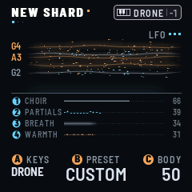

Under the waterline, four strata show the drone's mix: CHOIR, PARTIALS and BREATH, each drawn as its own thing in
the river, and WARMTH, as embers in lamp light. K1–K4 set them. The one you turn lights up.

At the top right of the river, only what is on, out of sight elsewhere: **SEQ** (ice while the sequence runs, slate
while it is stopped) or **REC** (lamp, while it records); **ARP**, or **ARP LATCH**, while the arpeggio has notes
(slate while it waits); **BASS SEQ** (lamp while the bass's sequence runs, slate while it is stopped) or **BASS REC**
while it records; **LFO** and three dots, one for each, ice while it runs; **SWELL** (lamp) while it swells.

At the bottom, the three left encoders, the same on every page: **KEYS** (SELECT: what the keys play), the
drone's **PRESET** (PRESETS: its number among the 24 over it, CUSTOM's PRESET) and **BODY** (ALGORITHM).

**The badges.** Every setting on screen wears the badge of the control that turns it. A blue disc numbered 1–4 is
K1–K4, the four encoders at the top right. An orange disc A, B or C is SELECT, PRESETS or ALGORITHM, the three
encoders on the left. Turning one of these shows its value large for a moment, on any page.

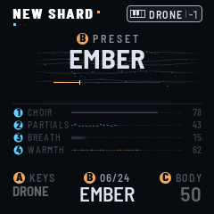

**The header.** On the play page: the scene's name, as large as it fits (a long one smaller: its sixteen characters
always fit), an amber dot while the sound differs from the scene's, then the key (D MINOR), once you set a scale or a
chord and if there is room. Elsewhere, the page's name; SCENES adds CHANGED, in lamp, while the sound differs. FRASIL's
name stays on the logo screen. Under the title, a dot for each page of its button (those GLINT's SEQ hides not counted),
the one on screen ice; HOME's three are SOUND, MIXER and the logo.

At the right, the keys' badge: a small keyboard, what the keys do and the octave, in the mode's colour: DRONE white,
BASS orange, and for GLINT, in ice blue, what its keys do: GLINT (SEQ OFF: each key its glint), ARP (they feed the
arpeggio), SEQ (they transpose the sequence), or REC, in orange, while they write into it; for BASS with its sequence
on, SEQ or REC too, in orange. Its frame is solid while the notes latch, dotted while they sound only as long as their
key is held: for DRONE and BASS, GLOBAL's KEY MODE (LATCH or HOLD; dotted while the bass's sequence is on); for GLINT,
the arpeggio (SEQ on ARP and latched, or not). Beside it: FREEZE while the cloud is held (a flake of ice beside a long
name), an amber dot while the processor lightens the sound, and on GLOBAL the processor's load. When it is full, the
least important items step aside.

For a moment the header gives way to a message (STORED 09 ABYSS, FILTER > LFO 2); to PLAY held (RELEASE ALL or
RESTORE, a line of progress under it); on the play page and SCENES, to a scene's MORPH (an arrow, the scene's name, a
line for how far it has come; elsewhere, only the line, under the page's name); and, while EDIT is held, to COMPARE ·
AS SAVED.

**Pop-ups and questions.** A warning takes the whole screen until you press **SEL**: something did not happen, or
wants your hand (STOP FIRST, NOT RESTORED, NOT STORED, MIDI LEARN: TURN ONE FIRST), or what a restore from USB did
(RESTORED). Its one button, OK, is SEL, the only light left on. SEL only closes it: you are back where you were, the
lights too. Meanwhile the keys and MIDI play; the other buttons and the encoders wait. Everywhere a question is
asked, **SEL** is yes (OK, store, restore) and **FX** is no (cancel), and only the buttons that answer are lit.

**The mixer.** Press HOME on the play page: a fader for each track, DRONE, BASS, GLINT, and CLOUD, the reverb's
return, each in its colour, with the track's meter beside it, live. K1–K4 move them. 100 is the level as it is (a mark
on the track), up to 127. The faders are the tracks' levels in the mix, after their own sound: DRONE and GLINT take what
they send into the cloud down with them. HOME again opens the logo screen.

**The logo screen.** HOME's third screen: the logo, alive, the version at the top right, the sky over two thirds of
the screen. Over the waterline, granules of frasil drift like stars: they follow what plays (faster with MOTION),
pressure warms them, GLINT notes sparkle among them. Under it, the water: night blue, slow swells of light passing
through it, the sky's light on it in short strokes that come and go, and the letters in it, deep blue, swaying. FREEZE
stills it all. PLAY and the octave buttons leave it open, so you can play from it. HOME again goes back to the
play page.

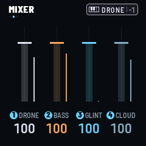

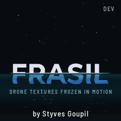

**Help.** Hold HOME: the help screen opens and stays, on the page with the button of the page you were on. Turn
SELECT for its five pages: the buttons in the panel's order (three pages), the encoders, the keys. Each line gives a
control's job, then the control, and under it, in amber, what it does again, held, or with something else. Tap HOME
to close it and go back where you were.

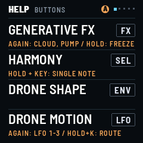

---

## 4. Playing drones

| Gesture | What happens |
| --- | --- |
| **Tap a key** | lights the note, or a chord (see Harmony). It rises over ATTACK and stays |
| **Tap a lit key** | it fades over RELEASE |
| **Hold a key and press** | the voice swells and opens (PRESSURE sets how much). Let go: it stays lit |
| **Hold ENV** | SWELL: after 0.4 s, every drone voice swells together (1.5 s up, 1.5 s down once let go); ENV is lit while it lasts |
| **SWELL** (FX, GENERATIVE FX's K1) | held where you leave it: every voice swells as far as it is turned (with ENV's and CC 11's, the most of them) |
| **Turn SELECT** | KEYS, what the keys play: DRONE, GLINT, BASS (it stops at each end). They stay until you come to a page from another section, which sets them too (below). On SCENES it picks the slot, as K1 does, and leaves KEYS as they are |
| **Hold a page button, turn SELECT** | that button's pages, one a detent, both ways, round (FX, SEL, ENV, LFO, EDIT, GLO, HOME, ARP, SEQ; not SAVE); from another section's page, the first detent sets KEYS as a tap would |
| **Turn PRESETS** | the drone's preset (CUSTOM, then the 24) |
| **Turn ALGORITHM** | BODY: at 100 % the drone as set; down, thinner (section 2) |
| **Hold SEL, tap a key** | a single note, even when CHORD makes chords: a note over a chord |
| **OCT− / OCT+** | octave −3 to +2. Both together: back to −1, where the keys run F2 to G4 |
| **Hold PLAY** | after 0.6 s, RELEASE ALL: the drones, the bass, the glints, the arpeggio and the sequences; the beat begins there (below). From 0.2 s the header says RELEASE ALL, a line counting down under it: let go then, before 0.6 s, and nothing happens |
| **Hold PLAY again** | with nothing playing: RESTORE, the scene again (RESTORED): what the last RELEASE ALL let go, else the scene's own notes as saved (at power-on, say): its latched drones, the arpeggio's notes, the bass; and every sequence that is on, from its first step; the beat begins there |
| **Tap PLAY** | the transport (sections 6 and 7): GLINT's sequence and the bass's stop together, or start together from their first steps, at once, the beat beginning there; the arpeggio waits, or goes on from the top. A stop leaves the beat going. With GLINT's SEQ and the bass's SEQUENCE OFF, it only says HOLD PLAY · RELEASE ALL |
| **REC** | into GLINT's sequencer, recording what you play (section 6); with the keys on BASS, into the bass's (section 7); again: RECORD OFF, the keys back to what they played before REC |
| **Hold FX** (or CLOUD's K4) | FREEZE: the cloud holds what is in it, without end and without darkening. Nothing more goes in: what you play next sounds dry over it. Off: it thaws, and fades over DECAY. The page stays; FX stays bright while it is on |

With GLOBAL › KEY MODE on HOLD, notes sound only while their key is held.

**The buttons.** A press shows, a hold acts. Every button does its job when you let it go, but OCT− and OCT+, which
act at once. Held 0.4 s (PLAY 0.6 s), it does its other thing instead. A button used with something else (SEL with a
key, SAVE with a key or REC, LFO with an encoder, GLO with a CC, a page button with SELECT) does nothing more when
you let it go.

**PLAY restarts the beat.** When PLAY starts the transport (a tap), and when it is held (RELEASE ALL, and again,
RESTORE), the grid starts again from its top at that moment, as a MIDI Start does: a beat and a bar begin there.
Everything on the grid starts with it: OCT's blink, REC's flash and the metronome, the LFOs on the grid (from the top of
their turn), PUMP, the arpeggio (from the top of its pattern), GLINT's sequence and the bass's (from their first steps,
at once) and PULSE's divisions. While a MIDI clock comes in, the beat is the clock's: PLAY leaves it where it is, and
the sequences start on its next step (MIDI Start resets it). A tap that stops the transport changes nothing. A scene
loaded with its notes (LOAD on SND+NOTES) starts the beat there too, as PLAY does (section 9).

**A page button and SELECT.** Hold a page button and turn SELECT: its pages, one a detent, in the order its taps go (the
pages GLINT's SEQ hides skipped), round; from another button's page, its first (turned back, its last). The page shows
at once; that first detent, come from another section, sets KEYS as a tap would (below), the next ones leave them. Let
go: nothing more, no next page, no hold. If the hold acted before SELECT moved (held past 0.4 s), the first detent
undoes it: FREEZE and the arpeggio's LATCH back as they were (its notes too, and GLINT's SEQ if LATCH on turned it to
ARP: its sequence and RECORD as they were), COMPARE and SWELL over. HOME is the exception: once its help is up, SELECT
turns the help's pages.

**KEYS follow the section.** When you come to a page from another section (another button's pages), the keys go
to its track, however you come (its button, a page button held and SELECT, HOME): ARP's pages put them on GLINT,
SEQ's (BASS to BASS SEQ II) on BASS, EDIT's, ENV's DRONE SHAPE and HOME's (the play page, MIXER, the logo) on DRONE.
The other sections leave them as they are: FX's, GLO's, SEL's HARMONY, LFO's (DRONE MOTION, the three LFOs and their
targets), SAVE's SCENES. Within a section they never change (ARP again for GLINT II, SELECT with ARP held, HOME to
MIXER and the logo): KEYS you set by hand with SELECT stay until you come from another section. SAVE back from SCENES
is a return: you come back as you left. When they change, the keys' badge at the top right shows it, with no words over the page's name. While a
recording has the keys (REC, or RECORD on STEP or LIVE), pages leave them alone: RECORD OFF gives them back. What
plays goes on: a latched drone or bass stays latched, and a key held down while the keys change ends as it began.

| Button | Tap | Hold | Held, with |
| --- | --- | --- | --- |
| **FX** | GENERATIVE FX; again: CLOUD, CLOUD II, CLOUD III, PUMP, PUMP II | FREEZE on or off | SELECT turned: its pages |
| **SEL** | HARMONY | | a key: a single note · SELECT: its page |
| **ENV** | DRONE SHAPE | SWELL, while held | SELECT: its page |
| **LFO** | DRONE MOTION; again: the three LFOs and their targets | | K1–K4 turned: that setting onto an LFO (section 8) · SELECT: its pages |
| **EDIT** | DRONE PARAMS; again: the layers' pages | COMPARE: the scene as saved, while held (section 9) | SELECT: its pages |
| **GLO** | GLOBAL; again: MIDI, MASTERING | | a CC from a controller: MIDI learn (section 10) · SELECT: its pages |
| **HOME** | the play page; again: MIXER, the logo | help, on the page with this page's button | SELECT: the play page, MIXER |
| **SAVE** | SCENES; again: back to the page you came from | | a white key: that scene · REC: STORE (section 9) |
| **ARP** | GLINT's pages | the arpeggio's LATCH (on: SEQ on ARP too) | SELECT: its pages |
| **SEQ** | BASS's pages | | SELECT: its pages |
| **PLAY** | start (the beat from there), stop the sequences (GLINT's, the bass's) or the arpeggio; on SCENES: load | RELEASE ALL; with nothing playing: RESTORE, the scene again (the beat from there) | |
| **REC** | record LIVE (GLINT's sequence; the bass's, the keys on BASS); again: RECORD OFF | the metronome on or off | |

---

## 5. Harmony

SEL opens HARMONY. You set a key once, then every key you tap plays something that belongs to it.

| K1 | K2 | K3 | K4 |
| --- | --- | --- | --- |
| ROOT: C to B | SCALE | CHORD | VOICING |

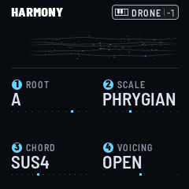

**Scales:** CHROMATIC, MAJOR, MINOR, DORIAN, PHRYGIAN, LYDIAN, MIXOLYDIAN, LOCRIAN, HARMONIC, MELODIC,
PENTA MAJ, PENTA MIN. A key outside the scale plays the scale's note just below it. The scale's keys glow faintly.

**Chords in the scale:** SINGLE, FIFTH, TRIAD, SEVENTH, SUS2, SUS4, ADD9, QUARTAL. Each key builds the chord from
the scale's own notes. In D MINOR with SEVENTH, D plays Dm7, E plays Em7♭5 and F plays Fmaj7.

**Fixed chords:** MAJ, MIN, MAJ7, MIN7, DOM7, AUG, DIM: the same shape on every key.

**Voicing**, for D MINOR with TRIAD:

- **CLOSE:** D3 F3 A3, tight, within an octave.
- **OPEN:** D3 A3 F4, the second note an octave up. More air.
- **WIDE:** D2 F3 A3, the root an octave down. A bass under the chord.

---

## 6. GLINT

Press **ARP** (come from another section, its pages put the keys on GLINT), or turn **SELECT** to GLINT: the keys
play GLINT (the badge turns blue, and says what they do: GLINT, ARP, SEQ, or REC in orange). On to BASS, or back to
DRONE, the same way. A key plays an icy FM bell in the scale, OCTAVE octaves up (two by default, from +0 to +3).
Pressing it makes it louder (up to +8 dB) and makes it ring longer.

**VIBRATO** (GLINT II, K4): once your finger has pressed in, wiggling it bends the glint's pitch, both ways around
its note, like a string player's finger. A steady press stays in tune. Up to 25 cents at 100; about 10 at its
default; OFF at 0.

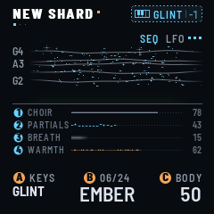

**Its pages:** tap **ARP**, then ARP again for the next page: GLINT I, GLINT II, GLINT ADSR and GLINT DELAY,
always the fourth. Then SEQ (GLINT I, K2) decides: GLINT ARP while it is on ARP, the sequencer's three pages while it
is on SEQ, neither on OFF (four pages). If the page on screen goes (SEQ turned, a scene loaded), you land on GLINT I.

| Page | K1 | K2 | K3 | K4 |
| --- | --- | --- | --- | --- |
| GLINT I | PRESET | SEQ (OFF, ARP, SEQ) | LEVEL | BRIGHT (FM index) |
| GLINT II | OCTAVE (+0 to +3: every glint) | RATIO (×0.5 to ×13.6) | PING (strike or ring) | VIBRATO (OFF, the wiggle's depth) |
| GLINT ADSR | ATTACK (2 ms to 1.5 s) | DECAY (80 ms to 6 s) | SUSTAIN (0 to 100 %, the level held) | RELEASE (20 ms to 6 s) |
| GLINT DELAY | TIME (1/32 to 1/2, triplet and dotted; then the same, PP) | FEEDBACK | MIX | SPACE (GLINT's reverb send) |
| GLINT ARP (SEQ on ARP) | MODE (UP, DOWN, UPDOWN, RANDOM, DRIFT) | RATE (1/1 to 1/32, triplets) | RANGE (1 to 3 octaves) | CHANCE |
| GLINT SEQ, II, III (SEQ on SEQ) | the sequencer's (below) | | | |

**SEQ** (GLINT I, K2) is how the keys play GLINT: OFF, each key its own glint; ARP, through the arpeggiator; SEQ,
through the sequencer (on its own pages, RECORD OFF, each key its own glint again: below).

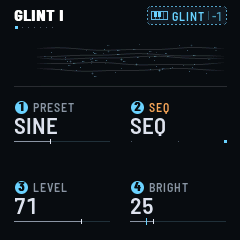

**Presets:** ICE, BELL, BLIP, GLASS, CHIME, DROP, FROST, CELESTA, SINE (the default), KALIMBA, MARIMBA, MUSIC BOX,
VIBES, HARP, PIPE, BOWED, and six leads: WARM LEAD, BRASS, SQUARE, SUB LEAD, STRINGS, REED. A preset sets GLINT's
sound, its RELEASE too (all but VIBRATO and the delay's TIME, FEEDBACK and MIX). Turn RATIO, BRIGHT and the rest from
there.

**The envelope** (GLINT ADSR, in its usual order): ATTACK, how long a glint takes to rise; DECAY, how long it then
takes to die away to silence, or, while its key is down, to SUSTAIN's level; SUSTAIN, the level it holds while the
key is down; RELEASE, how long it rings on once its key is let go (600 ms by default). Scenes and shards from
before RELEASE come with one that matches what their DECAY did then (DECAY's time up to 0.6 s, else half of it, 0.6 s
at least): they sound as they did.

**SUSTAIN** (GLINT ADSR, K3) turns a bell into a lead. At 0 a glint fades out over DECAY, even while you hold its key.
Turned up, it settles at that level for as long as the key is down, then rings out over RELEASE when you let go.
DECAY is then how long it takes to settle, and PING (GLINT II) the brightness at the start, as a filter's sweep would
be. The leads use it, with RATIO at ×1 (all the harmonics, as a saw has), ×2 (the odd ones, hollow, as a square) or
×0.5 (an octave under).

On GLINT ADSR the river gives way to the envelope: ATTACK up to the top, DECAY down to SUSTAIN's level, SUSTAIN's
plateau, RELEASE down to nothing, each part as wide as its knob is turned (the plateau takes what is left), its time
across it, A D S R under it. The part whose knob you turn is lit. Each glint sounding, up to four, is a little ice-blue
glint riding the curve: it waits at the end of the plateau while its key is held, then goes down RELEASE once let go.

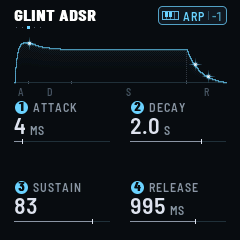

**OCTAVE** (GLINT II, K1) is GLINT's own: it moves every glint GLINT plays, a key's, a MIDI note's, the arpeggio's,
the sequence's. Turned, it moves the glints sounding at once, without striking them again. The arpeggio and the
sequence keep their notes without it, and play them with it.

**The arpeggiator** (SEQ on ARP) plays the held GLINT keys one at a time, at RATE, over RANGE octaves. CHANCE
decides whether each step plays. It follows MIDI clock when one comes in, and TEMPO (GLOBAL, K1) otherwise. It stays
on the grid: a new chord, an added or a lifted note takes effect on the next RATE step, and the pattern starts again
from its first note. MIDI Start resets the grid.

**Latch:** hold **ARP**. With LATCH on (the default), the arpeggio keeps playing after you lift your hands, even back
on the drones. A new hand replaces the chord. Hold ARP again to turn it off. Turned on, LATCH puts SEQ (GLINT I, K2)
on ARP too if it was OFF or on SEQ, as turning it there would (a sequence playing stops; the header says ARP LATCH · ON,
SEQ ON ARP); turned off, it leaves SEQ as it is. Tap **PLAY** and the arpeggio waits, its
notes kept (ARPEGGIO · WAITING); tap it again and it goes on from the top, the beat beginning there. Hold PLAY to let
it go with everything else.

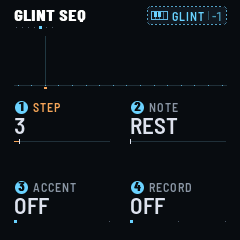

**The sequencer:** set SEQ (GLINT I, K2) to **SEQ**, or tap REC (below). In place of the arpeggio, a 32-step sequence
plays GLINT, on the same grid: RATE, MIDI clock or TEMPO, CHANCE for each step (the arpeggiator's RATE and CHANCE, on
GLINT SEQ II too). It plays on without end while the sequencer is on. **PLAY** stops it, and starts it again from its
first step, at once, the beat beginning there. MIDI Start starts it from the top too.

| Page | K1 | K2 | K3 | K4 |
| --- | --- | --- | --- | --- |
| GLINT SEQ | STEP (1 to 32) | NOTE (REST, a note, TIE) | ACCENT (OFF, ON) | RECORD (OFF, STEP, LIVE) |
| GLINT SEQ II | SEQ LENGTH (1 to 32 steps) | RATE (the arpeggiator's) | GATE (a note's length) | CHANCE (the arpeggiator's) |
| GLINT SEQ III | TRANSPOSE (−14 to +14 steps of the scale) | CLEAR (turn twice) | NEW TAKE (turn twice) | UNDO TAKE (turn twice) |

**REC** takes you straight in: the sequencer on, the keys on GLINT, RECORD on LIVE, GLINT SEQ on screen, the sequence
started if it was stopped. Play, and what you play goes in. REC again, on LIVE or STEP: RECORD OFF, and the page
stays. REC keeps the sequence as it was before the take, for UNDO TAKE.

While RECORD is on, STEP or LIVE (however you turned it on: REC, K4, NEW TAKE), the keys play GLINT; RECORD OFF gives
them back to what they played before (RECORD OFF · DRONE).

**The metronome** ticks while RECORD is on LIVE, counting the sequence's own beats from its first step: a tick each
beat, the higher one as the sequence comes round to its first step. A sequence that is not a whole number of beats
long starts its beats again from its first step each time round (SEQ LENGTH 5 at 1/16, a beat and a quarter: the
high tick, a tick a beat later, the high one again a quarter beat after). REC flashes on the same beats, twice as
quick as OCT. On STEP the metronome is silent and REC stays lit. Hold REC to turn the metronome off, or on again; it
is kept with the settings.

- **RECORD on STEP:** a GLINT key (or a note on GLINT's MIDI channel) writes its note on STEP, then STEP moves on to
  the next, round SEQ LENGTH. A hard strike writes an accent. K2 and K3 change the step on STEP: its NOTE (as it
  sounds, OCTAVE on it; REST all the way down, TIE all the way up, the last note held on through it) and its ACCENT.
- **RECORD on LIVE:** play while it runs. Each note sounds and goes into the step nearest the playhead.
- **RECORD OFF, on GLINT SEQ's pages** (SEQ, II, III): the keys play GLINT as with SEQ OFF, each key its own glint,
  to try a line before you record it. The sequence goes on as it was, TRANSPOSE and the steps untouched; the badge
  says GLINT.
- **RECORD OFF, on any other page:** the keys transpose the sequence. A key moves it from its first note to that
  key's, along the scale, so it stays in the key. TRANSPOSE shows how far, and turns it back. Playing, the sequence
  also starts again from its first step, on the nearest beat of the grid (MIDI clock or TEMPO): a key in the first half
  of a beat, from the beat just gone, transposed at once (it catches up: the step it would be on now sounds now); in
  the second half, it goes on as it was until the next beat, then starts from its first step there, transposed from
  then. Stopped, a key only transposes it: nothing starts. A sequence with no note in the steps it plays has nothing
  to transpose: the keys play GLINT as with SEQ OFF, each key its own glint, and the badge says GLINT.
- **GATE** is how long each note sounds, from a twentieth of its step to all of it. A TIE holds a note on, legato;
  with SUSTAIN up, GLINT's leads then sing through.
- **CLEAR:** turn it once (AGAIN), then once more: every step a rest.
- **NEW TAKE:** turned twice the same way: every step a rest, RECORD on LIVE, the sequence started if it was stopped
  (NEW TAKE · RECORDING). Play it in again from nothing.
- **UNDO TAKE:** turned twice: the sequence as it was before the last take (REC, NEW TAKE) or CLEAR. Again: back to the
  one after.

The screen draws the sequence as a constellation: a star a step, as high as its note, larger with an accent; a line
for a tie, a dot for a rest. The step playing is white, with a line of light through it; the step on STEP has an
amber mark under it. While RECORD is on, the strip is ruled, faintly: a line each whole tone, so a note sits on a line
or between two (fewer lines when the notes span more than the strip has room for, the Cs a touch brighter), and a
column each step. The column being recorded into is lit in ice: on STEP, the one the next key writes; on LIVE, the one
playing. RECORD OFF, the rules go. The keys light the note playing. Each scene keeps its own sequence.

, then ARP five times")

**The delay** is GLINT's alone. TIME runs from 1/32 to 1/2, with triplets and dotted values, first mono, then the
same twelve again ping-pong (PP); 1/8D PP by default. Its time follows MIDI clock, or TEMPO. Its echoes go into the
cloud with GLINT: SPACE, on the same page, is how much.

---

## 7. BASS

Press **SEQ** (come from another section, its pages put the keys on BASS), or turn **SELECT** all the way, to BASS:
the keys play BASS (the badge turns orange). One note at a time, deep and
steady: one of eight MODELs, DRIVE into a soft clip, through a resonant low-pass. None of it goes into the reverb.

**Models:** SINE (pure), TRIANGLE (soft, a little hollow), SQUARE (hollow, woody), SAW (bright, buzzing), REESE (two
saws ten cents apart, beating slowly), SUB (the sine and its octave below), ORGAN (three drawbars: the note, its
octave and its twelfth), FM (a sine modulating itself: round, growling). Turning MODEL while the bass sounds crosses
over in a few milliseconds, without a click.

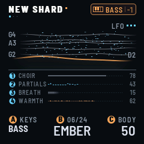

| Gesture | What happens |
| --- | --- |
| **Tap a key** | the bass holds that note: the key's note in the scale, OCTAVE octaves down. It rises over ATTACK, then settles over DECAY to SUSTAIN |
| **Tap another key** | the bass glides to its note (GLIDE), without a gap: it rises to the top again from where it is (with SUSTAIN at 100 %, it simply goes on); with PULSE on, PULSE strikes it on its next division (below) |
| **Tap the bass's key** | it lets go, over RELEASE |
| **Hold its key and press** | louder, and its filter opens. Let go: it stays |

With GLOBAL › KEY MODE on HOLD, the bass sounds while its key is down. Holding PLAY lets it go with everything else. It
stays when you switch the keys back to drones or GLINT: SEQ, or SELECT to BASS again, comes back to it.

**Its pages:** tap **SEQ**, then SEQ again for the next: BASS, BASS II, BASS ADSR, then its sequencer's two, BASS SEQ
and BASS SEQ II.

| Page | K1 | K2 | K3 | K4 |
| --- | --- | --- | --- | --- |
| BASS | MODEL (SINE, TRIANGLE, SQUARE, SAW, REESE, SUB, ORGAN, FM) | DRIVE (clean to soft-clipped) | FILTER (40 Hz to 5 kHz) | RESONANCE (Q 0.5 to 6) |
| BASS II | LEVEL | OCTAVE (−2, −1, 0: every note the bass plays) | GLIDE (OFF to 2 s) | PULSE (OFF, 1/8 BEAT to 4 BEATS) |
| BASS ADSR | ATTACK (5 ms to 5 s) | DECAY (10 ms to 10 s) | SUSTAIN (0 to 100 %) | RELEASE (30 ms to 15 s) |
| BASS SEQ | STEP (1 to 16) | NOTE (CUT, a note, HOLD) | STEP LENGTH (1/16 to 16 BARS) | RECORD (OFF, STEP, LIVE) |
| BASS SEQ II | SEQ STEPS (1 to 16) | SEQUENCE (OFF, ON) | CLEAR (turn twice) | TRANSPOSE (−14 to +14 steps of the scale) |

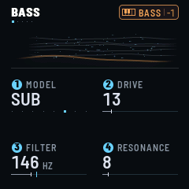

**The envelope** (BASS ADSR, in its usual order): ATTACK, how long a note takes to rise to the top; DECAY, how long
it then takes, while the note is held, to come down to SUSTAIN's level; SUSTAIN, the level it holds while the note is
held; RELEASE, how long it fades once let go. Each note played rises from where the bass is, over ATTACK, then decays
again. At SUSTAIN 100 %, as it starts, DECAY does nothing: there is nothing to come down to, and the bass holds, as it
always has. Lower SUSTAIN to hear DECAY; at 0 % a held note fades to silence over DECAY.

On BASS ADSR the river gives way to the envelope: ATTACK up to the top, DECAY down to SUSTAIN's level, SUSTAIN's
plateau, RELEASE down to nothing, each part as wide as its knob is turned (the plateau takes what is left), its time
across it, A D S R under it. The part whose knob you turn is lit. The bass's note is a little glint of lamp light
riding the curve: it waits at the end of the plateau while the note is held, then goes down RELEASE once let go.

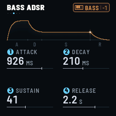

**PULSE** (BASS II, K4) makes the held note pulse on the grid (MIDI clock, else TEMPO, from the beat): OFF, 1/8 BEAT,
1/4 BEAT, 1/2 BEAT, 1 BEAT, 2 BEATS or 4 BEATS. On each, the note is let go for a moment and played again: it fades
over RELEASE through a short gap, then rises over ATTACK and settles over DECAY to SUSTAIN once more, the same note at
the same velocity, without gliding; pressing into it carries on. The gap is a quarter of the division, 8 ms at least
and 60 ms at most: at 120 BPM, 16 ms on 1/8 BEAT, 31 ms on 1/4 BEAT, 60 ms from 1/2 BEAT on. A short RELEASE and a low
SUSTAIN make a hard, gated pulse; a long RELEASE, a gentle swell on each beat. It pulses whatever plays the bass: a
key, a latched note, MIDI or the sequencer, inside its NOTEs only: never in a CUT, and a step that begins with a NOTE
is that division's attack itself.

PULSE keeps the beat. While the bass sounds, a note changed by hand (a key, a MIDI note) is not struck off the grid:
the bass goes to it (gliding, as GLIDE says) and PULSE strikes it on its next division. From silence, a key strikes
at once.

**OCTAVE** (BASS II, K2) is the bass's own: it moves every note the bass plays, a key's, a MIDI note's, the
sequence's (C1 the lowest). Turned, it moves the note sounding at once, gliding as GLIDE says.

A pure sine this low barely reaches the FM-1's small speaker: DRIVE, or a richer MODEL, gives it the harmonics that
let you hear it there. In headphones or a mixer, SINE with DRIVE at 0 is a clean sub.

**The sequencer:** turn SEQUENCE (BASS SEQ II, K2) ON, or tap REC with the keys on BASS (below). Sixteen steps play
the bass one after the other, on GLINT's grid: MIDI clock when one comes in, else TEMPO. Each step is a **NOTE**, a
**CUT** or a **HOLD**, and has its own **STEP LENGTH**: 1/16, 1/8, 1/4 (a beat), 1/4D (a beat and a half), 1/2, 1/2D, 1
BAR, 1.5 BARS, 2 BARS, 3 BARS, 4 BARS, 8 BARS or 16 BARS. As a step begins, a NOTE plays its note (gliding from the
last, as GLIDE says), a CUT stops the bass (it fades over RELEASE), a HOLD changes nothing: a note lasts until the next
NOTE or CUT. **SEQ STEPS** (BASS SEQ II, K1) is how many of the sixteen play; a turn lasts as long as their lengths
together.

The steps keep their notes as the keys play them, without OCTAVE (BASS II): turning OCTAVE moves the whole sequence.
Two NOTEs of the same pitch in a row are one note held on (with SUSTAIN under 100 %, the second rises to the top
again): a CUT between them makes two.

**PLAY** is both sequencers' transport: it stops GLINT's sequence and the bass's together, and starts them again
together from their first steps, at once, the beat beginning there (following a MIDI clock: on GLINT's next step,
else the next sixteenth, the clock's beats kept). Turned on, the sequence starts on GLINT's next step (else the next
sixteenth); MIDI Start starts it from its first step. Hold PLAY: RELEASE ALL stops it with everything else; hold it
again, RESTORE starts it again from its first step. Both start the beat there too.

- **RECORD OFF:** the keys transpose the sequence. A key moves it from its first NOTE to that key's, along the scale.
  TRANSPOSE (BASS SEQ II, K4) shows how far, and turns it back. The keys sound nothing themselves. A sequence with no
  NOTE in its SEQ STEPS has nothing to transpose: the keys play the bass, as with SEQUENCE OFF, and its CUTs leave it
  sounding.
- **RECORD on STEP:** the keys turn to BASS at once (RECORD OFF gives them back). A key (or a note on BASS's MIDI
  channel) writes its note on STEP, with the STEP LENGTH you set last, then STEP moves on, round SEQ STEPS; it sounds
  while the key is down. So a run of notes all take the same length, until you turn STEP LENGTH again. While RECORD is
  on STEP, STEP LENGTH (K3) shows the length the next key will write, which starts as the length of the step STEP was
  on: turned, it sets that step at once, and the steps after it. K2 changes the step on STEP's note alone (as the bass
  plays it, OCTAVE on it; CUT all the way down, HOLD all the way up). With RECORD OFF, K3 is the step on STEP's own
  length again.
- **RECORD on LIVE:** play while it runs: a take. Each note sounds as you play it and goes in as you played it, its
  start and its length to the nearest sixteenth (a sixteenth at least), whatever the steps were: the sequence is
  written again around it, each stretch in as few steps as the STEP LENGTHs make it, the longest first (a note 5/16
  long, a NOTE of 1/4 and a HOLD of 1/16; a 1/2, one NOTE). A key pressed while another is down ends that one where it
  begins (legato); let go, the one still down takes over. While a key is down the sequence's own steps under it are
  silent, the bass playing one note at a time: what you hear is what the loop will hold.
- **LIVE, over a sequence:** the take records within its loop, round and round, and the loop keeps its length (SEQ
  STEPS follows the steps it takes). A note replaces the time it covers and nothing else. A note it cuts short does not
  sound on after it from its middle: a CUT, up to that note's next NOTE or CUT.
- **LIVE, on an empty sequence** (no NOTE in the steps it plays): the take makes the loop. It starts at the bar of the
  first note you play (bars counted from the sequence's first step, as the metronome counts them; a note played just
  before a bar line belongs to the next bar), a CUT before the note in its bar. The loop grows a bar at a time as it
  reaches its end, and the metronome's higher tick marks each bar line. REC again (or RECORD off, or PLAY) ends the
  take: the loop runs to the bar line nearest the moment you stopped (a little late or a little early, the same bar),
  never before the start of the last note, with a CUT to its end, and SEQ STEPS is set. A note still down then holds
  on to that line.
- **LIVE, sixteen steps at most:** a note that needs more goes in legato if that makes it fit: the silence after it
  held by it, else the one before it held by the note before, else both (BASS SEQ FULL · JOINED LEGATO). If it still
  does not fit, it is not recorded (BASS SEQ FULL · NOT RECORDED): the notes already in stay, and later ones still go
  in where they fit. A take on an empty sequence with no room for another bar ends its loop there (BASS SEQ FULL · LOOP
  CLOSED) and goes on round it, as over a sequence.
- **CLEAR:** turn it once (AGAIN), then once more: every step a CUT, a sixteenth long. Recording LIVE, the next note
  starts a new take, as on an empty sequence.

**REC**, with the keys on BASS, takes you straight in: SEQUENCE on, RECORD on LIVE, BASS SEQ on screen, the sequence
started if it was stopped. REC again, on LIVE or STEP: RECORD OFF, and the page stays. As with GLINT's, while RECORD
is on the keys play BASS; on LIVE the metronome counts the bass sequence's own beats from its first step, the higher
tick as it comes round to it (a sequence that is not a whole number of beats long, its beats again from the top each
time round; a take on an empty sequence, on each bar line too), and REC flashes on them; on STEP the metronome is
silent and REC stays lit.

The screen draws the sequence as a line of time: each step as wide as it is long; a NOTE a line at its note's height,
on through its HOLDs, the water under it down to the bed, as the bass's in the river; a CUT, nothing. The note
playing is bright, the playhead a line of lamp light going along; the step on STEP has a lamp line under it, and a
lamp light in the corner says RECORD is on LIVE. While RECORD is on, the strip is ruled, faintly: a line each whole
tone (fewer when the notes span more), a column each step, as wide as it is long; the column being recorded into is
lit in lamp: on STEP, the one the next key writes, on LIVE, the one playing. On LIVE, the note you hold is drawn
bright as you hold it, from where you pressed it to the playhead; let go, it is written in. With SEQUENCE OFF, it is
all slate. The keys light the note playing.

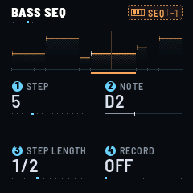

Each scene keeps its own bass sequence: its notes, their lengths, and its SEQUENCE, SEQ STEPS and TRANSPOSE, as
GLINT's sequence its SEQ setting, SEQ LENGTH and TRANSPOSE: a scene loaded plays its own, or none, from its first
step. While SEQUENCE is on, notes on BASS's MIDI channel go into the sequencer as the keys do.

---

## 8. The pages

Press a page's button again for its next page (EDIT ×7, LFO ×7: DRONE MOTION and the three LFOs, ARP ×4 to ×7 as
GLINT's SEQ has them, SEQ ×5, FX ×6, GLO ×3: GLOBAL, MIDI, MASTERING;
HOME: SOUND, MIXER, the logo). A button opens its page when you let it go, because holding it may do something else
(section 4, the buttons). The dots under the page's name say where you are among them.

| Button | Page | K1 | K2 | K3 | K4 |
| --- | --- | --- | --- | --- | --- |
| HOME | SOUND | CHOIR | PARTIALS | BREATH | WARMTH (soft saturation) |
| HOME | MIXER | DRONE | BASS | GLINT | CLOUD (each 0 to 127, 100 as it is) |
| EDIT | DRONE PARAMS | TIMBRE (all three layers' brightness) | SPACE (the reverb's share) | MOTION (the drift's depth) | BODY (100 %: as set; down: thinner) |
| EDIT | CHOIR | CHOIR (level) | DETUNE (0 to 40 cents) | FILTER (follows the note) | WARMTH |
| EDIT | CHOIR II | SHAPE (SAW, SQUARE in the middle, then narrower pulses) | INTERVAL (the centre saw: UNISON, −12, +7, +12) | RESONANCE (the filter's peak, Q 0.5 to 20) | TYPE (LOW, BAND, HIGH) |
| EDIT | PARTIALS | PARTIALS (level) | TILT (bright to dark) | ODD (odd harmonics) | STRETCH (toward a bell) |
| EDIT | PARTIALS II | EVOLVE (their levels wander, deeper and quicker) | BEAT (each one pulses at its own pace) | FORMANT (its place, H1 to H8) | PEAK (up to that harmonic alone) |
| EDIT | BREATH | BREATH (level) | RESONANCE (air to glass) | COLOR (harmonic, odd, bell) | SPREAD (the voices' width) |
| EDIT | BREATH II | GRAIN (a hiss to sparse grains) | PITCH (the resonators: −12, UNISON, +12, +19, +24) | TONE (the noise darker or brighter) | AIR (the noise itself, beside them) |
| ENV | DRONE SHAPE | ATTACK (5 ms to 30 s) | RELEASE (50 ms to 60 s) | PRESSURE (its effect) | VELOCITY |
| LFO | DRONE MOTION | MOTION (the drift's depth) | RATE (20 s to 0.5 s) | TIDE (a swell of the timbre) | PERIOD (5 min to 10 s) |
| LFO | LFO 1, LFO 2, LFO 3 | SHAPE (SINE, TRIANGLE, SAW, RAMP, SQUARE, RANDOM, DRIFT) | RATE (200 s to 10 Hz, then 16 BARS to 1/16) | DEPTH (0: off) | POLARITY (BIPOLAR, UP, DOWN) |
| LFO | LFO 1, 2, 3 TARGETS | TARGET 1 | TARGET 2 | TARGET 3 | TARGET 4 (each OFF or a setting) |
| SEL | HARMONY | ROOT | SCALE | CHORD | VOICING |
| FX | GENERATIVE FX | SWELL (every voice swelled, held) | SPARKLE (glints by themselves) | BLUR (the drone into the cloud) | SINK (a low-pass on everything) |
| FX | CLOUD | SIZE | DECAY (0.4 s to 60 s) | TONE (how long the highs last) | FREEZE (OFF, ON) |
| FX | CLOUD II | DIFFUSION | MODULATION | PRE-DELAY (0 to 200 ms) | WIDTH (the tail's stereo width) |
| FX | CLOUD III | SHIMMER | INTERVAL (+12, +7, +5, +19, −12) | BRIGHT (the shimmer's brightness, 700 Hz to 8 kHz) | |
| FX | PUMP | RATE (OFF, 4 BARS, 2 BARS, 1 BAR, 1/2, 1/4, 1/8) | DRONE (its depth) | BASS | GLINT |
| FX | PUMP II | RELEASE (10 to 100 % of the period) | ATTACK (1 to 300 ms) | OFFSET (0 to 100 % of the period) | |
| GLO | GLOBAL | TEMPO (30 to 240 BPM) | LOW CUT (20 to 500 Hz) | TUNE (±50 cents) | KEY MODE (LATCH, HOLD: two detents) |
| GLO | MIDI | DRONE CH | GLINT CH | BASS CH (each OFF, 1 to 16, OMNI) | |
| GLO | MASTERING | THRESHOLD (−40 to 0 dB) | RATIO (OFF, 1.5:1 to 20:1) | RELEASE (30 ms to 1.5 s) | GAIN (0 to +18 dB) |
| SAVE | SCENES | the slot, 1 to 16, or NEW SHARD above | MORPH (CUT, 1 S to 2:00) | LOAD (SND+NOTES, SND ONLY) | |

GLINT's pages are under ARP (section 6: its sound, its delay, the arpeggiator or the sequencer), BASS's five under
SEQ (section 7: its sound and its sequencer).

**GLOBAL** (GLO): TEMPO, the grid's when no MIDI clock comes in (the arpeggiator, the sequencers, GLINT's delay, PUMP,
the LFOs on the grid), each scene its own (section 9); LOW CUT; TUNE; KEY MODE. KEY MODE lets every note go, so it
changes only on a second detent the same way within 2 seconds: the first says KEY MODE · TURN AGAIN.

**GENERATIVE FX** is FX's first page, to perform with, on the whole sound:

- **SWELL** swells every drone voice as far as it is turned, and holds it there (with ENV's and CC 11's, the most of
  them). It is not kept: FRASIL starts with it at 0.
- **SPARKLE** plays glints by themselves, now and then, on the notes the drones hold: GLINT's OCTAVE up, one in three
  an octave more, soft and short, in GLINT's sound. From a few a minute to about six a second. No drone, no sparkle.
- **BLUR** dissolves the drone into the cloud: wetter (SPACE toward 90 %), a longer DECAY, more DIFFUSION and
  MODULATION, the glints further in too. The settings themselves stay where they are.
- **SINK** takes everything under: a low-pass on the whole mix, from 12 kHz down to about 120 Hz (some 2.4 kHz at
  25, 800 Hz at 50), with a small resonance as it goes down.

A scene keeps SPARKLE, BLUR and SINK. An LFO can move them.

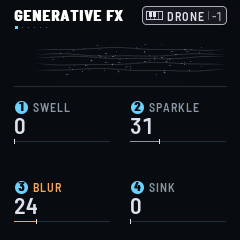

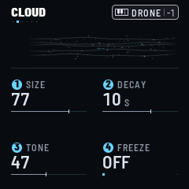

**PUMP** (FX, fifth page) ducks the tracks on the beat, as a sidechain from a kick would, without a kick: at RATE,
on the arpeggiator's grid (MIDI clock, else TEMPO), each track dips and comes back up. DRONE, BASS and GLINT set how
deep each one goes; the cloud pumps with the drones. The river breathes with it. PUMP II shapes it: RELEASE, how much
of the period it takes to come back (short: a tight pump; all of it: a slow breath); ATTACK, how fast it goes down
(1 ms: a kick's; 300 ms: a soft wave); OFFSET, where in the period it goes down (50 %: on the off-beat).

**MASTERING** (GLO, third page) is a compressor on the whole output, before the soft limit: THRESHOLD, RATIO (OFF by
default), RELEASE (its attack is 10 ms) and GAIN, the make-up. The page shows the gain reduction, live.

**The layers' second pages.**

- **CHOIR II.** SHAPE takes each saw toward a square, reached in the middle: hollow, woody, the even harmonics
  gone. Past it, the pulse narrows: brighter, nasal. Its width sways on its own, as an old synthesizer's pulse width
  modulation does, more so toward the narrow end. It stays as loud all the way. INTERVAL moves the centre saw an
  octave down, a fifth up or an octave up, under or over its two detuned neighbours. RESONANCE gives the filter a
  peak, a soft vowel by the middle, a whistle at the top. TYPE is the filter: LOW (the low-pass, as on the first
  page), BAND (a band-pass: nasal, vocal) or HIGH (a high-pass: thin, airy). FILTER sets where it sits either way.
- **PARTIALS II.** EVOLVE makes the partials' levels wander much further, and up to four times quicker, than
  MOTION alone does: partials come and go, and the spectrum changes colour by itself. At 0 they wander as MOTION has
  them. BEAT makes each partial pulse at its own pace, slow and shallow at first, quick and deep at the top (about
  7 Hz): a shimmering, beating texture, as loud as before. FORMANT and PEAK lift the partials around one harmonic, as
  a vowel does. The higher PEAK, the narrower, and the more the rest go down: at the top only that harmonic sounds,
  as in overtone singing. Sweep FORMANT with PEAK up. At 0, PEAK leaves the spectrum as TILT and ODD make it.
- **BREATH II.** GRAIN turns the hiss into grains, sparser as you turn it up: the resonators then ring like ice
  ticking, or rain on glass, more so with RESONANCE high. PITCH moves the resonators an octave down or up, a twelfth
  or two octaves up: an airy halo over the drone. TONE makes the noise darker (turned left) or brighter (right)
  before it reaches them. AIR adds the noise itself, beside the resonators: breath, or with GRAIN, crackle.

They all start where the sound was before them. SHAPE, RESONANCE, TYPE, BEAT and AIR take more of the processor.
With many voices and several of them up, FRASIL thins out the partials, then the voices, to keep the sound going.

**LFO 1, LFO 2 and LFO 3** move the sound on their own. Tap LFO again after DRONE MOTION: LFO 1, its targets, LFO 2,
its targets, LFO 3, its targets.

- **SHAPE:** SINE, TRIANGLE, SAW (up), RAMP (down), SQUARE, RANDOM (a new value each turn, held) or DRIFT (a new
  value each turn, glided to).
- **RATE:** one knob, free first: from a 200-second turn to 10 Hz. Past the fastest it is on the grid: 16 BARS to
  1/16, with triplets, following MIDI clock when one comes in, else TEMPO (GLOBAL, K1). MIDI Start puts those back to
  the top of their turn.
- **DEPTH:** 0 is off. Up, it reaches the whole range of each target.
- **POLARITY:** BIPOLAR moves a setting both ways around where you set it, UP only above, DOWN only below.
- **TARGET 1–4:** each OFF or a setting: TIMBRE, SPACE, MOTION, WARMTH, CHOIR, PARTIALS, BREATH, DETUNE, FILTER,
  SHAPE, CH RESO (CHOIR's), TILT, ODD, STRETCH, EVOLVE, BEAT, FORMANT, PEAK, BR RESO and BR TONE (BREATH's), COLOR,
  GRAIN, AIR, SPREAD, GL LEVEL, GL BRIGHT, GL PING, GL SPACE (GLINT's), BS FILTER, BS RESO, BS DRIVE (BASS's: they
  glide, so a FILTER swept by an LFO is a smooth wobble), DRONE LVL, GLINT LVL and BASS LVL (the MIXER's), BODY,
  GL CHANCE (the arpeggiator's and the sequencer's CHANCE), SEQ LEN (GLINT's SEQ LENGTH), SPARKLE, BLUR, SINK.
  Each is written in its track's colour, as the keys' badge has them: GLINT's ice blue (the GL ones, GLINT LVL, SEQ
  LEN, SPARKLE), BASS's orange (the BS ones, BASS LVL), the drone's and the whole mix's white.

An LFO runs freely and without end while it is on, with DEPTH up and a target set; a key does not start or restart
it. Its four targets move together, by the same amount, and LFOs on one setting add up. The setting keeps the
value you gave it, and that is what a scene saves, with the LFOs; the LFO moves the sound around it. On every page,
a setting's gauge shows a small ice-blue mark where the LFO has it now. On an LFO's pages the river gives way to
its shape and a glint where it is, grey while it is off. GL BRIGHT and GL PING are set at each strike: an LFO on
them changes the next notes. The engine glides between the LFO's steps, so a SQUARE or a RANDOM steps softly.

**LFO held and an encoder.** On any page, hold LFO and turn K1, K2, K3 or K4: the setting under that encoder goes
onto LFO 1, then LFO 2, LFO 3, then none (turned back, the other way), into that LFO's first free TARGET. An LFO's
DEPTH at 0 comes up to 25 %. The header says where it went: FILTER > LFO 2, FILTER > NO LFO, LFO 2 FULL (its four
TARGETs taken), or NOT AN LFO TARGET. Let LFO go without turning anything and it opens its pages, as ever.

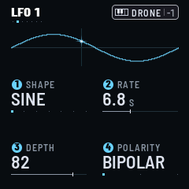

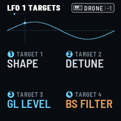

---

## 9. Scenes

Press **SAVE** for SCENES; SAVE again goes back to the page you came from. The page lists five lines around the one
K1 picks (framed in ice; SELECT scrolls it the same way, both ways, and leaves KEYS as they are; a page button held
with it still turns that button's pages): NEW SHARD first, then the sixteen slots, each its number, its name and what it holds (what
it plays, FACTORY, EMPTY; a long name takes its room), NOW by the one loaded. Under them, in a box of their own, the
page's two actions: PLAY LOAD, SAVE + REC STORE. K2 and K3 are MORPH and LOAD.

- **NEW SHARD**, above slot 01 (turn K1 below slot 1): not a slot, a sound to start a new shard from, fresh. Its line
  has a plus for a number and says START FRESH; K1 on it, it is framed in lamp, and the box says PLAY LOAD alone:
  nothing is stored into it. PLAY loads it as any scene (MORPH, LOAD); it is then the current scene: the play page's
  header says NEW SHARD, SAVE lights while the sound differs from it, COMPARE plays it. It plays nothing: tap a key.
  A new FM-1, with nothing stored yet, starts on it.

- **Load:** on SCENES, **PLAY** loads the slot K1 points at. On any page, hold **SAVE** and press a white key: the 16
  white keys are the 16 scenes, F2's key the first. That key sounds nothing, and the page stays. While SAVE is held,
  the white keys light: the current scene's bright, the slots that hold a scene faintly. MIDI Program Change loads
  them too (section 10). Every load comes in as MORPH and LOAD say.
- **Store:** hold **SAVE** and press **REC**: the sound goes into the slot K1 points at on SCENES, into the current
  scene anywhere else, with the latched drones (up to 8 chords), GLINT's arpeggio notes and its sequence, the bass's
  note and its sequence, and TEMPO. Into a free slot (8 to 16) with a drone preset on, the scene takes the preset's
  name; else it is SCENE and its number. With K1 on NEW SHARD, nothing is stored (the header: STORE · CHOOSE A SLOT). NEW SHARD loaded,
  STORE from another page goes into the first EMPTY slot (8 to 16; a factory scene stays), then NAME IT; with none
  empty, SCENES opens on slot 16 to choose one (CHOOSE A SLOT).
- **Name:** right after STORE, its name takes the screen (NAME IT): **OCT−** and **OCT+** move the cursor, **K4**
  turns its letter (a space before A), **K3** its digit (then - and .). Press **SEL** to store the name
  (the button says STORE), changed or not; **FX** leaves it as it was stored. Sixteen characters at most.

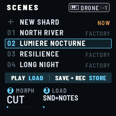

**MORPH** (K2) is how the sound comes in: CUT, at once, or over 1 S, 2 S, 4 S, 8 S, 15 S, 30 S, 60 S or 2:00. Over a
time, the settings that glide go from where they are to the scene's; the choices (the presets, MODEL, ROOT, SCALE,
CHORD, RATIO, TYPE, GLINT's SEQ, the TARGETs, INTERVAL, the rates, TIME, SEQ LENGTH, TRANSPOSE, TUNE) switch at once. A
setting you turn during the morph leaves it: your hand wins (a preset, all it sets). On the play page and SCENES, the
header shows an arrow, the scene's name and a line for how far it has come; on the other pages, only the line, under the
page's name. A new load starts from the values as they are.

**LOAD** (K3) is what a load brings. SND+NOTES: the sound, its TEMPO and its notes: everything is let go, then the
scene's notes play (its drones, the bass, GLINT's arpeggio and sequence, the bass's sequence), if it has any. Its
sequences start from their first steps, and the beat begins there, as PLAY starts it (following a MIDI clock: on its
next step, its beats kept); PULSE falls on the bass's NOTEs, none of them doubled. SND ONLY: the sound alone; what
plays goes on (the drones, the bass and its sequence, GLINT's arpeggio and sequence, with its SEQ setting and the
settings that play it: MODE, RATE, RANGE, CHANCE, SEQ LENGTH, GATE, TRANSPOSE), and TEMPO stays as it is.

MORPH is back on CUT at every power-on. LOAD is kept with the settings (ALL at first), not in the scenes.

**COMPARE:** hold **EDIT**. While it is held, the scene sounds as it was saved or last loaded, whatever you have
turned since; the header says COMPARE · AS SAVED. Let go: the sound as it is now.

Slots 1 to 7 hold the factory scenes. Each plays something once loaded with its notes (LOAD on SND+NOTES), at its own
TEMPO. The first four were made on the FM-1 by FRASIL's author, and are kept whole:

| Scene | Key · TEMPO | What plays |
| --- | --- | --- |
| NORTH RIVER | F# PENTA MIN · 90 BPM | two sevenths latched wide, on B2 and F#3; FROST's arpeggio at random, in sixteenths over three octaves; SUB's line of five steps, struck on each beat (PULSE) |
| LUMIERE NOCTURNE | A MAJOR · 60 BPM | an ADD9 latched wide on D2, the drone all PARTIALS and BREATH, slow to come and to go, in a long, bright hall; GLINT's arpeggio on one note; SAW's A2 held, struck on each half beat (PULSE) |
| RESILIENCE | F# PENTA MIN · 90 BPM | two sevenths latched wide, on B2 and A3, a full drone; HARP's arpeggio at random, in sixteenths over three octaves, through a long ping-pong echo; REESE's line of nine steps far under |
| LONG NIGHT | A PHRYGIAN · 60 BPM | NOCTURNE's low drone on a wide FIFTH; REESE's line gliding in bars; BOWED glass in long tied notes, far in an echo; a slow LFO drift |
| OPEN WATER | D DORIAN · 118 BPM | the PULSE preset's drone on a SUS2, ducked on each beat (PUMP); MARIMBA's sequence in syncopated sixteenths; a driven SAW, plucked, its line in eighths, its FILTER swept by LFO 1 |
| WHITEOUT | C# MINOR · 72 BPM | WIND's breath alone, on a wide SUS4; FROST's flurries, an arpeggio at random in sixteenth triplets; a slow SUB far under; BLUR |
| THAW | D# MAJOR · 78 BPM | EMBER's choir on an open ADD9, its WARMTH and BODY swaying (LFO 1); DROP's arpeggio drifting in eighth triplets; FM's bass held, struck on each half beat (PULSE) |

NEW SHARD is a calm drone in A minor, SEVENTH open (A on the keys: Am7), at 90 BPM: CUSTOM, BODY 50 %, MOTION 50 % with
a slow drift; the choir soft, a little PARTIALS and BREATH, some WARMTH; slow to come (3.6 S) and to go (7.6 S); a lush
cloud (DECAY 10 S, SPACE 52), its low end cut (LOW CUT 83 HZ). The three LFOs on, slow sines, each on two settings:
LFO 1 on TIMBRE and BREATH (23 S), LFO 2 on SPACE and SPREAD (37 S), LFO 3 on GLINT's BRIGHT and the bass's FILTER
(16 S). GLINT: SINE, BRIGHT 25, SEQ on ARP. BASS: SUB, DRIVE and FILTER low, slow to come. No notes.

Slots 8 to 16 are free: an empty one loads as NEW SHARD, named SCENE and its number. While the sound differs from the
one last loaded or saved (its TEMPO too), SAVE lights, the SCENES page says CHANGED and the play page's header has an
amber dot beside the scene's name (back to it, they go). Storing also keeps the settings: at power-on FRASIL comes back
with the sound you stored last, silent. Nothing plays until you play (PLAY held brings the scene's notes). A new FM-1,
with nothing stored yet, starts on NEW SHARD. Scenes saved by an earlier FRASIL come back as they were, the settings
added since at their defaults (the bass's sequence empty), their TEMPO the one the settings had. The arpeggiator's old
MODE (OFF, the five modes, SEQ) becomes GLINT's SEQ and MODE, the delay's TIME and MODE one TIME, and the arpeggio's and
the sequence's notes lose the OCTAVE they were kept with (it is put on as they play now).

**Backing up** (FRASIL 1.1 and later): the scenes and the settings go to a file over USB, and come back from it.

- **The River** (https://river.frasilsynth.com/, Chrome or Edge): **Back up** reads the FM-1 and shows each slot as a
  card, a *shard*: its drone, what plays, GLINT's sequence or arpeggio, every page's settings as the screen writes
  them. Download everything (a `.frasil` file) or the shards you select (a `.frasilscenes` package). Open a file to see it
  without the FM-1. Put a backup back whole, or shards into the slots you choose, several at once: the River reads
  the FM-1 first, and the other slots and the settings stay as they are. Shards go into the slots of an FM-1 that
  runs FRASIL 2.0 (an earlier FRASIL is asked to update first); a shard keeps its scene's TEMPO.
- **A terminal:** `python3 base/tools/fm1_backup.py backup scenes.frasil --magic FRBK`, then
  `python3 base/tools/fm1_backup.py restore scenes.frasil`; `info` shows what a file holds.

A backup can be taken while FRASIL plays (what you haven't stored yet isn't in it). A restore can't: the River lets
everything go first (it sends MIDI's All Sound Off); from a terminal, hold **PLAY** to release everything,
or the screen says STOP FIRST. A key held down still waits. The FM-1 receives the whole file and checks it before
anything changes, then asks: RESTORE FROM USB? **SEL** yes, **FX** no (a minute, then no). Restoring everything
brings back the settings too, the sound at power-on with them; never the panel's calibration, which is your FM-1's.
A backup from an earlier FRASIL restores: its scenes are brought up to date. While a backup is sent, STORE doesn't
happen (NOT STORED, a pop-up). Back up before you switch firmwares.

---

## 10. MIDI

FRASIL takes MIDI over USB and the TRS input. Each track has its own channel, whatever the keys play: the drones on 1,
GLINT on 2, BASS on 3 by default. Press GLO twice for the MIDI page: DRONE CH, GLINT CH and BASS CH, each OFF, 1 to 16
or OMNI.

- **The drones' notes** go through the harmony, so a sequencer's single note plays a chord. Sustain (CC 64) holds
  them. Channel pressure swells them all (SWELL).
- **GLINT's notes** play as they come, no scale, with GLINT's OCTAVE on them as on a key's. While the arpeggiator or
  the sequencer is on, they go into it, as held keys would.
- **BASS's notes** play as they come too, the bass's OCTAVE on them, one at a time: the last one sounds, and letting
  it go brings back the one still held under it. While the bass's sequence is on, they go into it, as the keys would.

Notes sound only while held. Polyphonic aftertouch swells a note; channel pressure, the whole track. The CCs below
come in on the drones' channel (sustain too); 123 releases the notes of the track whose channel it comes on, 120 (All
Sound Off), on any channel, lets everything go and stops the sequences, as PLAY held, RESTORE after it (the River
sends it before it sends to the FM-1).

| CC | | CC | |
| --- | --- | --- | --- |
| 1 | MOTION | 74 | TIMBRE |
| 91 | SPACE | 11 | SWELL |
| 70 · 71 · 72 | CHOIR · PARTIALS · BREATH | 73 · 75 | ATTACK · RELEASE |
| 76 · 77 | SIZE · DECAY | 78 · 79 | SHIMMER · WARMTH |
| 12 · 13 | BODY · the drone's PRESET | 14 · 15 · 16 | SPARKLE · BLUR · SINK |
| 17 · 18 · 19 | the MIXER's DRONE · GLINT · BASS | 80 | FREEZE (64 and up) |
| 120 | all sound off, any channel: everything let go, the sequences stopped (PLAY held again: RESTORE) | 123 | release the notes of the track on that channel |

**Program Change** 0 to 15, on the drones' channel, loads scenes 1 to 16, as SCENES' MORPH and LOAD say (NEW SHARD, no slot, has none).

**MIDI learn:** turn a setting, hold GLO, and move a knob on your controller (a CC on the drones' channel): from then
on that CC turns that setting (CC 21 · SINK). FRASIL learns 8 at most, the oldest replaced, and keeps them with the
settings. A learned CC comes before the table's (SWELL's 11 and FREEZE's 80 too), but for 64, 120 and 123, which keep
their jobs.

MIDI clock drives GLINT's arpeggiator, its sequencer and its delay, and the bass's sequencer. Start resets the grid,
and starts the sequences from their first steps. With no clock coming in, PLAY does the same when it starts the
transport, or is held (section 4); while one comes in, PLAY leaves its beats as they are.

---

## 11. The lights

| Light | Means |
| --- | --- |
| Keys, bright | the roots of the latched drones, and the keys held |
| Keys, faint | the scale's notes |
| Keys, GLINT with the arpeggio on | faint: the arpeggio's notes. Bright: the one sounding, for as long as it sounds |
| Keys, GLINT with the sequencer on | bright: the note playing. Faint: the scale's notes |
| Keys, BASS | bright: the bass's note. Faint: the scale's notes |
| Keys, SAVE held | the white keys, the scenes: bright, the current one; faint, the slots that hold a scene |
| The function buttons, faint | always: their names stay readable in the dark |
| The page's button, bright | the page on screen |
| SAVE, bright | the sound differs from the scene's (SCENES says CHANGED) |
| LFO | faint as the others while an LFO runs; fainter, as PLAY, while none does |
| ARP, a flash | each step GLINT's arpeggio or sequence plays, while GLINT's pages are not on screen |
| PLAY | faint; bright while voices or the bass are sounding |
| REC | faint, as the others; while a sequencer records, GLINT's or the bass's: lit with RECORD on STEP, flashing on the sequence's beats (as the metronome counts them, from its first step), twice as quick as OCT, with RECORD on LIVE |
| OCT− and OCT+ | faint, a little brighter on the beat: MIDI clock when one comes in, else TEMPO (GLOBAL, K1) |
| FX, bright | one of FX's pages is on screen, or FREEZE is on |
| ENV, bright | DRONE SHAPE, and SWELL while you hold it (until it has come back down) |
| SEQ, bright | BASS's pages |
| SEQ, a flash | each NOTE the bass's sequence plays, while BASS's pages are not on screen |

---

## 12. Troubleshooting

**No sound:** turn MASTER up, and tap a key: drones need a tap to start. Check the layers' levels (HOME, K1–K3).
If the keys' badge (top right) says BASS, or in blue GLINT, ARP, SEQ or REC, the keys play BASS or GLINT: turn
SELECT back to DRONE (or press HOME from another section's page).

**Everything went silent:** PLAY held lets everything go. Hold it again before you play anything else: RESTORE brings
back what it let go. A tap on PLAY does not let the drones go: it starts and stops the sequences (GLINT's, the
bass's) or the arpeggio.

**KEY MODE doesn't change:** it lets every note go, so it takes a second detent the same way within 2 seconds (KEY
MODE · TURN AGAIN).

**A CC from a controller moves another setting than the table's:** it was learned (section 10). Learn it again onto
the setting you want.

**Crackles or a voice dropping out:** FRASIL lowers its load on its own when the processor is full; an amber dot left
of the keys' badge says so. GLOBAL's header shows the load. Fewer voices, or SHIMMER at 0, give it room.

**The installer doesn't find the FM-1:** use Chrome or Edge, allow MIDI when asked, and close other programs that
use the FM-1's MIDI port.

**The FM-1 doesn't start after an install:** hold OCT− while you switch it on, then install again, or put the
official firmware back.
