# FRASIL

FRASIL turns the M-VAVE FM-1 into an instrument for ambient drones and textures. The drones are the notes
you light, and they never change. A tap latches a drone, and pressing makes it swell. The timbre drifts and ebbs
slowly on its own. Everything flows into a large reverb with shimmer and freeze. Above the drones, GLINT plays small
icy FM bells, by hand, through an arpeggiator or a 32-step sequencer. Under them, BASS holds one deep note, or plays
its own arpeggio or a line of up to 32 steps. The drone has a sequence of its own too: its chords, a step at a time.
Chance comes in only where you let it (CHANCE skips steps, RANDOM and DRIFT pick an arpeggio's order, SPARKLE lets
glints fall on the notes your drones hold).

---

## Contents

1. Install
2. How FRASIL works
3. The screen
4. Playing
5. Harmony and the keys
6. GLINT
7. BASS
8. DRONE SEQ
9. The pages
10. Scenes and presets
11. MIDI
12. PERFORM
13. The lights
14. Troubleshooting

---

## 1. Install

**Try it first:** the emulator runs the same code in the browser, with sound. No FM-1 needed.

**Install from the browser:** in Chrome or Edge, connect the FM-1 by USB, open the installer and press Install.
The browser asks once to allow MIDI: allow it. Don't unplug the cable while it writes.

**Install from a terminal:** `python3 base/tools/fm1_install.py frasil-VERSION.fwsc`, from a checkout of FRASIL's
repository.

**Back to the official firmware:** install M-VAVE's V15 from the installer or from The FM-1 Firmware Hub. If the
FM-1 no longer starts, hold OCT− while you switch it on: it waits for an update over USB.

FRASIL keeps its scenes, your presets and its settings in the FM-1's flash, in its own format. Another firmware may
not read them, and may overwrite them: back them up first (section 10, Backing up).

---

## 2. How FRASIL works

FRASIL plays three tracks, each an instrument of its own: the **DRONE**, **GLINT** and **BASS**. Turn **SELECT**
(the screen calls it TRACK) to choose one. The keys play it, the header at the top of the screen takes its colour
(DRONE white, GLINT ice blue, BASS orange), and **EDIT**, **ENV**, **ARP**, **SEQ** and **REC** act on it: its sound,
its envelope, its arpeggio, its sequence, its recording. PRESETS (B) and ALGORITHM (C) turn its preset and its
brightness. What the other two play goes on.

**The drone.** Every note you light is a **voice** (up to 8), and every voice sounds three layers of the drone:

- **CHOIR:** three detuned saws (or pulses) through a low-pass filter that follows the note. Warm, wide, vocal.
- **PARTIALS:** 8 additive harmonics, each drifting on its own in level and tuning. Bright or dark, odd, stretched
  into bells, with a formant.
- **BREATH:** noise (a hiss or sparse grains) through three resonators tuned to the note, from air to glass.

With the DRONE selected, EDIT opens **DRONE TONE**, then **DRONE MOTION**, then two pages for each of the drone's
layers: the first its level and main character, the second (CHOIR II, PARTIALS II, BREATH II) its source and what
shapes it after; CHOIR has a third, CHOIR III (SOFT). DRONE TONE shapes the whole drone: its PRESET, TIMBRE (all three layers brighter or
darker), SPACE (how much of it goes to the reverb) and BODY. At 100 % BODY leaves the drone as its settings make it.
Turned down, it thins it out without changing them: the choir closer and quieter, fewer partials, little breath,
narrower, less warmth, its low body taken off. The presets leave it where it is. An LFO can move it. **ALGORITHM**
(C) turns TIMBRE, on any page, while the DRONE is selected. How far the drone drifts is on EDIT's second page, DRONE
MOTION: MOTION, its RATE, TIDE and its PERIOD.

**The presets.** Turn **PRESETS** (B), on any page: the selected track's preset. The names fill the screen while you
turn (the name grid, section 3). For the DRONE, 36 drones, each setting the three layers (their levels, all their
pages) and the drone's own (DRONE TONE but BODY, DRONE SHAPE's ATTACK and RELEASE, DRONE MOTION). The cloud,
PRESSURE and VELOCITY stay as they are. MIST, CATHEDRAL, GLACIER, ABYSS, AURORA, EMBER, TIDE, DUST, WIND, ORGAN,
HOLLOW, VOWEL, SHIMMER, CHANTER, ENSEMBLE, BELLS, NOCTURNE, HAZE, PULSE, RIME, DEEP, SPECTRAL, RUST, STILL, VELVET,
CHROME, SWARM, FOGHORN, SOLAR, CAVE, GLASS HARP, MONK, STATIC, LULLABY, STORM, PRISM. Before them, **CUSTOM**: your
own. Turn any of those settings and the drone becomes CUSTOM, from where it was. Another preset doesn't lose it: turn
back to CUSTOM and it is there. A scene keeps its CUSTOM, and the preset chosen over it. GLINT's 23 presets are in
section 6, the bass's eight MODELs in section 7. The presets you store yourself come after the factory ones
(section 10).

You don't choose a drone layer per note: all three play every note, and you mix and shape them. Then WARMTH (a soft
saturation) feeds **CLOUD**, the reverb: an 8-line modulated network with diffusion in its loop, a pre-delay, a
pitch-shifted **shimmer** inside the loop, and **FREEZE**. Its tail runs from 0.4 to 60 seconds.

Your drones' notes never change. What moves on its own is the sound: **MOTION** is a slow random drift of each
partial, detune and resonance; **TIDE** is a slow swell of the timbre over minutes. Chance comes into the notes only
where you let it: **CHANCE** skips steps, RANDOM and DRIFT pick an arpeggio's order, **SPARKLE** plays glints of its
own on the notes the drones hold.

**GLINT** is a track above: 4 voices of clean FM. Each note rings and fades like a bell, or sings on as a lead. The
drones keep sounding while you play GLINT.

**BASS** is a track under everything: one deep note at a time, held like a drone. It stays out of the reverb, but for
its SPACE.

**Arpeggios and sequences.** GLINT and BASS each play their keys as they come, through an arpeggiator (**ARP**), or
from a sequence (**SEQ**): one at a time, turned ON on its button's first page. Each track has its own sequence, the
drone's included: up to 32 steps, each track on its own RATE, all three on one beat, started and stopped together by
**PLAY**. **REC** records what you play into the selected track's sequence.

**GENERATIVE FX** (FX's first page) acts on everything at once: SWELL swells every voice, SPARKLE scatters glints over
the drones' notes, BLUR dissolves the drone into the cloud, SINK takes the whole mix under a low-pass (section 9).

---

## 3. The screen

FRASIL's screen is a river at night. Pitch is height above the waterline. Each voice is a current carrying ice.

- **The current** is CHOIR: its line grows brighter as CHOIR gets louder.
- **The crystals** are PARTIALS: more of them as PARTIALS gets louder.
- **The mist** around the current is BREATH.
- **Pressure** warms a voice's crystals to lamp light. **GLINT** notes shine in the sky above. **FREEZE** sets the
  crystals into a lattice and stills the water.
- **The bass** is a slow swell in lamp light, the bass's colour, across the whole river at its note's height, the
  water darker under it; pressing into it brightens it. Its note is written on the right.
- **SINK** darkens the river from the top as it is turned, deep water closing over it. **BLUR** thickens the haze
  off the water, the reverb's, as SPACE toward 90 % would.

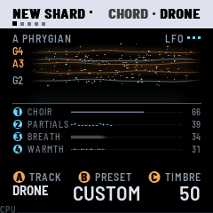

Under the waterline, four strata show the drone's mix: CHOIR, PARTIALS and BREATH, each drawn as its own thing in
the river, and WARMTH, as embers in lamp light. K1–K4 set them. The one you turn lights up.

At the top left of the river, on the play page, the key: its root and scale (A PHRYGIAN), once you set a scale or a
chord. It shortens when the tags at its right crowd it, and gives way when they take the whole row.

At the top right of the river, only what is on, out of sight elsewhere: **SEQ** (ice while GLINT's sequence runs,
slate while it is stopped) or **REC** (lamp, while it records); **ARP**, or **ARP LATCH**, while GLINT's arpeggio has
notes (slate while it waits); **BASS SEQ** (lamp while the bass's sequence runs, slate while it is stopped) or
**BASS REC** while it records; **BASS ARP** while the bass's arpeggio plays; **DRONE SEQ** (white while the drone's
sequence runs, slate while it is stopped) or **DRONE REC** while it records; **LFO** and three dots, one for each, ice
while it runs; **SWELL** (lamp) while it swells.

**The header** is the selected track's. The whole band at the top of the screen is filled with its colour, DRONE white,
GLINT ice blue, BASS orange, and the page's name and the track's name are written dark on it: wherever you are, you
see which track the buttons act on (GLO > SCREEN's HEADER on DARK turns it round: the band dark, its words in the
track's colour, section 9). On the play page the title is the scene's name, as large as it fits (a long one
smaller; one that still does not fit rolls slowly along and back), with a dot while the sound differs from the scene's. Elsewhere, the
page's name; SCENES adds CHANGED while the sound differs. FRASIL's name stays on the logo screen. Under the title, a
dot for each page of its button, the one on screen larger and darkest; a button with one page has none, an ARP or a SEQ that is OFF
among them. At the right: the track's name, CHORD before it a little paler while its keys play chords (CHORD · GLINT:
KEYS' NOTES on CHORD, and heard; not on GLOBAL); LIVE or STEP in its place while that track records. On the track's SEQ
pages the title already says the track, so the corner says how to clear its sequence, CLEAR [OCT−] + [REC], and
during a take the title says the take: GLINT LIVE, DRONE STEP. The octave isn't in the header: OCT+ or OCT− shows it
large over the strip for a moment, the page staying. Beside them: FREEZE while the cloud is held
(on the play page a flake, when the name leaves it no room); a small dot for 3 seconds after the engine lightened the
sound (section 14, Crackles); on GLOBAL, the processor's load. When it is full, the least important items step aside.
A long title is drawn smaller beside CHORD · DRONE. At the far right, in the margin, the battery: it fills with green,
turns yellow at 30 % and under, red at 10 % and under. It moves slowly, so a loud chord or plugging in USB doesn't
make it jump; plugged in, it fills up again.

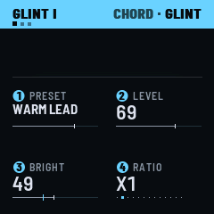

For a moment the header gives way to a message (STORED 09 ABYSS, FILTER > LFO 2, ARP ON · SEQ OFF); to PLAY held
(RELEASE ALL or RESTORE, a line of progress under it); on the play page and SCENES, to a scene's MORPH (an arrow, the
scene's name, a line for how far it has come; elsewhere, only the line, under the page's name); while OCT− and EDIT
are held, to COMPARE · AS SAVED; and while a recording counts in, to COUNT-IN and its beat (COUNT-IN · 2).

At the bottom of the play page, the three left encoders: **TRACK** (SELECT: DRONE, GLINT, BASS), the track's
**PRESET** (PRESETS: its name under PRESET; the bass's MODEL under MODEL) and what ALGORITHM turns for it: the drone's
TIMBRE, GLINT's BRIGHT, the bass's FILTER.

**The badges.** Every setting on screen wears the badge of the control that turns it. A blue disc numbered 1–4 is
K1–K4, the four encoders at the top right. An orange disc A, B or C is SELECT, PRESETS or ALGORITHM, the three
encoders on the left. Turning ALGORITHM shows its value large for a moment, on any page; SELECT shows the track large
over the river on the play page and on a track's own pages. Elsewhere the header's colour says it.

**The name grid.** A setting with a long list of names (the drone's PRESET, GLINT's PRESET, the bass's MODEL, an
LFO's TARGET, SCALE, CHORD and the like: eight choices or more) shows them all while you turn it. The page gives way
to a grid of the names, down the left column, then down the right, ten rows to a screen, more screens if they need
them (dashes at the foot); the choice framed in ice, your presets a little brighter; the header says the setting's
name. **OCT+** and **OCT−**, while the grid is open, move the choice a screen on or back (with OCT− held to pick
unheard, only OCT+ does); the octave doesn't move. The sound follows a moment after you stop turning (about a quarter
of a second), so a quick turn through the drones doesn't play each of them.

- **A track's preset, an LFO's TARGET:** the header says [SEL] SELECT. **SEL** keeps what you hear; **FX** brings back
  the sound as it was before the grid opened. Only those two are lit; the grid stays until you press one, the other
  buttons and the knobs waiting.
- **SCALE, CHORD, MASTER EQ's PRESET and the like:** the header says where you are (5 / 12). The grid closes 1.2
  seconds after the last turn, or at once on any button, which then does its own job.

An LFO's TARGET opens on four screens, one a section, each in a box: DRONE and CHOIR; PARTIALS and BREATH; GLINT; BASS
and GLOBAL. The names are in their track's colour, GLOBAL's in green. OCT+ and OCT− turn the sections.

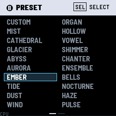

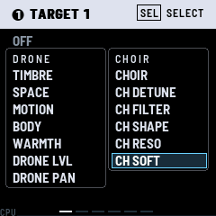

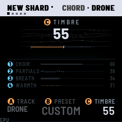

**Pop-ups and questions.** A warning takes the whole screen until you press **SEL**: something did not happen, or
wants your hand (STOP FIRST, NOT RESTORED, NOT STORED, MIDI LEARN: TURN ONE FIRST), or what a restore from USB did
(RESTORED). Its one button, OK, is SEL, the only light left on. SEL only closes it: you are back where you were, the
lights too. Meanwhile the keys and MIDI play; the other buttons and the encoders wait. Everywhere a question is
asked, **SEL** is yes (OK, restore) and **FX** is no (cancel), and only the buttons that answer are lit. Saving too:
SEL goes on, FX goes back (section 10).

**HOME's pages.** Tap HOME for the play page, then again: KEYS (how the keys play the selected track, section 5),
MIXER, CLOUD SEND, the logo screen, and back to the play page.

**The mixer.** A fader for each track, DRONE, BASS, GLINT, and CLOUD, the reverb's return, each in its colour, with
the track's meter beside it, live. K1–K4 move them. 100 is the level as it is (a mark on the fader), up to 127. The
faders are the tracks' levels in the mix, after their own sound: DRONE and GLINT take what they send into the cloud
down with them. Hold **OCT−** and turn K1–K4: each track's PAN (DRONE, BASS, GLINT, CLOUD), L50 to C to R50 (a
balance), kept in each scene; a small scale above each fader shows it (a dot, lit while turned), the footer shows the
pans instead of the levels while OCT− is held, and the octave does not change. The page's foot says it: PAN: HOLD
OCT− AND K, OCT− drawn as a key. An LFO can move each pan (TARGET's DRONE PAN, BASS PAN, GLINT PAN, CLOUD PAN, on the
LFO's page: LFO held and a knob turned on MIXER routes the level under it).

**CLOUD SEND** gathers what each track sends into the cloud: DRONE (DRONE TONE's SPACE), GLINT (GLINT DELAY's SPACE)
and BASS (BASS II's SPACE), on K1–K3. The same settings as on their own pages.

**The logo screen.** HOME's last screen: the logo, alive, the version at the top right, the sky over two thirds of
the screen, FRASIL's site up in it (frasilsynth.com: its River backs up and edits your scenes). Over the waterline,
granules of frasil drift like stars: they follow what plays (faster with MOTION), pressure warms them, GLINT notes
sparkle among them. Under it, the water: night blue, slow swells of light passing through it, the sky's light on it in
short strokes that come and go, and the letters in it, deep blue, swaying. FREEZE stills it all. PLAY and the octave
buttons leave it open, so you can play from it. HOME again goes back to the play page.

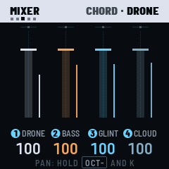

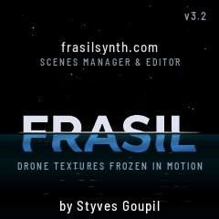

**Help.** Hold HOME: the help screen opens and stays, on the page with the button of the page you were on. Turn
SELECT for its five pages: the buttons in the panel's order (three pages), the encoders, the keys. Each line gives a
control's job, then the control, and under it, in amber, what it does again, held, or with something else. Tap HOME
to close it and go back where you were.

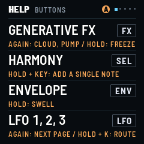

---

## 4. Playing

The DRONE selected (SELECT all the way left):

| Gesture | What happens |
| --- | --- |
| **Tap a key** | lights the note, or a chord (see Harmony). It rises over ATTACK and stays |
| **Tap a lit key** | it fades over RELEASE |
| **Tap another key** | it takes the place of what is lit, which fades over RELEASE; keys pressed together stay together. With KEYS' STACK ON, it joins them (section 5) |
| **Hold a key and press** | the voice swells and opens (PRESSURE sets how much). Let go: it stays lit |
| **Hold ENV** | SWELL: after 0.4 s, every drone voice swells together (1.5 s up, 1.5 s down once let go); ENV is lit while it lasts. Whatever track is selected |
| **SWELL** (FX, GENERATIVE FX's K1) | held where you leave it: every voice swells as far as it is turned (with ENV's and CC 11's, the most of them). A scene keeps it |
| **Hold SEL, tap a key** | a single note over what is lit, even when CHORD makes chords, whatever KEYS' STACK says (on the bass it takes the note's place: it has one voice) |

With KEYS' LATCH OFF (HOME, KEYS, K3), notes sound only while their key is held (section 5).

On any track:

| Gesture | What happens |
| --- | --- |
| **Turn SELECT** | the track: DRONE, GLINT, BASS (it stops at each end). The keys play it, the header takes its colour, and on EDIT, ENV, ARP and SEQ the page follows it (below). On SCENES it picks the slot, as K1 does, and leaves the track as it is |
| **Hold OCT−, turn SELECT** | the track changes and the page stays: play the drones while the bass's page is on screen. The header follows the track, the page doesn't. The octave doesn't move |
| **Hold a page button, turn SELECT** | that button's pages, one a detent, both ways, round (FX, SEL, ENV, LFO, EDIT, GLO, HOME, ARP, SEQ; not SAVE) |
| **Turn PRESETS** | the track's preset, in the name grid: the drone's (CUSTOM, then the 36, then yours), GLINT's, the bass's MODEL. You hear each as you stop on it; SEL keeps it, FX goes back to the sound before |
| **Hold OCT−, turn PRESETS** | picked unheard: the grid's choice framed in amber, the sound going on as it is; let OCT− go and it is taken (the octave unchanged) |
| **Turn ALGORITHM** | the track's brightness: the drone's TIMBRE, GLINT's BRIGHT, the bass's FILTER |
| **Hold GLO, turn ALGORITHM** | MASTER FILTER's CUTOFF (FX), whatever the track; with the filter OFF, it turns on, LOW PASS |
| **OCT− / OCT+** | octave −3 to +2, shown large over the strip a moment; at power-on −1, where the keys run F2 to G4. While the name grid is open, its screens instead |
| **OCT− + OCT+** | ANCHOR: the scene as it sounds now kept, the octave with it (ANCHOR SET), a violet frame round the screen, breathing, while it is. Change anything. Press them again: MORPH (MORPH TO ANCHOR), the sound gliding back over 8 s, SWELL with it, the values on the screen gliding with it, its choices (a preset, ROOT, a TYPE, PLAYS, the steps) switching halfway, the frame erasing counter-clockwise from the top as it goes. Hold them a moment: BACK (BACK TO ANCHOR), every setting as it was, at once; pressed again during the MORPH, there at once too. What plays plays on. Loading a scene lets the anchor go. Nothing is stored: it is gone at power-off. (Held past 7 s, the two count down to UPDATE MODE, entered at 10 s: let go.) |
| **Hold EDIT** | the key map: three black keys light (below) |
| **Hold PLAY** | after 0.6 s, RELEASE ALL: the drones, the bass, the glints, the arpeggios and the sequences; the beat begins there (below). From 0.2 s the header says RELEASE ALL, a line counting down under it: let go then, before 0.6 s, and nothing happens |
| **Hold PLAY again** | with nothing playing: RESTORE, the scene again (RESTORED): what the last RELEASE ALL let go, else the scene's own notes as saved (at power-on, say): its latched drones, the arpeggios' notes, the bass; and every sequence that is on, from its first step; the beat begins there |
| **Tap PLAY** | with nothing playing at all: the scene, its three tracks, as held (RESTORE). Else the transport: every sequence that is on stops, or they all start together from their first steps, at once, the beat beginning there; an arpeggio waits, or goes on from the top. A stop leaves the beat going. With no sequence or arpeggio on, it only says HOLD PLAY · RELEASE ALL |
| **Tap PLAY twice** | quick, while anything plays: RELEASE ALL, as held (the first tap stops the sequences, the second lets everything else go); hold PLAY then for RESTORE. On SCENES each tap loads |
| **Hold OCT−, press PLAY** | CUT: every sound gone at once, the cloud's tail, GLINT's echoes and the tape's loop too (RELEASE ALL lets them ring out): a 6 ms fade, then silence (CUT · ALL SOUND). The sequences stop, as RELEASE ALL stops them, and the beat begins there; the octave doesn't move. PLAY then, tapped or held: RESTORE |
| **REC** | records into the selected track's sequence, from any page: its SEQ II opens, LIVE; again STEP, again OFF (section 6, Recording) |
| **Hold SEQ** | the selected track's STACK on or off (KEYS, section 5), from any page |
| **Hold OCT−, press REC** | on the track's SEQ pages: CLEAR, its sequence emptied (UNDO TAKE brings it back) |
| **Hold SAVE, press REC** | STORE: the current scene into its slot, in one gesture (section 10) |
| **Hold FX** (or CLOUD's K4) | FREEZE: the cloud holds what is in it, without end and without darkening. Nothing more goes in: what you play next sounds dry over it. Off: it thaws, and fades over DECAY. The page stays; FX stays bright while it is on |

**The buttons.** A press shows, a hold acts. Every button does its job when you let it go, but OCT− and OCT+, which
act at once. Held 0.4 s (PLAY 0.6 s, REC 0.8 s), it does its other thing instead. A button used with something else
(SEL with a key or an encoder, SAVE with a key or REC, LFO with an encoder, GLO with a CC or ALGORITHM, EDIT with a
key, a page button with SELECT) does nothing more when you let it go.

**The track and the pages.** EDIT, ENV, ARP, SEQ and REC act on the selected track; FX, SEL, LFO, GLO, HOME and SAVE
are the same whatever it is. Turn SELECT on one of the track's pages and the page follows: ENV, ARP and SEQ go to the
same page of the new track (GLINT ADSR to BASS ADSR, GLINT SEQ II to DRONE SEQ II; to the first page if that one is
not there), EDIT to its first page, and the track shows large over the river for a moment. On the other pages only
the track changes. Hold OCT− as you turn SELECT and the page stays where it is, whatever it is; the header goes with
the track, so a white band can say BASS ADSR: the knobs are that page's, the buttons and the keys the new track's.
What plays goes on: a latched drone or bass stays latched, and a key held down while the track changes ends as it
began. While a recording runs, SELECT waits: the header says RECORDING, and REC: OFF smaller beside it.

**EDIT held: the key map.** Hold EDIT: the three leftmost black keys (F♯, G♯ and A♯ of the lowest octave) light,
every other key goes dark. Press one, EDIT still held, to jump to a group of the track's pages; its key lights. On the
DRONE: F♯ CHOIR, G♯ PARTIALS, A♯ BREATH, the same key again the group's next page, round (CHOIR, CHOIR II, CHOIR III).
On GLINT: GLINT I, GLINT II, GLINT DELAY; on BASS: BASS I, BASS II, BASS TONE. Those keys sound nothing; the others are
silent while EDIT is held. Let EDIT go: the page stays, the keys' lights come back. A tap on EDIT opens its first page,
as ever. With OCT− held, EDIT is COMPARE instead (section 10).

**PLAY restarts the beat.** When PLAY starts the transport (a tap), when it is held (RELEASE ALL, and again,
RESTORE), and at a CUT, the grid starts again from its top at that moment, as a MIDI Start does: a beat and a bar
begin there. Everything on the grid starts with it: OCT's blink, REC's flash and the metronome, the LFOs on the grid
(from the top of their turn), PUMP, the arpeggios (from the top of their patterns), the three sequences (from their
first steps, at once) and PULSE's divisions. While a MIDI clock comes in, the beat is the clock's: PLAY leaves it
where it is, and the sequences start on its next step (MIDI Start resets it). A tap that stops the transport changes
nothing. A scene loaded with its notes (LOAD on SND+NOTES) starts the beat there too, as PLAY does (section 10).

**A page button and SELECT.** Hold a page button and turn SELECT: its pages, one a detent, in the order its taps go
(an ARP or SEQ that is OFF has only its first), round; from another button's page, its first (turned back, its last).
The page shows at once. Let go: nothing more, no next page, no hold. If the hold acted before SELECT moved (held past
0.4 s), the first detent undoes it: FREEZE and the arpeggio's LATCH back as they were, COMPARE and SWELL over, EDIT's
key map closed. HOME is the exception: once its help is up, SELECT turns the help's pages.

| Button | Tap | Hold | Held, with |
| --- | --- | --- | --- |
| **FX** | GENERATIVE FX; again: CLOUD, CLOUD II, CLOUD III, MASTER FILTER, LOFI TAPE, LOFI TAPE II (only while TAPE is on), PUMP, PUMP II | FREEZE on or off | SELECT turned: its pages |
| **SEL** | HARMONY | | a key: a single note · K1–K4 turned: the LFO AMOUNT of that setting (section 9) · SELECT: its page |
| **ENV** | the track's envelope: DRONE SHAPE, GLINT ADSR, BASS ADSR | SWELL of the drone, while held | SELECT: its page |
| **LFO** | LFO 1; again: its targets, LFO 2, its targets, LFO 3, its targets | | K1–K4 turned: that setting onto an LFO (section 9) · SELECT: its pages |
| **EDIT** | the track's sound: DRONE TONE, DRONE MOTION and the drone's layers (9 pages), GLINT I, II, DELAY, or BASS I, II, TONE | the key map: F♯, G♯, A♯ jump to the track's groups | with OCT− held, COMPARE: the scene as saved (section 10) · SELECT: its pages |
| **GLO** | GLOBAL; again: MIDI, MASTERING, MASTER EQ, MASTER EQ II, ROUTING, SCREEN, RECORD | | a CC from a controller: MIDI learn (section 11) · SELECT: its pages |
| **HOME** | the play page; again: KEYS, MIXER, CLOUD SEND, the logo | help, on the page with this page's button | SELECT: its pages |
| **SAVE** | LOAD or SAVE: the scenes, or storing a scene or a preset (section 10) | | a white key: that scene · REC: STORE the current scene |
| **ARP** | the track's arpeggio: its ON/OFF first, its pages while ON. On the DRONE: NOT AVAILABLE FOR DRONE | the track's arpeggio LATCH (on: ARP ON too); nothing on the DRONE | SELECT: its pages |
| **SEQ** | the track's sequence: its ON/OFF first, its pages while ON | the track's STACK, on or off | SELECT: its pages |
| **PLAY** | start (the beat from there; with nothing playing, the scene's three tracks), stop the sequences and arpeggios; twice quick: RELEASE ALL; on SCENES: load (with nothing playing, it plays at once) | RELEASE ALL; with nothing playing: RESTORE, the scene again (the beat from there) | pressed with OCT− held: CUT, every sound gone at once |
| **REC** | record into the track's sequence, from any page (its SEQ II opens): LIVE; again STEP; again OFF | 0.8 s: the metronome off, or on again | pressed with OCT− held, on the track's SEQ pages: CLEAR |

---

## 5. Harmony and the keys

SEL opens HARMONY. You set a key once, then every key you tap plays something that belongs to it.

| K1 | K2 | K3 | K4 |
| --- | --- | --- | --- |
| ROOT: C to B | SCALE | CHORD | VOICING |

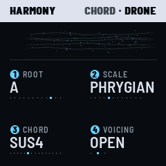

**Scales:** CHROMATIC, MAJOR, MINOR, DORIAN, PHRYGIAN, LYDIAN, MIXOLYDIAN, LOCRIAN, HARMONIC, MELODIC,
PENTA MAJ, PENTA MIN. A key outside the scale plays the scale's note just below it. The scale's keys glow faintly.

**Chords in the scale:** SINGLE, FIFTH, TRIAD, SEVENTH, SUS2, SUS4, ADD9, QUARTAL. Each key builds the chord from
the scale's own notes. In D MINOR with SEVENTH, D plays Dm7, E plays Em7♭5 and F plays Fmaj7.

**Fixed chords:** MAJ, MIN, MAJ7, MIN7, DOM7, AUG, DIM: the same shape on every key.

**Voicing**, for D MINOR with TRIAD:

- **CLOSE:** D3 F3 A3, tight, within an octave.
- **OPEN:** D3 A3 F4, the second note an octave up. More air.
- **WIDE:** D2 F3 A3, the root an octave down. A bass under the chord.

**KEYS** (HOME, second page) says how the keys play the selected track. Each track keeps its own four:

| K1 | K2 | K3 | K4 |
| --- | --- | --- | --- |
| HARMONY (OFF, ON) | NOTES (SINGLE NOTE, CHORD) | LATCH (OFF, ON) | STACK (OFF, ON) |

- **HARMONY:** ON, the keys follow HARMONY: in the scale, and chords if NOTES says so. OFF, each key plays its own
  note, chromatic.
- **NOTES:** SINGLE NOTE, one note a key; CHORD, the chord CHORD builds on it. CHORD needs HARMONY ON: with HARMONY OFF
  it stays in slate, and turning NOTES to CHORD turns HARMONY ON too. CHORD can always be chosen; where the keys still
  play one note, it is in slate and says why under it: on GLINT with SEQUENCE ON, (NOT ON SEQ); on the bass, which plays one
  note at a time, (ARP ONLY), its chords heard only through its arpeggio. The drone's turns, its sequence on or off.
- **LATCH:** ON, a tap holds the note until you tap it again; OFF, it sounds while the key is down. On GLINT, LATCH
  holds four notes at most; with ARP ON, the arpeggio's own LATCH (ARP II) holds them instead. Turned OFF, it lets that
  track's latched notes go at once, under a finger too, so it changes only on a second detent the same way within 2
  seconds (LATCH, TURN AGAIN smaller beside it).
- **STACK:** ON, a new key or chord joins what is latched (on GLINT, the fifth note takes the oldest's place); OFF, it
  takes its place, keys pressed together staying together. Hold **SEQ** to turn it from any page; the SEQ and ARP
  pages say it at their foot, STACK ON (HOLD SEQ) in amber, or STACK OFF (HOLD SEQ).

A choice that doesn't apply stays where it is, in slate. The strip above draws an octave of keys as a key plays now:
the scale's dots with HARMONY ON, a chord's notes with CHORD, a solid outline for LATCH, a dotted one for HOLD, the word
beside it, and under the word NOTES or CHORDS while STACK is ON.

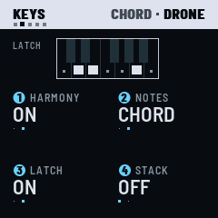

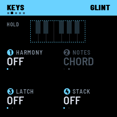

At first, and on NEW SHARD:

| Track | HARMONY | NOTES | LATCH | STACK | Plays |
| --- | --- | --- | --- | --- | --- |
| DRONE | ON | CHORD | ON | OFF | SEQUENCE OFF |
| GLINT | ON | SINGLE NOTE | ON | OFF | ARP ON |
| BASS | ON | SINGLE NOTE | ON | OFF | SEQUENCE OFF |

KEYS are the FM-1's, not a scene's: kept with the settings through power-off, and a scene you load leaves them as
they are. Only NEW SHARD puts them back to these. ARP and SEQUENCE are the scene's. MIDI takes only HARMONY and NOTES,
on the drones' channel (section 11). LATCH takes over from the KEY MODE of earlier FRASILs: its LATCH or HOLD becomes
the drone's and the bass's LATCH.

---

## 6. GLINT

Turn **SELECT** to GLINT: the keys play GLINT, the header turns ice blue. Each note is an icy FM bell in the scale,
OCTAVE octaves up (two by default, from +0 to +3). Pressing a key makes it louder (up to +8 dB) and makes it ring
longer. At first a key plays its note through the arpeggiator (KEYS' SINGLE NOTE, ARP ON); KEYS' CHORD makes it a chord. With ARP OFF, KEYS' LATCH holds
four notes; LATCH OFF, each rings out on its own (section 5).

**VIBRATO** (GLINT II, K3): once your finger has pressed in, wiggling it bends the glint's pitch, both ways around
its note, like a string player's finger. A steady press stays in tune. Up to 25 cents at 100; about 10 at its
default; OFF at 0. **AUTO VIB** (GLINT II, K4) is a vibrato of its own on every glint, whatever plays it: some five
times a second, coming in as the note settles, up to 50 cents at 100. OFF at 0, its default.

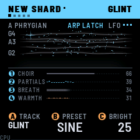

**Its pages.** GLINT selected, **EDIT** opens its sound, three pages; **ENV** its envelope; **ARP** its arpeggiator;
**SEQ** its sequencer.

| Button | Page | K1 | K2 | K3 | K4 |
| --- | --- | --- | --- | --- | --- |
| EDIT | GLINT I | PRESET | LEVEL | BRIGHT (FM index) | RATIO (×0.5 to ×13.6) |
| EDIT | GLINT II | OCTAVE (+0 to +3: every glint) | PING (strike or ring) | VIBRATO (OFF, the wiggle's depth) | AUTO VIB |
| EDIT | GLINT DELAY | TIME (1/32 to 1/2, triplet and dotted; always ping-pong) | FEEDBACK | MIX | SPACE (GLINT's reverb send) |
| ENV | GLINT ADSR | ATTACK (2 ms to 1.5 s) | DECAY (80 ms to 6 s) | SUSTAIN (0 to 100 %, the level held) | RELEASE (20 ms to 6 s) |
| ARP | GLINT ARP | ARP (OFF, ON) | MODE (UP, DOWN, UPDOWN, RANDOM, DRIFT) | RATE (1/1 to 1/32, triplets) | RANGE (1 to 3 octaves) |
| ARP | GLINT ARP II (ARP ON) | CHANCE | LATCH (OFF, ON) | | |
| SEQ | GLINT SEQ | SEQUENCE (OFF, ON) | SEQ LENGTH (1 to 32 steps) | RATE (the arpeggiator's) | GATE (a note's length) |
| SEQ | GLINT SEQ II (SEQUENCE ON) | STEP (1 to SEQ LENGTH) | NOTE (REST, a note, TIE) | LENGTH (the note's, in steps) | ACCENT (OFF, ON) |
| SEQ | GLINT SEQ II, recording LIVE | SEQ LENGTH | RATE | UNDO TAKE (turn twice) | |
| SEQ | GLINT SEQ III (SEQUENCE ON) | CHANCE (the arpeggiator's) | TRANSPOSE (−14 to +14 steps of the scale) | UNDO TAKE (turn twice) | |

With GLINT selected, ALGORITHM (C) turns BRIGHT and PRESETS (B) its PRESET, on any page.

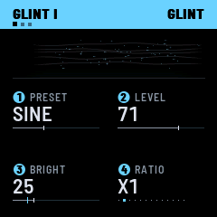

**Presets:** ICE, BELL, BLIP, GLASS, CHIME, DROP, FROST, CELESTA, SINE (the default), KALIMBA, MARIMBA, MUSIC BOX,
VIBES, HARP, PIPE, BOWED, six leads: WARM LEAD, BRASS, SQUARE, SUB LEAD, STRINGS, REED, and PIANO, a lofi upright
piano: the hammer's brightness falls fast, a long dark ring. A preset sets GLINT's sound, its RELEASE too (all but
VIBRATO, AUTO VIB and the delay's TIME, FEEDBACK and MIX). Turn RATIO, BRIGHT and the rest from there. Your own GLINT
presets come after these (section 10).

**The envelope** (GLINT ADSR, in its usual order): ATTACK, how long a glint takes to rise; DECAY, how long it then
takes to die away to silence, or, while its key is down, to SUSTAIN's level; SUSTAIN, the level it holds while the
key is down; RELEASE, how long it rings on once its key is let go (600 ms by default). Scenes and shards from
before RELEASE come with one that matches what their DECAY did then (DECAY's time up to 0.6 s, else half of it, 0.6 s
at least): they sound as they did.

**SUSTAIN** (GLINT ADSR, K3) turns a bell into a lead. At 0 a glint fades out over DECAY, even while you hold its key.
Turned up, it settles at that level for as long as the key is down, then rings out over RELEASE when you let go.
DECAY is then how long it takes to settle, and PING (GLINT II) the brightness at the start, as a filter's sweep would
be. The leads use it, with RATIO at ×1 (all the harmonics, as a saw has), ×2 (the odd ones, hollow, as a square) or
×0.5 (an octave under).

On GLINT ADSR the river gives way to the envelope: ATTACK up to the top, DECAY down to SUSTAIN's level, SUSTAIN's
plateau, RELEASE down to nothing, each part as wide as its knob is turned (the plateau takes what is left), its time
across it, A D S R under it. The part whose knob you turn is lit. Each glint sounding, up to four, is a little ice-blue
glint riding the curve: it waits at the end of the plateau while its key is held, then goes down RELEASE once let go.

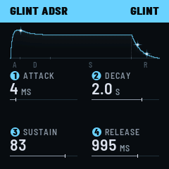

**OCTAVE** (GLINT II, K1) is GLINT's own: it moves every glint GLINT plays, a key's, a MIDI note's, the arpeggio's,
the sequence's. Turned, it moves the glints sounding at once, without striking them again. The arpeggio and the
sequence keep their notes without it, and play them with it.

**ARP and SEQ: ON or OFF.** ARP and SEQ each open on their ON/OFF (K1). OFF, that page is all there is: only its
ON/OFF, the other cells empty, no dots under the title; ARP or SEQ again stays there. Turned ON, its other pages
appear, and the track's other one turns OFF: GLINT plays its keys through the arpeggiator, or from its sequence, never
both. The header says so for a moment (ARP ON · SEQ OFF). Both OFF, the keys play GLINT as KEYS says. The page on screen
stays where it is as the other one turns off. A scene keeps which one is on.

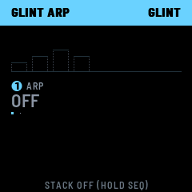

**The arpeggiator** (ARP ON) plays the notes of the held GLINT keys one at a time, at RATE, over RANGE octaves. CHANCE (GLINT ARP
II) decides whether each step plays. It follows MIDI clock when one comes in, and TEMPO (GLOBAL, K1) otherwise. It
stays on the grid: a new chord, an added or a lifted note waits for the next point of **ARP SNAP** (GLOBAL, K4: 1/4 at
first, the next beat) and starts the pattern there from its lowest note; the old one plays on until then. Keys a little
apart are one chord, and a chord up to 80 ms late lands on the point it just missed. ARP SNAP OFF: the next RATE step.
The bass's arpeggio does the same. MIDI Start resets the grid.

**Latch:** hold **ARP**, or turn LATCH (GLINT ARP II, K2). With LATCH on (the default), the arpeggio keeps playing
after you lift your hands, even with another track selected. A new hand replaces the chord (with KEYS' STACK ON, it joins it). Hold ARP again to turn it
off. Turned on, LATCH turns ARP ON too, and the sequence OFF if it was on (a sequence playing stops; the header says
ARP LATCH, ON, ARP ON); turned off, it leaves ARP as it is. Tap **PLAY** and the arpeggio waits, its notes kept (ARPEGGIO ·
WAITING); tap it again and it goes on from the top, the beat beginning there. Hold PLAY to let it go with everything
else.

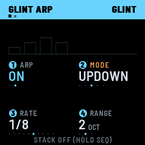

**The sequencer** (SEQUENCE ON, or tap REC: below). In place of the arpeggio, a 32-step sequence plays GLINT, on the
same grid: RATE, MIDI clock or TEMPO, CHANCE for each step (the arpeggiator's RATE and CHANCE, on GLINT SEQ and SEQ
III too). It plays on without end while it is on. **PLAY** stops it, and starts it again from its first step, at once,
the beat beginning there, with the other tracks' sequences. MIDI Start starts it from the top too.

- **STEP** (GLINT SEQ II, K1) is the step the other three show and change: its **NOTE** (as it sounds, OCTAVE on it;
  REST all the way down, TIE all the way up, the last note held on through it), the note's **LENGTH** in steps (its
  step and the TIEs after it; turned, it writes them, to SEQ LENGTH's end; – on a step with no note) and its
  **ACCENT**.
- **GATE** (GLINT SEQ, K4) is how long each note sounds, from a twentieth of its step to all of it. A TIE holds a note
  on, legato; with SUSTAIN up, GLINT's leads then sing through.
- **CLEAR:** hold **OCT−** and press **REC**, on any of GLINT's SEQ pages: every step a rest (SEQUENCE CLEARED; on an
  empty one, SEQUENCE EMPTY, and nothing changes). The octave doesn't move, and REC starts nothing. The corner of the
  header says it on every SEQ page: CLEAR [OCT−] + [REC].
- **UNDO TAKE** (GLINT SEQ III): turned twice: the sequence as it was before the last take or CLEAR. Again: back to
  the one after.
- **RECORD OFF, the sequence stopped, or on GLINT SEQ's pages:** the keys play GLINT as KEYS says, to try a line before
  you record it. The sequence goes on as it was, TRANSPOSE and the steps untouched.
- **RECORD OFF, the sequence playing, on any other page:** the keys transpose it. A key moves it from its first note to
  that key's, along the scale, so it stays in the key. TRANSPOSE shows how far, and turns it back. The sequence also
  starts again from its first step, on the nearest beat of the grid (MIDI clock or TEMPO): a key in the first half of a
  beat, from the beat just gone, transposed at once (it catches up: the step it would be on now sounds now); in the
  second half, it goes on as it was until the next beat, then starts from its first step there, transposed from then.
  A sequence with no note in the steps it plays has nothing to transpose: the keys play GLINT.

**Recording.** **REC** records into the selected track's sequence, GLINT's, the bass's or the drone's, from any page.
It takes you straight in: that track's SEQUENCE ON (its ARP OFF), its SEQ II on screen, RECORD on LIVE. REC again:
STEP. Once more: OFF, and the page stays. A take lives on the track's SEQ and ARP pages: leave them, stop the
sequences with PLAY, or hold PLAY, and RECORD is OFF. Each take keeps the sequence as it was before it, for UNDO TAKE;
a take that wrote nothing leaves the track as it found it. To record over nothing, CLEAR first, then REC.

- **COUNT-IN.** With no sequence and no arpeggio running (a latched drone doesn't count, nor a sequence with no
  notes), REC on LIVE counts you in for a bar: the title says COUNT-IN and the beat (COUNT-IN · 2), REC flashes on the
  four counts, then every sequence that is on starts with the take, from its first step. A note in the count's last
  half beat goes into the first step. While a sequence plays, LIVE records at once, over what is there (overdub), and
  the track's sequence joins the one playing where it is, in time with it. COUNT-IN (GLO › RECORD, K2) OFF: no count,
  the take starts at once.
- **LIVE:** play while it runs. Each note sounds and goes into the step nearest the playhead, as it sounds (TRANSPOSE
  taken back off it, so it plays as you played it). SEQ II is no step editor then: K1 SEQ LENGTH, K2 RATE, K3 UNDO
  TAKE (K4, on the DRONE, STACK). The title says GLINT LIVE.
- **STEP:** SEQ II's steps, as ever. A GLINT key (or a note on GLINT's MIDI channel) writes its note on STEP, a step
  long; STEP stays where it is: K1 moves it, never the keys. A hard strike writes an accent. K2 changes the step's NOTE,
  K3 its LENGTH, K4 its ACCENT. The metronome is silent and REC stays lit. The title says GLINT STEP.
- While a recording runs, the keys play that track and SELECT waits (RECORDING, REC: OFF smaller beside it).

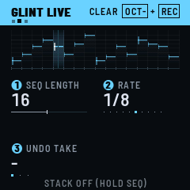

![COUNT-IN · 2 as the title, CLEAR [OCT−] + [REC] beside it, over DRONE SEQ II on LIVE: SEQ LENGTH 4, RATE 1 BAR, UNDO TAKE, STACK ON; three steps of chords](img/screen-count-in.png "REC, from silence")

**The metronome** (GLO › RECORD, K1): **REC**, it ticks while you record LIVE and through the count-in; **ALWAYS**,
on every beat, recording or not; **OFF**, never. Hold REC 0.8 s to turn it off, or back to the last value it had on. It
counts the sequence's own beats from its first step: a tick each beat, the higher one as the sequence comes round to
its first step. A sequence that is not a whole number of beats long starts its beats again from its first step each
time round (SEQ LENGTH 5 at 1/16, a beat and a quarter: the high tick, a tick a beat later, the high one again a
quarter beat after). REC flashes on the same beats, twice as quick as OCT. Both settings are kept with the settings,
not the scenes.

The screen draws the sequence as a line of time, SEQ LENGTH's steps alone, as wide as the next block of four (5 to 8
steps take a step as wide): each note a line at its note's height, a mark where it starts (taller with an accent), on
through its TIEs, the water under it down to the bed; a rest, nothing. STEP stops at SEQ LENGTH. The note playing is
bright, a line of light going along; the step on STEP has an amber line under it (none on LIVE). While RECORD is on, the
strip is ruled, faintly: a line each whole tone, so a note sits on a line or between two (fewer lines when the notes
span more than the strip has room for, the Cs a touch brighter), and a column each step. The column being recorded
into is lit in ice: on STEP, the one the next key writes; on LIVE, the one playing. RECORD OFF, the rules go. The keys
light the note playing. Each scene keeps its own sequence.

![GLINT SEQ II: STEP 1, NOTE D4, LENGTH 1 STEP, ACCENT ON; over it sixteen steps, the playhead going along; CLEAR [OCT−] + [REC] in the header, STACK OFF (HOLD SEQ) at the foot](img/screen-glint-seq.png "SELECT on GLINT, SEQ, SEQUENCE ON, then SEQ")

**The delay** is GLINT's alone. TIME runs from 1/32 to 1/2, with triplets and dotted values (twelve), always
ping-pong; a scene from before keeps its time, a mono one becomes ping-pong. Its time follows MIDI clock, or TEMPO.
Its echoes go into the cloud with GLINT: SPACE, on the same page, is how much.

---

## 7. BASS

Turn **SELECT** all the way, to BASS: the keys play BASS, the header turns orange. One note at a time, deep and
steady: one of eight MODELs, DRIVE into a soft clip, through a resonant low-pass. Only its SPACE goes into the reverb.

**Models:** SINE (pure), TRIANGLE (soft, a little hollow), SQUARE (hollow, woody), SAW (bright, buzzing), REESE (two
saws ten cents apart, beating slowly), SUB (the sine and its octave below), ORGAN (three drawbars: the note, its
octave and its twelfth), FM (a sine modulating itself: round, growling). Turning MODEL while the bass sounds crosses
over in a few milliseconds, without a click. PRESETS (B) turns MODEL, on any page; your own bass presets come after
the eight (section 10).

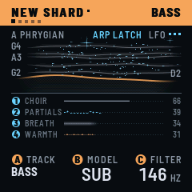

| Gesture | What happens |
| --- | --- |
| **Tap a key** | the bass holds that note: the key's note in the scale, OCTAVE octaves down. It rises over ATTACK, then settles over DECAY to SUSTAIN |
| **Tap another key** | the bass glides to its note (GLIDE), without a gap: it rises to the top again from where it is (with SUSTAIN at 100 %, it simply goes on); with PULSE on, PULSE strikes it on its next division (below) |
| **Tap the bass's key** | it lets go, over RELEASE |
| **Hold its key and press** | louder, and its filter opens. Let go: it stays |
| **Hold SEL, tap a key** | as a tap: the bass has one voice, so the note takes the place of what it holds (with ARP ON, it joins the arpeggio's notes) |

With KEYS' LATCH OFF (section 5), the bass sounds while its key is down. Holding PLAY lets it go with everything
else. It stays when you select another track.

**Its pages.** BASS selected, **EDIT** opens its sound, three pages; **ENV** its envelope; **ARP** its arpeggiator;
**SEQ** its sequencer.

| Button | Page | K1 | K2 | K3 | K4 |
| --- | --- | --- | --- | --- | --- |
| EDIT | BASS I | MODEL (SINE, TRIANGLE, SQUARE, SAW, REESE, SUB, ORGAN, FM) | LEVEL | FILTER (40 Hz to 5 kHz) | RESONANCE (Q 0.5 to 6) |
| EDIT | BASS II | OCTAVE (−2, −1, 0: every note the bass plays) | GLIDE (OFF to 2 s) | PULSE (OFF, 1/8 BEAT to 4 BEATS) | SPACE (the bass's reverb send) |
| EDIT | BASS TONE | DRIVE (clean to soft-clipped) | WEIGHT | PUNCH | BITE |
| ENV | BASS ADSR | ATTACK (5 ms to 5 s) | DECAY (10 ms to 10 s) | SUSTAIN (0 to 100 %) | RELEASE (30 ms to 15 s) |
| ARP | BASS ARP | ARP (OFF, ON) | MODE (UP, DOWN, UPDOWN, RANDOM, DRIFT) | RATE (the sequence's) | RANGE (1 to 3 octaves) |
| ARP | BASS ARP II (ARP ON) | CHANCE | LATCH (OFF, ON) | | |
| SEQ | BASS SEQ | SEQUENCE (OFF, ON) | SEQ LENGTH (1 to 32 steps) | RATE (1/16 to 16 BARS) | GATE |
| SEQ | BASS SEQ II (SEQUENCE ON) | STEP (1 to SEQ LENGTH) | NOTE (CUT, a note, HOLD) | LENGTH (the note's, in steps) | ACCENT (OFF, ON) |
| SEQ | BASS SEQ II, recording LIVE | SEQ LENGTH | RATE | UNDO TAKE (turn twice) | |
| SEQ | BASS SEQ III (SEQUENCE ON) | CHANCE | TRANSPOSE (−14 to +14 steps of the scale) | UNDO TAKE (turn twice) | |

With BASS selected, ALGORITHM (C) turns FILTER, on any page.

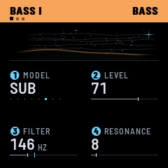

**BASS TONE** keeps the bass in its place in the mix. At 0, each leaves the bass as it is. **DRIVE** pushes it into a
soft clip. **WEIGHT** adds a sine an octave under the note (at the note itself when that is too low to hear), into a
soft clip whose harmonics carry it on a small speaker. **PUNCH** opens the filter and lifts the level as each note is
struck, falling back within some 50 ms. **BITE** adds an edge, the wave clipped hard through a band of 700 Hz to 3 kHz:
what cuts through the drones.

**The envelope** (BASS ADSR, in its usual order): ATTACK, how long a note takes to rise to the top; DECAY, how long
it then takes, while the note is held, to come down to SUSTAIN's level; SUSTAIN, the level it holds while the note is
held; RELEASE, how long it fades once let go. Each note played rises from where the bass is, over ATTACK, then decays
again. At SUSTAIN 100 %, as it starts, DECAY does nothing: there is nothing to come down to, and the bass holds, as it
always has. Lower SUSTAIN to hear DECAY; at 0 % a held note fades to silence over DECAY.

On BASS ADSR the river gives way to the envelope: ATTACK up to the top, DECAY down to SUSTAIN's level, SUSTAIN's
plateau, RELEASE down to nothing, each part as wide as its knob is turned (the plateau takes what is left), its time
across it, A D S R under it. The part whose knob you turn is lit. The bass's note is a little glint of lamp light
riding the curve: it waits at the end of the plateau while the note is held, then goes down RELEASE once let go.

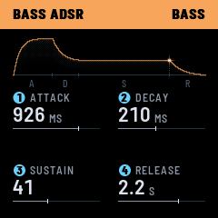

**PULSE** (BASS II, K3) makes the held note pulse on the grid (MIDI clock, else TEMPO, from the beat): OFF, 1/8 BEAT,
1/4 BEAT, 1/2 BEAT, 1 BEAT, 2 BEATS or 4 BEATS. On each, the note is let go for a moment and played again: it fades
over RELEASE through a short gap, then rises over ATTACK and settles over DECAY to SUSTAIN once more, the same note at
the same velocity, without gliding; pressing into it carries on. The gap is a quarter of the division, 8 ms at least
and 60 ms at most: at 120 BPM, 16 ms on 1/8 BEAT, 31 ms on 1/4 BEAT, 60 ms from 1/2 BEAT on. A short RELEASE and a low
SUSTAIN make a hard, gated pulse; a long RELEASE, a gentle swell on each beat. It pulses whatever plays the bass: a
key, a latched note, MIDI, the arpeggio or the sequence, inside its NOTEs only: never in a CUT, and a step that
begins with a NOTE is that division's attack itself.

PULSE keeps the beat. While the bass sounds, a note changed by hand (a key, a MIDI note) is not struck off the grid:
the bass goes to it (gliding, as GLIDE says) and PULSE strikes it on its next division. From silence, a key strikes
at once.

**OCTAVE** (BASS II, K1) is the bass's own: it moves every note the bass plays, a key's, a MIDI note's, the
arpeggio's, the sequence's (C1 the lowest). Turned, it moves the note sounding at once, gliding as GLIDE says.

A pure sine this low barely reaches the FM-1's small speaker: DRIVE, WEIGHT or a richer MODEL gives it the harmonics
that let you hear it there. In headphones or a mixer, SINE with DRIVE at 0 is a clean sub.

**The arpeggiator** (ARP ON) plays the held bass keys one at a time, on the bass's RATE, over RANGE octaves, as
GLINT's does (section 6), its CHANCE and LATCH its own. ARP and SEQ: one or the other, as on GLINT.

**The sequencer** (SEQUENCE ON, or REC with BASS selected). Up to 32 steps play the bass one after the other, all as
long as **RATE**: 1/16, 1/8, 1/4 (a beat), 1/2, 1 BAR, 2 BARS, 4 BARS, 8 BARS or 16 BARS (the arpeggio's too), on the
same grid as the others: MIDI clock when one comes in, else TEMPO. Each step is a **NOTE**, a **CUT** or a **HOLD**. As
a step begins, a NOTE plays its note (gliding from the last, as GLIDE says), a CUT stops the bass (it fades over
RELEASE), a HOLD changes nothing: a note lasts until the next NOTE or CUT, or as far into its last step as **GATE**
says (at 100 %, on to the next NOTE or CUT). **LENGTH** (BASS SEQ II, K3) is the note on STEP's: its step and the
HOLDs after it, written as you turn it. An **ACCENT** strikes the note at full velocity, pressed in: brighter and
louder. **SEQ LENGTH** is how many of the 32 play.

The steps keep their notes as the keys play them, without OCTAVE (BASS II): turning OCTAVE moves the whole sequence.
Two NOTEs of the same pitch in a row are one note held on (with SUSTAIN under 100 %, the second rises to the top
again): a CUT between them makes two.

PLAY starts and stops it with the other tracks' sequences (section 4). Turned on, the sequence starts on the grid's
next step; MIDI Start starts it from its first step. Hold PLAY: RELEASE ALL stops it with everything else; hold it
again, RESTORE starts it again from its first step. Both start the beat there too.

- **RECORD OFF, the sequence stopped, or on BASS SEQ's pages:** the keys play the bass as KEYS says, to try a line.
  Over a sequence running, a key sounds while it is down, latching nothing, the steps silent under it.
- **RECORD OFF, the sequence playing, on any other page:** the keys transpose it. A key moves it from its first NOTE
  to that key's, along the scale. TRANSPOSE (BASS SEQ III, K2) shows how far, and turns it back. The keys sound
  nothing themselves. A sequence with no NOTE in its SEQ LENGTH has nothing to transpose: the keys play the bass, as
  with SEQUENCE OFF, and its CUTs leave it sounding.
- **RECORD on STEP** (REC twice): a key (or a note on BASS's MIDI channel) writes its note on STEP, a step long; it
  sounds while the key is down. K3 (LENGTH) then draws it out, its HOLDs after it. STEP stays where it is: K1 moves it.
  K2 changes the note on STEP (as the bass plays it, OCTAVE on it; CUT all the way down, HOLD all the way up).
- **RECORD on LIVE** (REC): play while it runs: a take, counted in as GLINT's (section 6, Recording); BASS SEQ II
  shows SEQ LENGTH, RATE and UNDO TAKE. Each note sounds
  as you play it and goes in as you played it, its start and its length to the step (a step at least), over what was
  there: a NOTE, then HOLDs as long as you held it. The loop keeps its SEQ LENGTH. A key pressed while another is down
  ends that one where it begins (legato); let go, the one still down takes over. While a key is down the sequence's
  own steps under it are silent, the bass playing one note at a time: what you hear is what the loop will hold.
- **CLEAR:** hold OCT− and press REC, on BASS's SEQ pages: every step a CUT (BASS SEQUENCE CLEARED), as GLINT's.
- **UNDO TAKE:** turned twice: the sequence as it was before the last take or CLEAR. Again: back to the one after.

The screen draws the sequence as a line of time, SEQ LENGTH's steps alone, as GLINT's: each NOTE a line at its note's
height, on through its HOLDs, the water under it down to the bed, as the bass's in the river; a CUT, nothing. The note
playing is bright, the playhead a line of lamp light going along; the step on STEP has a lamp line under it (none on
LIVE). While RECORD is on, the strip is ruled, faintly: a line each whole tone (fewer when the notes span more),
a column each step; the column being recorded into is lit in lamp: on STEP, the one the next key writes, on LIVE, the
one playing. On LIVE, the note you hold is drawn bright as you hold it, from where you pressed it to the playhead; let
go, it is written in. With SEQUENCE OFF, it is all slate. The keys light the note playing.

![BASS SEQ II: STEP 6, NOTE HOLD, LENGTH 2 STEPS, ACCENT OFF; over it a line of notes and HOLDs, a CUT in the middle, the playhead after it; CLEAR [OCT−] + [REC] in the header](img/screen-bass-seq.png "SELECT on BASS, SEQ, SEQUENCE ON, then SEQ")

Each scene keeps its own bass sequence: its notes, its RATE, SEQ LENGTH, GATE and TRANSPOSE, and whether ARP or SEQ is
on. A scene loaded plays its own, or none, from its first step. While SEQUENCE is on, notes on BASS's MIDI channel go
into the sequencer as the keys do.

---

## 8. DRONE SEQ

The drone has a sequence of its own: its chords, a step at a time. Each step holds the notes the drone plays there
(up to eight: a chord as HARMONY builds it, single notes stacked over it), a rest, or a tie. Select the DRONE and press
**SEQ**: DRONE SEQ, its ON/OFF first. The drone has no arpeggiator: **ARP** on the DRONE opens a page, DRONE ARP, that
only says NOT AVAILABLE FOR DRONE, and holding it does nothing.

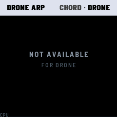

| Page | K1 | K2 | K3 | K4 |
| --- | --- | --- | --- | --- |
| DRONE SEQ | SEQUENCE (OFF, ON) | SEQ LENGTH (1 to 32 steps; 4 at first) | RATE (1/16 to 16 BARS; 1 BAR at first) | GATE |
| DRONE SEQ II (SEQUENCE ON) | STEP (1 to SEQ LENGTH) | NOTES (REST, its notes, TIE) | LENGTH (the chord's, in steps) | STACK (KEYS', OFF, ON) |
| DRONE SEQ II, recording LIVE | SEQ LENGTH | RATE | UNDO TAKE (turn twice) | STACK |
| DRONE SEQ III (SEQUENCE ON) | CHANCE | TRANSPOSE (−14 to +14 steps of the scale) | UNDO TAKE (turn twice) | |

As a step begins, its notes sound on the drone as a held chord does, every layer of it, each voice on its own
envelope (DRONE SHAPE's ATTACK and RELEASE). They are let go as the next step begins, or as far into the step as
GATE says (100 %, the default: all of it); a TIE holds them on. A note a latched chord holds already sounds once.
**NOTES** (DRONE SEQ II, K2) shows the step on STEP: REST, how many notes (3 NOTES), or TIE; turned, it makes it a
rest or a tie. **LENGTH** is the chord's: its step and the ties after it. RATE runs from 1/16 to 16 BARS, as the
bass's: the default, 1 BAR a step over SEQ LENGTH 4, is four bars round. **STACK** (K4) is KEYS' own for the drone,
at hand: it says whether a new hand replaces a step or joins it.

It plays on the beat with GLINT's and the bass's, from the top with them: PLAY, a scene loaded, MIDI Start. TRANSPOSE
moves it along the scale. CHANCE may leave a step out.

The strip draws a column a step, SEQ LENGTH's steps alone, each note a line at its height; a tie carries the step
before on. The step playing is lit, and on DRONE SEQ II the step on STEP has a line under it (none on LIVE).

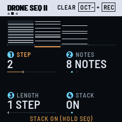

**Recording.** With the DRONE selected, **REC** records into its sequence: LIVE, then STEP, then OFF, as GLINT's
(section 6): DRONE SEQ II on screen, SEQUENCE ON, counted in from silence.

- **LIVE:** what the drone's keys sound goes into the step under the playhead (the nearest at quicker RATEs), as it
  sounds (TRANSPOSE taken back off it): a key, a chord latched or tapped again, a note on the drones' MIDI channel.
  STACK OFF, your first hand on a step joins what an earlier take left there, another hand in the same turn takes its
  place, and once the loop comes round, a hand takes the whole step. STACK ON, every hand joins the step (none twice,
  eight notes at most). The keys latch as ever; RECORD OFF lets go of what the take latched.
- **STEP:** a chord held goes into STEP's step, sounding while its keys are down: nothing latches, so what you hear
  after is the sequence. STACK OFF, a new hand takes the step's place; STACK ON, it joins it. STEP stays: K1 moves it.
- **RECORD OFF:** the keys play chords over the sequence, as ever.

Each scene keeps its drone sequence.

---

## 9. The pages

Press a page's button again for its next page. A button opens its page when you let it go, because holding it may do
something else (section 4, the buttons). The dots under the page's name say where you are among them.

- **Whatever the track:** FX ×8, SEL ×1, LFO ×6 (the three LFOs and their targets), GLO ×8 (GLOBAL, MIDI,
  MASTERING, MASTER EQ, MASTER EQ II, ROUTING, SCREEN, RECORD), HOME ×5 (SOUND, KEYS, MIXER, CLOUD SEND, the logo),
  SAVE (section 10).
- **The selected track's:** EDIT (the DRONE ×9, GLINT ×3, BASS ×3), ENV ×1, ARP (×1 while OFF, ×2 while ON; the DRONE
  none), SEQ (×1 while OFF, ×3 while ON).

| Button | Page | K1 | K2 | K3 | K4 |
| --- | --- | --- | --- | --- | --- |
| HOME | SOUND | CHOIR | PARTIALS | BREATH | WARMTH (soft saturation) |
| HOME | KEYS | HARMONY (OFF, ON) | NOTES (SINGLE NOTE, CHORD) | LATCH (OFF, ON: two detents) | STACK (OFF, ON) |
| HOME | MIXER | DRONE | BASS | GLINT | CLOUD (each 0 to 127, 100 as it is; with OCT− held, the PAN: L50 to C to R50) |
| HOME | CLOUD SEND | DRONE | GLINT | BASS | |
| EDIT (DRONE) | DRONE TONE | PRESET (CUSTOM, the 36, yours) | TIMBRE (all three layers' brightness) | SPACE (the reverb's share) | BODY (100 %: as set; down: thinner) |
| EDIT (DRONE) | DRONE MOTION | MOTION (the drift's depth) | RATE (20 s to 0.5 s) | TIDE (a swell of the timbre) | PERIOD (5 min to 10 s) |
| EDIT (DRONE) | CHOIR | CHOIR (level) | DETUNE (0 to 40 cents) | FILTER (follows the note) | WARMTH |
| EDIT (DRONE) | CHOIR II | SHAPE (SAW, SQUARE in the middle, then narrower pulses) | INTERVAL (the centre saw: UNISON, −12, +7, +12) | RESONANCE (the filter's peak, Q 0.5 to 20) | TYPE (LOW, BAND, HIGH) |
| EDIT (DRONE) | CHOIR III | SOFT (the wave softened: 50 %, a square becomes a triangle; 100 %, near a sine) | | | |
| EDIT (DRONE) | PARTIALS | PARTIALS (level) | TILT (bright to dark) | ODD (odd harmonics) | STRETCH (toward a bell) |
| EDIT (DRONE) | PARTIALS II | EVOLVE (their levels wander, deeper and quicker) | BEAT (each one pulses at its own pace) | FORMANT (its place, H1 to H8) | PEAK (up to that harmonic alone) |
| EDIT (DRONE) | BREATH | BREATH (level) | RESONANCE (air to glass) | COLOR (harmonic, odd, bell) | SPREAD (the voices' width) |
| EDIT (DRONE) | BREATH II | GRAIN (a hiss to sparse grains) | PITCH (the resonators: −12, UNISON, +12, +19, +24) | TONE (the noise darker or brighter) | AIR (the noise itself, beside them) |
| EDIT (GLINT) | GLINT I, II, DELAY | section 6 | | | |
| EDIT (BASS) | BASS I, II, TONE | section 7 | | | |
| ENV (DRONE) | DRONE SHAPE | ATTACK (5 ms to 30 s) | RELEASE (50 ms to 60 s) | PRESSURE (its effect) | VELOCITY |
| ENV (GLINT, BASS) | GLINT ADSR, BASS ADSR | ATTACK | DECAY | SUSTAIN | RELEASE |
| ARP (GLINT, BASS) | ARP, ARP II | ARP (OFF, ON) · CHANCE | MODE · LATCH | RATE | RANGE |
| SEQ | SEQ, SEQ II, SEQ III | SEQUENCE (OFF, ON) · STEP · CHANCE | SEQ LENGTH · NOTE · TRANSPOSE | RATE · LENGTH · UNDO TAKE | GATE · ACCENT (the DRONE: STACK) · – |
| SEQ | SEQ II, recording LIVE | SEQ LENGTH | RATE | UNDO TAKE | the DRONE: STACK |
| LFO | LFO 1, LFO 2, LFO 3 | SHAPE (SINE, TRIANGLE, SAW, RAMP, SQUARE, RANDOM, DRIFT) | RATE (200 s to 10 Hz, then 16 BARS to 1/16) | DEPTH (0: off) | POLARITY (BIPOLAR, UP, DOWN) |
| LFO | LFO 1, 2, 3 TARGETS | TARGET 1 | TARGET 2 | TARGET 3 | TARGET 4 (each OFF or a setting) |
| SEL | HARMONY | ROOT | SCALE | CHORD | VOICING |
| FX | GENERATIVE FX | SWELL (every voice swelled, held) | SPARKLE (glints by themselves) | BLUR (the drone into the cloud) | SINK (a low-pass on everything) |
| FX | CLOUD | SIZE | DECAY (0.4 s to 60 s) | TONE (how long the highs last) | FREEZE (OFF, ON) |
| FX | CLOUD II | DIFFUSION | MODULATION | PRE-DELAY (0 to 200 ms) | WIDTH (the tail's stereo width) |
| FX | CLOUD III | SHIMMER | INTERVAL (+12, +7, +5, +19, −12) | BRIGHT (the shimmer's brightness, 700 Hz to 8 kHz) | |
| FX | MASTER FILTER | TYPE (OFF, LOW PASS, HIGH PASS) | CUTOFF (20 Hz to 20 kHz) | RESONANCE | TRACKS (ALL, DRONE, GLINT, BASS, or two of them) |
| FX | LOFI TAPE | TAPE (OFF, ON) | SATURATION | WOBBLE (wow, flutter, hiccups) | TRACKS (as MASTER FILTER's) |
| FX | LOFI TAPE II | TAPE SPEED (×0.25 to ×2.00) | TONE (dark to bright) | NOISE (hiss) | DROPOUT |
| FX | PUMP | RATE (OFF, 4 BARS, 2 BARS, 1 BAR, 1/2, 1/4, 1/8) | DRONE (its depth) | BASS | GLINT |
| FX | PUMP II | RELEASE (10 to 100 % of the period) | ATTACK (1 to 300 ms) | OFFSET (0 to 100 % of the period) | |
| GLO | GLOBAL | TEMPO (30 to 240 BPM) | LOW CUT (20 to 500 Hz) | TUNE (±50 cents) | ARP SNAP (OFF, 1/16, 1/8, 1/4, 1/2, 1 BAR) |
| GLO | MIDI | DRONE CH | GLINT CH | BASS CH (each OFF, 1 to 16, OMNI) | CLOCK (AUTO, INTERNAL) |
| GLO | MASTERING | THRESHOLD (−40 to 0 dB) | RATIO (OFF, 1.5:1 to 20:1) | RELEASE (30 ms to 1.5 s) | GAIN (0 to +18 dB) |
| GLO | MASTER EQ | PRESET (OFF, CUSTOM, then the seven) | LOW | MID | HIGH (each −12 to +12 dB) |
| GLO | MASTER EQ II | LOW FREQ (a shelf, 30 to 600 Hz) | MID FREQ (a bell, 80 Hz to 12 kHz) | Q (the bell's width, 0.4 to 8) | HIGH FREQ (a shelf, 1.5 to 16 kHz) |
| GLO | ROUTING | FILTER (POST CLOUD, PRE CLOUD) | TAPE (POST CLOUD, PRE CLOUD) | CLOUD PUMP (ON, OFF) | SPK/JACK (ON, OFF) |
| GLO | SCREEN | ANIMATIONS (NORMAL, LOW) | SCREENSAVER (ON, OFF) | IDLE TIME (1 to 60 MIN) | HEADER (INVERT, DARK) |
| GLO | RECORD | METRONOME (OFF, REC, ALWAYS) | COUNT-IN (OFF, 1 BAR) | TUNE A4 (415 to 466 HZ) | |
| SAVE | SCENES | the slot, 1 to 16, or NEW SHARD above | MORPH (CUT, 1 S to 2:00) | LOAD (SND+NOTES, SND ONLY) | |

GLINT's pages are in section 6, BASS's in section 7, the DRONE's sequence in section 8.

**GLOBAL** (GLO): TEMPO, the grid's when no MIDI clock comes in (the arpeggiators, the sequences, GLINT's delay, PUMP,
the LFOs on the grid), each scene its own (section 10); LOW CUT; TUNE; ARP SNAP, where a new chord joins an arpeggio
(section 6), kept through power-off. While a MIDI clock leads (CLOCK on AUTO), TEMPO reads **TEMPO (EXT)**: the
clock's tempo, greyed, K1 not turning it. Your TEMPO stays as it was, and comes back when the clock stops.

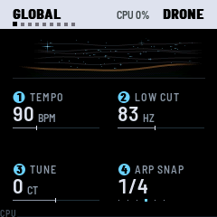

**RECORD** (GLO, last page): METRONOME and COUNT-IN, for recording (section 6, Recording); TUNE A4, the pitch A4
sounds at, 415 to 466 Hz, 440 at first: every voice moves with it, the notes stay the same. A quick turn stops at 432
and at 440. All three are kept with the settings, not in scenes (GLOBAL's TUNE, ±50 cents, is the scene's).

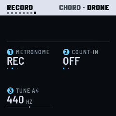

**GENERATIVE FX** is FX's first page, to perform with, on the whole sound:

- **SWELL** swells every drone voice as far as it is turned, and holds it there (with ENV's and CC 11's, the most of
  them). A scene keeps it, and ANCHOR glides it back; one made by an earlier FRASIL comes in at 0. ENV held and CC 11
  swell only while they last.
- **SPARKLE** plays glints by themselves, now and then, on the notes the drones hold: GLINT's OCTAVE up, one in three
  an octave more, soft and short, in GLINT's sound. From a few a minute to about six a second. No drone, no sparkle.
- **BLUR** dissolves the drone into the cloud: wetter (SPACE toward 90 %), a longer DECAY, more DIFFUSION and
  MODULATION, the glints further in too. The settings themselves stay where they are.
- **SINK** takes everything under: a low-pass on the whole mix, from 12 kHz down to about 120 Hz (some 2.4 kHz at
  25, 800 Hz at 50), with a small resonance as it goes down.

A scene keeps SWELL, SPARKLE, BLUR and SINK. An LFO can move the last three.

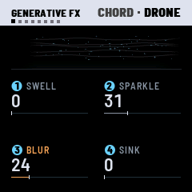

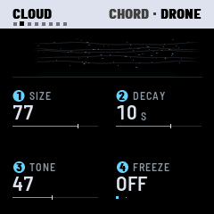

**MASTER FILTER** (FX, fifth page) is a low-pass or a high-pass, 12 dB an octave, on the tracks you choose: TYPE (OFF,
LOW PASS, HIGH PASS), CUTOFF (20 Hz to 20 kHz), RESONANCE (its peak), TRACKS (ALL, DRONE with its CLOUD, GLINT with its
echoes, BASS, or two of them). An LFO can move CUTOFF and RESO. On any page, hold GLO and turn ALGORITHM (C): CUTOFF;
with TYPE OFF, the filter turns on, LOW PASS.
The page draws the filter's response: the resonance's peak, what passes as water under the curve, CUTOFF's badge at
the corner.

**LOFI TAPE** (FX, sixth page) puts the tracks you choose on tape: TAPE (OFF, ON), SATURATION (the tape's; the output
stays about as loud as what goes in, so it changes the colour and the density, not the volume, and duller as it grows,
from 16 kHz down to 6 kHz), WOBBLE (wow, up to about 3 % at 100 with a slow drift under it, and flutter; now and then,
more often as it grows, the tape drags: slower for a tenth of a second to well over a second, up to 8 % at 100, its
level dipping, then it catches up), TRACKS (as MASTER FILTER's). The page shows a cassette's reels, turning
anticlockwise as the tape runs, the right one filling as the left empties, with a quick rewind at the end: a wow sways
them, a drag nearly stops them. The tape runs round two rollers and over the head; WOBBLE loosens and sways it,
SATURATION warms it and lights a glow round the head.

**LOFI TAPE II** (FX, right after LOFI TAPE) is the tape's other four settings: TAPE SPEED (the whole sound slowed
down or sped up, as a tape played slower or faster: ×0.25 to ×2.00, ×1.00 in the middle; ×0.50 is an octave lower and
half as fast, ×2.00 an octave higher and twice as fast, ×0.25 two octaves lower and four times slower. It moves every
voice's pitch, the grid's tempo (the arpeggios, the sequences, DRONE SEQ), the LFOs' rates, the envelopes' times and
the tape's own wow and flutter; CLOUD and the delays stay in real time, as if the tape came before them. With a MIDI
clock coming in, the tempo stays the clock's and only the pitch moves. A change glides briefly, as a tape slowing
down. On a half-tone, the page shows the change in tones between the reels: -1.5 TONES, -1 TONE, +3.5 TONES), TONE (how dull or bright the
tape is: the pole SATURATION sets, from a quarter of its cutoff to four times, the middle leaving it where it was),
NOISE (the tape's hiss, up from nothing: it has no low end, and TONE dulls it too) and DROPOUT (now and then, more
often as it grows, up to about twice a second, the level dips for a tenth of a second or so, as a bad patch of tape
does; a deep one nearly silences it). A new scene starts at ×1.00, TONE +10, NOISE 0 and DROPOUT 0. A scene made
before this page comes in at ×1.00, TONE 0, NOISE 0 and DROPOUT 0, so it sounds as it did, its flutter at 5 Hz.
The page is there only while TAPE is ON: when it is OFF, FX goes past it (the page is skipped, not greyed), and SELECT
turned with FX held does the same. The cassette's reels are on this page too. The four are LFO targets: TAPE SPEED,
TAPE TONE, TAPE NOISE and DROPOUT (an LFO on TAPE SPEED glides it as the knob does, a tape slowing and speeding up).

When MASTER FILTER's TYPE or LOFI TAPE's TAPE is OFF, the page's other settings are grey; they still turn.

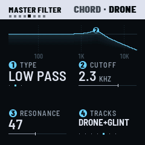

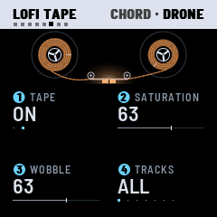

**PUMP** (FX, seventh page) ducks the tracks on the beat, as a sidechain from a kick would, without a kick: at RATE,
on the arpeggiator's grid (MIDI clock, else TEMPO), each track dips and comes back up. DRONE, BASS and GLINT set how
deep each one goes; the cloud pumps with the drones. The river breathes with it. PUMP II shapes it: RELEASE, how much
of the period it takes to come back (short: a tight pump; all of it: a slow breath); ATTACK, how fast it goes down
(1 ms: a kick's; 300 ms: a soft wave); OFFSET, where in the period it goes down (50 %: on the off-beat).

**MASTERING** (GLO, third page) is a compressor on the whole output, before the soft limit: THRESHOLD, RATIO (OFF by
default), RELEASE (its attack is 10 ms) and GAIN, the make-up. The page shows the gain reduction, live.

**MASTER EQ** (GLO, fourth page) shapes the whole output before MASTERING: three bands, LOW and HIGH (shelves) and MID
(a bell), each −12 to +12 dB in half decibels. PRESET sets the three; turn a band then, and PRESET says CUSTOM. OFF
bypasses the EQ and keeps the bands, grey on both pages: CUSTOM again, they are as they were (turn between the two to
hear the sound with and without). **MASTER EQ II** sets where they are: LOW FREQ, MID FREQ and its Q, HIGH FREQ. Both
pages draw the EQ's curve: what it raises warm, what it cuts ice, each band's knob a small badge on it.

| PRESET | |
| --- | --- |
| FLAT | 0 dB everywhere |
| WARM | +2.5 dB under 150 Hz, −2 dB over 7 kHz |
| AIR | +3 dB over 10 kHz |
| MUD CUT | −3.5 dB at 300 Hz |
| BOX CUT | −3 dB at 600 Hz, narrower |
| LOUD | +3 dB under 100 Hz, +2.5 dB over 9 kHz, −1 dB around 1 kHz |
| SMALL SPEAKER | −6 dB under 120 Hz (what a small speaker cannot carry), +2 dB of presence at 2.5 kHz |

**ROUTING** (GLO, sixth page) says where MASTER FILTER and LOFI TAPE sit against the cloud, and whether the drone ducks
its return, and quiets the FM-1's own output.

- **FILTER** (POST CLOUD, PRE CLOUD): PRE CLOUD, each track the filter is on goes through it before the cloud takes its
  share, so the cloud is fed filtered and its return is left as it is. POST CLOUD (as before): after the cloud; on
  DRONE the cloud's return is filtered with it.
- **TAPE** (POST CLOUD, PRE CLOUD): PRE CLOUD, the tape is on the tracks themselves only; the cloud is fed and comes
  back clean, untaped. POST CLOUD (as before): after the cloud; on DRONE the cloud's return is taped with it.
- **CLOUD PUMP** (ON, OFF): ON (as before), PUMP ducks the cloud's return with the drone. OFF, the return is not ducked.
- **SPK/JACK** (ON, OFF): OFF quiets the FM-1's own output, the speaker and the headphone jack (one output serves both),
  while the USB audio goes on (section 11). A setting of the FM-1, kept through power-off, not in the scenes.

The strip draws the chain: the tracks, the cloud on a lane below (its share down, its return up), FILTER and TAPE before
or after it, slate when off; a small saw on the return for CLOUD PUMP; a speaker at the end, crossed out when SPK/JACK
is OFF.

**SCREEN** (GLO, seventh page): ANIMATIONS, NORMAL or LOW, kept through power-off. LOW, what only decorates stands
still (the river and its particles, the tape's reels, the logo screen); the screen is drawn again when a value changes,
and four times a second for what informs (the meters, the playheads). SCREENSAVER, ON or OFF (ON at first), kept
through power-off: ON, after IDLE TIME without a touch of a button, a knob or a key (1 to 60 minutes, 10 at first, kept
too; slate while SCREENSAVER is OFF), the screen goes black and the logo drifts across it; the sound goes on as it was, and MIDI does not wake it. Any control wakes it, and only wakes it:
that touch changes nothing. HEADER, INVERT or DARK (INVERT at first), kept through power-off: INVERT, the band at the top
in the selected track's colour, its words and marks dark; DARK, the band dark, its words and marks in the track's colour,
no line under it.

A scene keeps MASTER FILTER, LOFI TAPE (LOFI TAPE II's four too) and MASTER EQ, as it keeps MASTERING, and ROUTING's
FILTER, TAPE and CLOUD PUMP; one made by an earlier FRASIL comes in with the three off, and one made before LOFI TAPE II
with its four in the middle, at nothing, as it sounded.

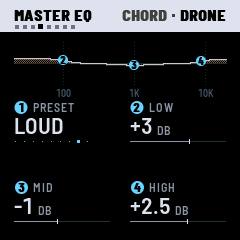

**The drone's second pages.**

- **CHOIR II.** SHAPE takes each saw toward a square, reached in the middle: hollow, woody, the even harmonics
  gone. Past it, the pulse narrows: brighter, nasal. Its width sways on its own, as an old synthesizer's pulse width
  modulation does, more so toward the narrow end. It stays as loud all the way. INTERVAL moves the centre saw an
  octave down, a fifth up or an octave up, under or over its two detuned neighbours. RESONANCE gives the filter a
  peak, a soft vowel by the middle, a whistle at the top. TYPE is the filter: LOW (the low-pass, as on the first
  page), BAND (a band-pass: nasal, vocal) or HIGH (a high-pass: thin, airy). FILTER sets where it sits either way.
  Above the page, the wave: faint, as SHAPE makes it; bright, as heard.
- **CHOIR III.** SOFT rounds the choir's wave off, the harmonics going down, the fundamental as loud: at 50 % a
  square becomes a triangle, at 100 % the wave is near a sine. At 0, the wave as SHAPE makes it. Its wave above the
  page, as on CHOIR II. The presets set it to 0.
- **PARTIALS II.** EVOLVE makes the partials' levels wander much further, and up to four times quicker, than
  MOTION alone does: partials come and go, and the spectrum changes colour by itself. At 0 they wander as MOTION has
  them. BEAT makes each partial pulse at its own pace, slow and shallow at first, quick and deep at the top (about
  7 Hz): a shimmering, beating texture, as loud as before. FORMANT and PEAK lift the partials around one harmonic, as
  a vowel does. The higher PEAK, the narrower, and the more the rest go down: at the top only that harmonic sounds,
  as in overtone singing. Sweep FORMANT with PEAK up. At 0, PEAK leaves the spectrum as TILT and ODD make it.
- **BREATH II.** GRAIN turns the hiss into grains, sparser as you turn it up: the resonators then ring like ice
  ticking, or rain on glass, more so with RESONANCE high. PITCH moves the resonators an octave down or up, a twelfth
  or two octaves up: an airy halo over the drone. TONE makes the noise darker (turned left) or brighter (right)
  before it reaches them. AIR adds the noise itself, beside the resonators: breath, or with GRAIN, crackle.

They all start where the sound was before them. SHAPE, RESONANCE, TYPE, BEAT and AIR take more of the processor.
With many voices and several of them up, FRASIL thins out the partials, then the voices, to keep the sound going.

**LFO 1, LFO 2 and LFO 3** move the sound on their own. Tap LFO: LFO 1, then its targets, LFO 2, its targets, LFO 3,
its targets.

- **SHAPE:** SINE, TRIANGLE, SAW (up), RAMP (down), SQUARE, RANDOM (a new value each turn, held) or DRIFT (a new
  value each turn, glided to).
- **RATE:** one knob, free first: from a 200-second turn to 10 Hz. Past the fastest it is on the grid: 16 BARS to
  1/16, with triplets, following MIDI clock when one comes in, else TEMPO (GLOBAL, K1). MIDI Start puts those back to
  the top of their turn.
- **DEPTH:** 0 is off. Up, it reaches the whole range of each target.
- **POLARITY:** BIPOLAR moves a setting both ways around where you set it, UP only above, DOWN only below.
- **TARGET 1–4:** each OFF or one of 61 settings, as the screen writes them: TIMBRE, SPACE, MOTION, WARMTH, CHOIR,
  PARTIALS, BREATH; CHOIR's CH DETUNE, CH FILTER, CH SHAPE, CH RESO, CH SOFT; PARTIALS' PA TILT, PA ODD, PA STRETCH,
  PA EVOLVE, PA BEAT, PA FORMANT, PA PEAK; BREATH's BR RESO, BR COLOR, BR GRAIN, BR TONE, BR AIR, BR SPREAD; GLINT's
  GL LEVEL, GL BRIGHT, GL PING, GL SPACE, GL CHANCE (the arpeggiator's and the sequencer's CHANCE), SEQ LEN (its SEQ
  LENGTH), GL ATTACK, GL DECAY, GL SUSTAIN, GL RELEASE; the bass's BS FILTER, BS RESO, BS DRIVE (they glide, so a
  FILTER swept by an LFO is a smooth wobble), BS ATTACK, BS DECAY, BS SUSTAIN, BS RELEASE; DRONE LVL, GLINT LVL and
  BASS LVL (the MIXER's), BODY, SPARKLE, BLUR, SINK, MS CUTOFF and MS RESO (MASTER FILTER's), DRONE PAN, BASS PAN,
  GLINT PAN and CLOUD PAN (the MIXER's pans: chosen here, the MIXER's knobs being the levels), TAPE SAT and WOBBLE (LOFI TAPE's SATURATION and WOBBLE), TAPE SPEED, TAPE TONE, TAPE NOISE and DROPOUT (LOFI TAPE II's four; the tape's six sound once TAPE is on). Each is written in its
  track's colour: GLINT's ice blue (the GL ones, GLINT LVL, SEQ LEN, SPARKLE, GLINT PAN), BASS's orange (the BS ones,
  BASS LVL, BASS PAN), the drone's white, the whole mix's green (MS CUTOFF, MS RESO, BLUR, SINK, CLOUD PAN, the tape's six). TARGET's
  list opens in the name grid, on five pages by section, the tape's six on the last, LOFI TAPE (section 3): you hear a
  target as you stop on it, SEL keeps it, FX goes back to the one before.

An LFO runs freely and without end while it is on, with DEPTH up and a target set; a key does not start or restart
it. Its four targets move together, each by its AMOUNT (below), and LFOs on one setting add up. The setting keeps the
value you gave it, and that is what a scene saves, with the LFOs; the LFO moves the sound around it. On every page,
a setting's gauge shows a small ice-blue mark where the LFO has it now. On an LFO's pages the river gives way to
its shape and a glint where it is, grey while it is off. GL BRIGHT and GL PING are set at each strike: an LFO on
them changes the next notes. The engine glides between the LFO's steps, so a SQUARE or a RANDOM steps softly.

**LFO held and an encoder.** On any page, hold LFO and turn K1, K2, K3 or K4: the setting under that encoder goes
onto LFO 1, then LFO 2, LFO 3, then none (turned back, the other way), into that LFO's first free TARGET, its AMOUNT
at ×1.00. An LFO's DEPTH at 0 comes up to 25 %. The header says where it went: FILTER > LFO 2, FILTER > NO LFO (in
bold, deep red), LFO 2 FULL (its four TARGETs taken), or NOT AN LFO TARGET. Let LFO go without turning anything and it
opens its pages, as ever.

**SEL held and an encoder: the AMOUNT.** Each TARGET has its AMOUNT, a multiplier of how far the LFO moves that
setting: ×1.00 the LFO as it is (as at first), ×0.50 half as far, ×0.00 not at all, ×3.00 three times, up to ×5.00
(the setting still stops at its ends). On any page, hold SEL and turn K1, K2, K3 or K4: the AMOUNT of the setting
under that encoder, on the LFO it is on. The header says it large, LFO 1 AMOUNT ×0.35, a bar under it from ×1.00 at
its middle, filling to the left down to ×0.00, to the right up to ×5.00. On an LFO's TARGETS page, it is that
TARGET's. A setting on no LFO: NO LFO; an empty TARGET: NO TARGET. On the TARGETS pages, a target whose AMOUNT is not
×1.00 has a small gauge under its name, lamp while SEL turns it. A scene keeps the AMOUNTs; one made by an earlier
FRASIL comes in with every AMOUNT at ×1.00, as it sounded.

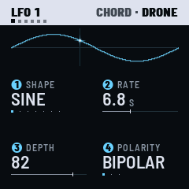

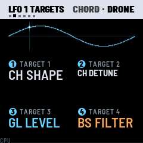

---

## 10. Scenes and presets

A **scene** is the whole sound with what plays: the three tracks and their settings, the latched drones (up to 8
chords), the arpeggios' notes, the bass's note, the three sequences, the effects, the LFOs and their AMOUNTs, SWELL,
TEMPO, its name. A **preset** is one track's sound alone: a drone, a GLINT sound, a bass. Sixteen scene slots; your
presets come after the factory ones.

**SAVE** opens a page of two: **LOAD** and **SAVE**, on K1, SAVE at first, then your last choice until power-off. Its
title follows K1: SCENES on LOAD, SAVE on SAVE. As every question: **SEL** goes on with the one chosen, **FX** goes back
where you were, and those two are lit. **SAVE** again goes straight to saving: SAVE twice opens WHAT and INTO. The other
buttons still work, dark: they leave SAVE.

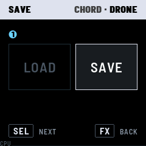

**LOAD** opens SCENES. The page lists five lines around the one K1 picks (framed in ice; SELECT scrolls it the same
way, both ways, and leaves the track as it is; a page button held with it still turns that button's pages): NEW SHARD
first, then the sixteen slots, each its number, its name and what it holds (what it plays, FACTORY, EMPTY; a long name
takes its room, as large as the others; the one K1 picks rolls slowly along and back, as on the play page), NOW by the
one loaded. Under them a box says what the buttons do: PLAY LOAD, and SAVE + REC STORE (on NEW SHARD, PLAY LOAD
alone). K2 and K3 are MORPH and LOAD. **PLAY** loads the slot K1 points at. SAVE goes back
where you were; FX here opens FX's pages.

- **NEW SHARD**, above slot 01 (turn K1 below slot 1): not a slot, a sound to start a new shard from, fresh. Its line
  has a plus for a number and says START FRESH; K1 on it, it is framed in lamp. PLAY loads it as any scene (MORPH,
  LOAD); it is then the current scene: the play page's header says NEW SHARD, SAVE lights while the sound differs from
  it, COMPARE plays it. It puts KEYS back to their first values (section 5). It plays nothing: tap a key. A new FM-1, with nothing stored yet, starts on it.
- **Load:** with nothing playing, the scene plays at once: its own notes (not those a RELEASE ALL kept for RESTORE)
  and its sequences from their first steps, the beat beginning there. Only power-on stays quiet. On any page, hold
  **SAVE** and press a white key: the 16 white keys are the 16 scenes, F2's key the first. That key sounds nothing, and
  the page stays. While SAVE is held, the white keys light: the current scene's bright, the slots that hold a scene
  faintly. MIDI Program Change loads them too (section 11). Every load comes in as MORPH and LOAD say.

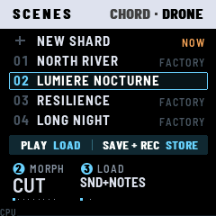

**SAVE** stores, in three steps. On WHAT and INTO the header turns red: something is about to be written.

1. **WHAT** (K1): SCENE, DRONE PRESET, GLINT PRESET or BASS PRESET.
2. **INTO** (K2): for a scene, its slot, 01 to 16. It starts on the current scene's slot if that scene is yours, else
   (a factory scene, NEW SHARD) on the first empty slot, or 01 if none is empty. For a preset, NEW, or one of your
   presets of that track, which it replaces. It starts on the one of yours you took or stored last, changed since or
   not; a factory preset or another scene ends that, and it starts on NEW. SEL: on to its name; FX: back.
3. **NAME IT:** the name, written in place of the old one, which it starts from. The page writes its controls:
   **OCT** or **K1** move the cursor, **K2** puts a space, **K3** turns a digit (then - and .), **K4** a letter (a space
   before A). A scene's name: 32 characters at most, in two rows; a preset's: sixteen. **SAVE** stores it (STORED 09 ABYSS), SEL too; **FX**, CANCEL, goes back a
   step. Only SAVE and FX are lit, OCT half. A name of spaces alone: nothing is stored, the name stays up.

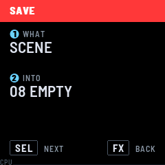

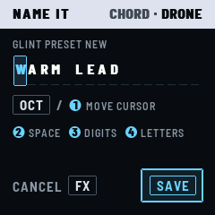

**SAVE + REC** is the quick STORE: hold **SAVE** and press **REC**, on any page. No WHAT, no INTO: the current scene
goes into its slot, then NAME IT, where SAVE or SEL keeps the name and FX leaves it as stored. On SCENES, it goes into the slot
K1 points at (on NEW SHARD, the header says STORE, CHOOSE A SLOT). NEW SHARD loaded, it goes into the first empty slot;
none empty, SCENES opens to choose one.

A scene stored keeps the sound and what plays, as above, and TEMPO. Into a free slot (8 to 16) with a drone preset on,
the scene's name starts as the preset's; else as SCENE and its number. A preset keeps that track's sound: the
drone's, everything a factory drone sets; GLINT's, everything its presets set, VIBRATO and AUTO VIB too; the bass's,
its pages' settings but LEVEL and OCTAVE. It comes after the factory ones in PRESETS' grid and its page's PRESET (or
MODEL): CUSTOM, the 36, then yours. Your presets are the FM-1's, whatever scene is loaded, and go into its backups.
Each track holds 16. Then INTO has no NEW: a seventeenth takes the place of one of them. A preset can't be deleted, only
stored over.

**MORPH** (SCENES' K2) is how the sound comes in: CUT, at once, or over 1 S, 2 S, 4 S, 8 S, 15 S, 30 S, 60 S or 2:00.
Over a time, the settings that glide go from where they are to the scene's; the choices (the presets, MODEL, ROOT,
SCALE, CHORD, RATIO, TYPE, ARP and SEQUENCE, the TARGETs, INTERVAL, the rates, TIME, SEQ LENGTH, TRANSPOSE, TUNE)
switch at once. A setting you turn during the morph leaves it: your hand wins (a preset, all it sets). On the play page
and SCENES, the header shows an arrow, the scene's name and a line for how far it has come; on the other pages, only
the line, under the page's name. A new load starts from the values as they are.

**LOAD** (SCENES' K3) is what a load brings. SND+NOTES: the sound, its TEMPO and its notes: everything is let go, then
the scene's notes play (its drones, the bass, the arpeggios and the three sequences), if it has any. Its sequences
start from their first steps, and the beat begins there, as PLAY starts it (following a MIDI clock: on its next step,
its beats kept); PULSE falls on the bass's NOTEs, none of them doubled. SND ONLY: the sound alone; what plays goes on
(the drones, the bass, the arpeggios and the sequences, with whether ARP or SEQ is on and the settings that play them:
MODE, RATE, RANGE, CHANCE, SEQ LENGTH, GATE, TRANSPOSE), and TEMPO stays as it is.

MORPH is back on CUT at every power-on. LOAD is kept with the settings (SND+NOTES at first), not in the scenes.

**COMPARE:** hold **OCT−**, then **EDIT**. As long as EDIT stays down, the scene sounds as it was saved or last
loaded, whatever you have turned since; the header says COMPARE · AS SAVED. Let go of EDIT: the sound as it is now.
EDIT held alone opens its key map instead (section 4).

Slots 1 to 7 hold the factory scenes. Each plays something once loaded with its notes (LOAD on SND+NOTES), at its own
TEMPO. The first four were made on the FM-1 by FRASIL's author, and are kept whole:

| Scene | Key · TEMPO | What plays |
| --- | --- | --- |
| NORTH RIVER | F# PENTA MIN · 90 BPM | two sevenths latched wide, on B2 and F#3; FROST's arpeggio at random, in sixteenths over three octaves; SUB's line of five steps, struck on each beat (PULSE) |
| LUMIERE NOCTURNE | A MAJOR · 60 BPM | an ADD9 latched wide on D2, the drone all PARTIALS and BREATH, slow to come and to go, in a long, bright hall; GLINT's arpeggio on one note; SAW's A2 held, struck on each half beat (PULSE) |
| RESILIENCE | F# PENTA MIN · 90 BPM | two sevenths latched wide, on B2 and A3, a full drone; HARP's arpeggio at random, in sixteenths over three octaves, through a long ping-pong echo; REESE's line of nine steps far under |
| LONG NIGHT | A PHRYGIAN · 60 BPM | NOCTURNE's low drone on a wide FIFTH; REESE's line gliding in bars; BOWED glass in long tied notes, far in an echo; a slow LFO drift |
| OPEN WATER | D DORIAN · 118 BPM | the PULSE preset's drone on a SUS2, ducked on each beat (PUMP); MARIMBA's sequence in syncopated sixteenths; a driven SAW, plucked, its line in eighths, its FILTER swept by LFO 1 |
| WHITEOUT | C# MINOR · 72 BPM | WIND's breath alone, on a wide SUS4; FROST's flurries, an arpeggio at random in sixteenth triplets; a slow SUB far under; BLUR |
| THAW | D# MAJOR · 78 BPM | EMBER's choir on an open ADD9, its WARMTH and BODY swaying (LFO 1); DROP's arpeggio drifting in eighth triplets; FM's bass held, struck on each half beat (PULSE) |

NEW SHARD is a calm drone in A minor, SEVENTH open (A on the keys: Am7), at 90 BPM: CUSTOM, BODY 50 %, MOTION 50 % with
a slow drift; the choir soft, a little PARTIALS and BREATH, some WARMTH; slow to come (3.6 S) and to go (7.6 S); a lush
cloud (DECAY 10 S, SPACE 52), its low end cut (LOW CUT 83 HZ). The three LFOs on, slow sines, each on two settings:
LFO 1 on TIMBRE and BREATH (23 S), LFO 2 on SPACE and SPREAD (37 S), LFO 3 on GLINT's BRIGHT and the bass's FILTER
(16 S). GLINT: SINE, BRIGHT 25, ARP ON. BASS: SUB, DRIVE and FILTER low, slow to come. No notes.

Slots 8 to 16 are free: an empty one loads as NEW SHARD, named SCENE and its number. While the sound differs from the
one last loaded or saved (its TEMPO too), SAVE lights, the SCENES page says CHANGED and the play page's header has a
dot beside the scene's name (back to it, they go). Storing also keeps the settings: at power-on FRASIL comes back
with the sound you stored last, silent. Nothing plays until you play: tap PLAY and the scene plays, its three tracks
and its sequences from their first steps, the beat beginning there. A new FM-1, with nothing stored yet, starts on
NEW SHARD. Scenes saved by an earlier FRASIL come back as they were, the settings added since at their defaults (the
drone's sequence empty and OFF), their TEMPO the one the settings had. A bass sequence whose steps each had a length of
their own comes in on the one grid, sounding as it did: its RATE the longest that divides every step, each step its
NOTE and HOLDs. The arpeggiator's old MODE (OFF, the five modes, SEQ) becomes ARP or SEQUENCE ON and MODE, the delay's
TIME and MODE one TIME, and the arpeggio's and the sequence's notes lose the OCTAVE they were kept with (it is put on
as they play now).

**Backing up** (FRASIL 1.1 and later): the scenes, your presets and the settings go to a file over USB, and come
back from it.

- **The River** (https://river.frasilsynth.com/, Chrome or Edge): **Back up** reads the FM-1 and shows each slot as a
  card, a *shard*: its drone, what plays, the sequences and arpeggios, every page's settings as the screen writes
  them. Download everything (a `.frasil` file) or the shards you select (a `.frasilscenes` package). Open a file to see
  it without the FM-1. Put a backup back whole, or shards into the slots you choose, several at once: the River reads
  the FM-1 first, and the other slots and the settings stay as they are. Shards go into the slots of an FM-1 that runs
  FRASIL 3.1; an earlier FRASIL is asked to update first (UPDATE FRASIL). A shard keeps its scene's TEMPO and its
  whole name, 32 characters.
- **A terminal:** `python3 base/tools/fm1_backup.py backup scenes.frasil --magic FRBK`, then
  `python3 base/tools/fm1_backup.py restore scenes.frasil`; `info` shows what a file holds.

A backup can be taken while FRASIL plays (what you haven't stored yet isn't in it). A restore can't: the River lets
everything go first (it sends MIDI's All Sound Off); from a terminal, hold **PLAY** to release everything,
or the screen says STOP FIRST. A key held down still waits. The FM-1 receives the whole file and checks it before
anything changes, then asks: RESTORE FROM USB? **SEL** yes, **FX** no (a minute, then no). Restoring everything
brings back the settings too, the sound at power-on with them; never the panel's calibration, which is your FM-1's.
A backup from an earlier FRASIL restores: its scenes are brought up to date. Your presets on the FM-1 stay, unless the
backup holds presets: then it replaces them (a backup from before 3.0 holds none). The question says so, IT REPLACES ALL
SCENES, THE SETTINGS AND ITS PRESETS, and the result, THE SCENES, THE SETTINGS AND ITS PRESETS ARE BACK. While a backup is sent, saving doesn't
happen (NOT STORED, a pop-up). Back up before you switch firmwares.

FRASIL 3.1 saves its scenes in a new layout. Scenes, shards and backups from earlier versions load as before, the new
settings at their defaults. A 3.1 backup does not restore on 3.0: `python3 tools/backup_for_3_0.py IN.frasil
OUT.frasil` writes a copy that does (`--3.0.1` for 3.0.1).

---

## 11. MIDI

FRASIL takes MIDI over USB and the TRS input. Each track has its own channel, whatever the keys play: the drones on 1,
GLINT on 2, BASS on 3 by default. Press GLO twice for the MIDI page: DRONE CH, GLINT CH and BASS CH, each OFF, 1 to 16
or OMNI. Its K4, **CLOCK**: AUTO, a MIDI clock coming in leads the grid (below); INTERNAL, TEMPO's always, the clocks
and Start that come in not taken (a device sending a clock you don't want). Kept through power-off, not in the scenes.
**SPK/JACK** (GLO, ROUTING's K4) OFF quiets the FM-1's own output, the speaker and the
headphone jack (one output serves both), while the USB audio goes on as ever: for recording into a computer or a phone
without the room hearing it. It is kept through power-off.

- **The drones' notes** go through the harmony, as the DRONE's HARMONY and NOTES say (KEYS, section 5): at first a
  sequencer's single note plays a chord. Sustain (CC 64) holds
  them. Channel pressure swells them all (SWELL). While the drone's sequence records, they go into it.
- **GLINT's notes** play as they come, no scale, with GLINT's OCTAVE on them as on a key's. While its arpeggiator or
  its sequence is on, they go into it, as held keys would.
- **BASS's notes** play as they come too, the bass's OCTAVE on them, one at a time: the last one sounds, and letting
  it go brings back the one still held under it. While the bass's arpeggiator or sequence is on, they go into it, as
  the keys would.

Notes sound only while held. Polyphonic aftertouch swells a note; channel pressure, the whole track. The CCs below
come in on the drones' channel (sustain too); 123 releases the notes of the track whose channel it comes on, 120 (All
Sound Off), on any channel, lets everything go and stops the sequences, as PLAY held, RESTORE after it (the River
sends it before it sends to the FM-1).

| CC | | CC | |
| --- | --- | --- | --- |
| 1 | MOTION | 74 | TIMBRE |
| 91 | SPACE | 11 | SWELL |
| 70 · 71 · 72 | CHOIR · PARTIALS · BREATH | 73 · 75 | ATTACK · RELEASE |
| 76 · 77 | SIZE · DECAY | 78 · 79 | SHIMMER · WARMTH |
| 12 · 13 | BODY · the drone's PRESET | 14 · 15 · 16 | SPARKLE · BLUR · SINK |
| 17 · 18 · 19 | the MIXER's DRONE · GLINT · BASS | 80 | FREEZE (64 and up) |
| 120 | all sound off, any channel: everything let go, the sequences stopped (PLAY held again: RESTORE) | 123 | release the notes of the track on that channel |

**Program Change** 0 to 15, on the drones' channel, loads scenes 1 to 16, as SCENES' MORPH and LOAD say (NEW SHARD,
no slot, has none).

**MIDI learn:** turn a setting, hold GLO, and move a knob on your controller (a CC on the drones' channel): from then
on that CC turns that setting (CC 21 · SINK). FRASIL learns 8 at most, the oldest replaced, and keeps them with the
settings. A learned CC comes before the table's (SWELL's 11 and FREEZE's 80 too), but for 64, 120 and 123, which keep
their jobs.

MIDI clock drives the arpeggiators, the three sequences and GLINT's delay (with CLOCK on AUTO, the MIDI page's K4: on
INTERNAL it is not taken, nor Start). Start resets the grid, and starts the sequences from their first steps. With no
clock coming in, PLAY does the same when it starts the transport, or is held (section 4); while one comes in, PLAY
leaves its beats as they are.

A PERFORM page (section 12) talks with the FM-1 in SysEx over USB. Without one, the FM-1 sends none of it.

---

## 12. PERFORM

**PERFORM** (https://perform.frasilsynth.com/, Chrome or Edge) shows your play on a large screen as it goes: a
projector on a stage, a filmed performance. Plug the FM-1 into the computer by USB, open the page and press F for full
screen.

The river fills the screen, very large, drawn from what the FM-1 plays. Under it: **LIVE**, what your hand does as
it does it (a page opened, a knob turned and its value, a scene loaded, the keys played, a button), then gone, leaving
room for the next; the **LFOs**, each its shape, a glint where it is and what it moves, in its track's colour; and
the effects drawn rather than their numbers: **CLOUD**, **TAPE** (the cassette) and **FILTER** (its curve), dim while
off, lit a moment while you turn one of their settings.

**The first screen:**

- **ENTER YOUR ARTIST NAME**, if you like: it shows under the scene's name, after BY. The browser remembers it.
- **FM-1 AUDIO** or **COMPUTER AUDIO**: where you hear it. FM-1 AUDIO, the FM-1's own speaker or jack, as always.
  COMPUTER AUDIO plays the FM-1's USB audio through the computer's speakers (the browser asks once to use it, an audio
  input: allow it), and quiets the FM-1's own output while the page is connected. SPK/JACK itself doesn't change:
  once the page lets go, or 5 seconds after it is last heard, the FM-1 sounds as SPK/JACK says.
- **CONNECT**: the page finds the FM-1 (the browser asks once to allow MIDI: allow it), and the river comes up.
  **DEMO**, without an FM-1: FRASIL's factory scenes play in the browser, with sound, an AUTO hand turning the knobs
  and changing the scene.

**The header**, at the top: the logo, the scene's name, and at the right the transport: DR, GL and BS, the three
tracks, each a glowing play triangle while it plays (the drones: a chord latched or held, or their sequence running;
GLINT: its arpeggio going or its sequence running; the bass: its note, its arpeggio or its sequence), a dim square
while it is stopped. Under each, where its notes come from: ARP or SEQ, else LATCH or HOLD (KEYS' LATCH).

| Key | What it does |
| --- | --- |
| **H** | hides the header: the logo glides to the centre, the transport to the right. Again: back |
| **F** | full screen |
| **ESC** | back to the first screen |
| **← →** (DEMO) | the scene |
| **TAB**, **1–4**, **↑ ↓** (DEMO) | the page, its knob, turning it (the wheel too; SHIFT faster) |
| **K**, **SPACE** (DEMO) | the keys' notes; AUTO on or off |

The FM-1 says nothing until a page asks: the page says HELLO (SysEx) every 2 seconds, and the FM-1 answers with what
it plays, some 18 times a second. Unheard for 5 seconds, it goes quiet again. It costs the sound nothing measurable.
FRASIL 2.5 is the first with PERFORM: an earlier one doesn't answer (NO ANSWER · THIS FM-1 NEEDS FRASIL WITH
PERFORM).

---

## 13. The lights

| Light | Means |
| --- | --- |
| Keys, bright | the roots of the latched drones, and the keys held |
| Keys, faint | the scale's notes |
| Keys, GLINT with the arpeggio on | faint: the arpeggio's notes. Bright: the one sounding, for as long as it sounds |
| Keys, a sequence on | bright: the note playing. Faint: the scale's notes |
| Keys, BASS | bright: the bass's note. Faint: the scale's notes |
| Keys, SAVE held | the white keys, the scenes: bright, the current one; faint, the slots that hold a scene |
| Keys, EDIT held | F♯, G♯ and A♯ of the lowest octave at half light, the group on screen bright; every other key dark |
| The function buttons, faint | always: their names stay readable in the dark |
| The page's button, bright | the page on screen |
| SAVE, bright | the sound differs from the scene's (SCENES says CHANGED) |
| LFO | faint as the others while an LFO runs; fainter, as PLAY, while none does |
| ARP, a flash | each step the selected track's arpeggio plays, while its ARP pages are not on screen |
| ARP, fainter | the DRONE selected: it has no arpeggio |
| SEQ, a flash | each step the selected track's sequence plays (the drone's too), while its SEQ pages are not on screen |
| PLAY | faint; bright while it plays: while a sequence runs (or an arpeggio plays) when one is on, else while anything is held. It goes out the moment you stop, the sound fading on as it does |
| REC | the faintest, as PLAY (brighter, red, it read as recording); while a sequence records: lit on STEP, flashing on the sequence's beats (as the metronome counts them, from its first step), twice as quick as OCT, on LIVE; flashing on the four counts of COUNT-IN |
| OCT− and OCT+ | faint, a little brighter on the beat: MIDI clock when one comes in, else TEMPO (GLOBAL, K1) |
| FX, bright | one of FX's pages is on screen, or FREEZE is on |
| ENV, bright | the track's envelope on screen, and SWELL while you hold it (until it has come back down) |

---

## 14. Troubleshooting

**No sound:** turn MASTER up, and tap a key: drones need a tap to start. Check the drone's mix (HOME, K1–K3) and the
MIXER. Look at the header's colour: orange, the keys play BASS; ice blue, GLINT. Turn SELECT back to DRONE.

**The buttons open another track's pages:** EDIT, ENV, ARP, SEQ and REC follow the track SELECT picks; the header's
colour says which. Turn SELECT, or hold OCT− and turn it to change the keys without leaving the page: the header then
says the keys' track over the other's page, a white band titled BASS ADSR.

**ARP says NOT AVAILABLE FOR DRONE:** the drone has no arpeggiator. Select GLINT or BASS, or use the drone's sequence
(SEQ).

**ARP or SEQ shows only its ON/OFF:** it is OFF. Turn K1 ON and its pages appear; the other one turns OFF.

**Everything went silent:** PLAY held, or tapped twice quick, lets everything go; OCT− held and PLAY (CUT) silences
it at once. Hold PLAY again, or tap it, before you play anything else: RESTORE brings back what it let go. A single
tap while something plays does not let the drones go: it starts and stops the sequences and the arpeggios.

**LATCH doesn't change:** turned OFF it lets that track's notes go, so it takes a second detent the same way within 2
seconds (LATCH, TURN AGAIN smaller beside it).

**SELECT doesn't move:** a recording is running (RECORDING, REC: OFF beside it). Tap REC until it is OFF, or leave the
track's SEQ and ARP pages.

**No CLEAR on SEQ III:** it is OCT− held and REC, on the track's SEQ pages.

**A CC from a controller moves another setting than the table's:** it was learned (section 11). Learn it again onto
the setting you want.

**Crackles or a voice dropping out:** when the load passes 82 %, or a render runs over its time, FRASIL lightens the
sound one step (fewer drone partials, then fewer voices, each faded out, not cut), and gives a step back after a calm
that doubles each time it fails (4 s, 8, 16, up to 64 s) and while the load is at most 75 %. A small dot by the track's
name, for 3 seconds, says it did. GLOBAL's header shows the load. Fewer voices, or SHIMMER at 0, give it room.
If the screen lags with a heavy scene, ANIMATIONS LOW (GLO, SCREEN) keeps it quick (the sound comes first either way:
it takes no load from it).

**The installer doesn't find the FM-1:** use Chrome or Edge, allow MIDI when asked, and close other programs that
use the FM-1's MIDI port.

**PERFORM doesn't find the FM-1:** as for the installer; for COMPUTER AUDIO, allow the audio input too. NO ANSWER: the
FM-1 needs FRASIL 2.5 or later. THIS COMPUTER PLAYS THROUGH THE FM-1: the computer's sound output is the FM-1 itself,
and COMPUTER AUDIO would play back into it: pick the computer's own speakers as its output, or choose FM-1 AUDIO.

**The River says UPDATE FRASIL:** shards go only into an FM-1 that runs FRASIL 3.1. Install it (section
1), then send again.

**The FM-1 doesn't start after an install:** hold OCT− while you switch it on, then install again, or put the
official firmware back.
